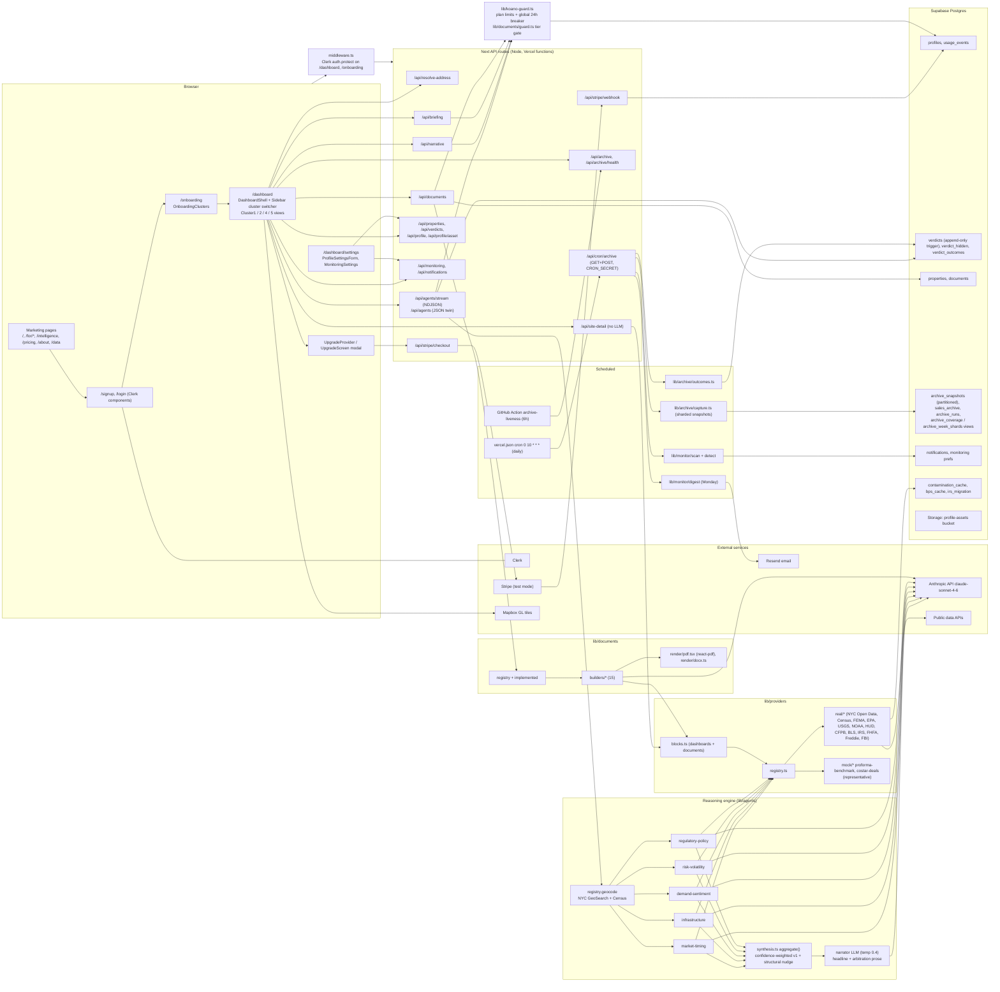

# 00. System Map (Phase 0 Reconnaissance)

Repo: `/Users/victor/Desktop/koano-app`, HEAD `5a9c8e4` ("intelligence: embed the product demo video in the how-it-works slot"), read 2026-10-19. All paths below are relative to the repo root. Every claim was verified against the code; where CLAUDE.md or section 3 of the engagement prompt disagrees, the code wins and the discrepancy is listed. State labels: EXISTS, PARTIAL, MISSING, VISION.

Health checks run (read-only):

| Check | Result |
|---|---|
| `npx tsc --noEmit -p .` | Exit 0, no errors, 3.9 s wall (incremental, `tsconfig.tsbuildinfo` present). Note `tsconfig.json:24` includes `**/*.ts`, so `video/` (Remotion) is typechecked as part of the app project. |
| `npx tsx scripts/test-fixture.ts` (offline replay) | PASS in 0.49 s: `BUY conf 69 risk 51 prov live / score 0.23 + nudge 1 = 1.23`, decision surface byte-identical. |
| Pre-push gate | `git config core.hooksPath` = `.githooks` in this clone, so `.githooks/pre-push` runs `scripts/prepush.sh` (full isolated `next build` + fixture replay). It is a LOCAL hook only: the sole GitHub workflow is `.github/workflows/archive-liveness.yml`; no CI runs any test. |
| Test inventory (`scripts/`) | 21 `scripts/test-*.ts` files plus `scripts/verify-documents-live.ts` (22 harnesses). No test framework (no jest/vitest); each is a standalone `tsx` script. Roughly 14 contain assertions (about 250 check sites in total; largest: test-document-engine 27, test-tax-appeal 19, test-monitor-detect 17); 7 are print-only harnesses with zero assertions (test-agent, test-pipeline, test-providers, test-sales, test-violations, test-development-providers, and test-fixture which asserts once on the whole surface). Only 4 are purely offline unit tests (test-fixture, test-monitor-detect, test-shard-logic, test-grounding); most others hit live NYC Open Data or federal APIs, so they are not runnable in CI without network. `package.json` exposes only 8 of them as npm scripts. |

Size: about 17.3k lines in `lib/`, 16.2k in `src/components/`, plus `src/app/**` (42 tracked files) and `supabase/` (schema + 21 migrations). 306 tracked files.

---

## 1. Repo structure

```
koano-app/
  src/
    app/                    Next.js 14 App Router: 13 pages, 19 API route files, layout, globals.css
      fonts/                GeistVF.woff, GeistMonoVF.woff (create-next-app leftovers, referenced nowhere)
    components/
      dashboard/            DashboardShell, Sidebar, clusters.ts, cluster1/ cluster2/ cluster4/ cluster5/, Upgrade*, Document*, Monitoring*
      marketing/            Nav, Footer, Hero*, *Section, ClusterLanding, *Content pages
      ui/                   VerdictCard, VerdictMathPanel, ReasoningChain, ProvenanceBadge/Ledger, CoverageMap, charts/, map/KoanoMap (Mapbox GL)
    middleware.ts           Clerk; protects /dashboard(.*) and /onboarding(.*)
  lib/
    providers/              types, registry, catalog, provenance, blocks, degradation, real/ (30 files), mock/ (2)
    agents/                 shared, 5 specialists, synthesis, breakdown, direction, confidence, entitlement, grounding, narrative, briefing
    documents/              registry, implemented, types, guard, assembler, disclaimer, narrative, builders/ (15), render/ (pdf, docx, model, fonts, samples)
    archive/                capture.ts, outcomes.ts
    monitor/                detect.ts, scan.ts, digest.ts
    stripe/client.ts        hard-coded test-mode price ids
    supabase/               server.ts (service role), verdicts.ts (persist)
    testing/cassette.ts     record/replay seam
    koano-guard.ts          spend + plan guard
  supabase/                 schema.sql + migration-002 .. migration-022 (no 001)
  scripts/                  22 test harnesses, record/rerecord/diff fixture, doc generators, fixtures/nyc-175-3rd-st.json
  public/                   logo.png, neural-map.html (orphan), renders/ (webp + 21 MB koano-demo.mp4, tracked in git)
  video/                    Remotion product film (UNTRACKED in git, but typechecked and its deps are in the app's package.json)
  demo-kit/                 1.9 GB of capture/VO/design uploads (UNTRACKED)
  .agents/skills/ (2.8 MB, untracked) + .claude/skills/ (12 symlinks into .agents) + skills-lock.json: Remotion agent skills
  .agent/                   koano-design skill + workflow (tracked)
  Root clutter (untracked, gitignored by pattern): 13 generated PDFs/DOCX incl. koano-ic-memo-175-3rd-STALE.pdf
  CLAUDE.md (88 KB), KOANO_COPY.md, KNOWN_ISSUES.md (untracked), KOANO_CV_AUDIT.md (untracked, a CV/resume write-up, not a code audit), README.md (create-next-app default, 1.4 KB)
```

## 2. Architecture diagram



---

## 3. Every route and screen

Auth model: `src/middleware.ts:7-10` force-protects only `/dashboard(.*)` and `/onboarding(.*)` (redirect to `/login`). Every `/api/*` route runs the Clerk middleware (`middleware.ts:18`) but is NOT force-protected; each handler checks `auth()` itself and returns 401. Two routes use `CRON_SECRET` bearer auth, and the Stripe webhook uses signature verification. `requireApproved()` is an allow-all shim (`lib/koano-guard.ts:99-104`): the approval gate is retired.

Note on cluster naming used below: the internal ids are `cluster_1/2/4/5`; the display badges are decoupled and reordered (`src/components/dashboard/clusters.ts:5-10`): cluster_1 = "C4" Community, cluster_2 = "C2" Transaction, cluster_4 = "C1" Development, cluster_5 = "C3" Portfolio.

### 3.1 Pages

| Route | File | Purpose | Audience | Auth |
|---|---|---|---|---|
| `/` | `src/app/page.tsx` | Homepage: Hero (headline "SMART DATA. / SMARTER REAL ESTATE DECISIONS.", `HeroSection.tsx:126-128`) with animated `HeroDashboard` replaying the recorded 175 3rd St verdict, then Agents, Provenance, Archive, Monitoring, Clusters, DataTicker, EarlyAccess CTA, Footer | All prospects | Public |
| `/for/developers` | `src/app/for/developers/page.tsx` | ClusterLanding "C1" Development: features + "not built yet" list | Developers, CRE brokers | Public |
| `/for/agents` | `src/app/for/agents/page.tsx` | ClusterLanding "C2" Transaction (nav label "For professionals", footer "For agents") | Agents, brokers, MLOs | Public |
| `/for/institutions` | `src/app/for/institutions/page.tsx` | ClusterLanding "C3" Portfolio | Institutions, REITs | Public |
| `/for/community` | `src/app/for/community/page.tsx` | ClusterLanding "C4" Community | Homeowners, renters, neighbors | Public |
| `/intelligence` | `src/app/intelligence/page.tsx` -> `IntelligenceContent.tsx` | How it works; embeds `/renders/koano-demo.mp4` (21 MB, `IntelligenceContent.tsx:261`) | Prospects | Public |
| `/pricing` | `src/app/pricing/page.tsx` -> `PricingContent.tsx` | Four tiers + FAQ; every CTA goes to `/signup` | Prospects | Public |
| `/about` | `src/app/about/page.tsx` | Company / category story | Prospects, investors | Public |
| `/data` | `src/app/data/page.tsx` -> `DataContent.tsx` | Source list generated from `lib/providers/catalog.ts` | Data-savvy buyers, partners | Public |
| `/signup/[[...rest]]` | `src/app/signup/[[...rest]]/page.tsx` | Clerk `<SignUp>`; fallback redirect `/onboarding` (`:18`); footnote "The free plan includes a limited number of analyses" (`:30-31`) | New users | Public |
| `/login/[[...rest]]` | `src/app/login/[[...rest]]/page.tsx` | Clerk `<SignIn>`; fallback `/dashboard` | Returning users | Public |
| `/onboarding` | `src/app/onboarding/page.tsx` -> `OnboardingClusters.tsx` | Pick one of four clusters; POST `/api/profile` then push `/dashboard` (`OnboardingClusters.tsx:37-44`) | New users | Clerk (middleware + `auth()`) |
| `/dashboard` | `src/app/dashboard/page.tsx` | Server reads `profiles.cluster`; none -> redirect `/onboarding` (`:37`); renders `DashboardShell` (single-page app; cluster views switched client-side) | Signed-in users | Clerk |
| `/dashboard/settings` | `src/app/dashboard/settings/page.tsx` | Letterhead/white-label fields (logo, headshot) + monitoring settings | Signed-in users | Clerk |

Dashboard "screens" are client-side views inside `/dashboard`, selected by the Sidebar switcher (`Sidebar.tsx:4-6`, any user may view any cluster regardless of plan):

| View | Component | Sections (sidebar targets, `clusters.ts:87-114`) | Documents wired (DocumentButton) |
|---|---|---|---|
| Community (cluster_1, "C4") | `cluster1/Cluster1Dashboard.tsx` | My property, Valuation, Permit history, Alerts, History | property_intelligence_report, violation_ownership_record, permit_history_report, tax_appeal_packet (`:258-283`) |
| Transaction (cluster_2, "C2") | `cluster2/Cluster2Dashboard.tsx` | Market velocity, CMA builder, Narrative, Pricing, History | client_neighborhood_report, pricing_recommendation_sheet, buyer_seller_net_sheet (`:220-236`). The CMA builder (`CmaBuilder.tsx`) has NO export button. |
| Development (cluster_4, "C1") | `cluster4/Cluster4Dashboard.tsx` + `SiteComparison.tsx` | Site comparison, Entitlement risk, Pro forma, History | site_screening_memo, entitlement_risk_memo, three_site_comparison_brief (`SiteComparison.tsx:494-516`) |
| Portfolio (cluster_5, "C3") | `cluster5/Cluster5Dashboard.tsx` | Portfolio overview, Monday briefing, Risk monitor, History | monday_briefing_pdf, asset_one_pager (`:211-233`) |
| (unreachable) | `ClusterPlaceholderView.tsx` + `VerdictWorkbench.tsx` | fallback branch in `DashboardShell.tsx` that can never render because all four ids are handled | none |

### 3.2 Redirects (`next.config.mjs:6-14`)

| Source | Destination | Note |
|---|---|---|
| `/for/homeowners` | `/for/community` | 308 |
| `/community` | `/for/community` | 308 |
| `/early-access` | `/signup` | 308; the waitlist is retired |

Static file also publicly served: `/neural-map.html` (`public/neural-map.html`), linked from no page.

### 3.3 API routes

| Route | Methods | Purpose | Auth | Spend guard | maxDuration |
|---|---|---|---|---|---|
| `/api/resolve-address` | POST | Geocode/disambiguate; BBL re-derived server side | Clerk | none | 30 |
| `/api/agents/stream` | POST | Full 5-agent + synthesis run as NDJSON; persists verdict | Clerk | `guardSpend verdict` (`:68`) | 300 |
| `/api/agents` | POST | Non-streaming twin; no candidate path; used by no UI component found | Clerk | `guardSpend verdict` (`:33`) | 300 |
| `/api/site-detail` | POST | Raw provider blocks, no LLM | Clerk | none | 60 |
| `/api/narrative` | POST | Cluster 2 neighborhood narrative (LLM) | Clerk | `guardSpend content` (`:48`) | 60 |
| `/api/briefing` | POST | Cluster 5 Monday briefing (LLM) | Clerk | `guardSpend content` (`:69`) | 120 |
| `/api/documents` | POST | Document engine: guard, assemble, build, render, log, stream file | Clerk | `guardDocument` (tier + caps) | 120 |
| `/api/properties` | GET/POST/DELETE | Portfolio list (Cluster 5) | Clerk | none | 60 |
| `/api/verdicts` | GET/POST | History; POST toggles `verdict_hidden` | Clerk | none | default |
| `/api/profile` | GET/PATCH/POST | Profile, letterhead fields, cluster choice | Clerk | none | default |
| `/api/profile/asset` | POST/DELETE | Logo/headshot upload to `profile-assets` bucket | Clerk | none | 30 |
| `/api/monitoring` | GET/PUT/PATCH | Prefs + watch toggles; PUT 402 for free | Clerk | plan cap | default |
| `/api/notifications` | GET/PATCH | In-app monitoring feed | Clerk | none | default |
| `/api/archive` | GET | Archive coverage grid for `ArchiveTrend` | Clerk | none | default |
| `/api/archive/health` | GET | Gap/staleness report | `CRON_SECRET` bearer | n/a | default |
| `/api/cron/archive` | GET + POST | Daily sharded snapshot, outcome scan, monitoring, Monday digest | `CRON_SECRET` bearer | n/a | 300 |
| `/api/stripe/checkout` | POST | Create subscription Checkout session | Clerk | n/a | default |
| `/api/stripe/webhook` | POST | Sets `profiles.plan` from subscription lifecycle | Stripe signature | n/a | default |

### 3.4 CLAUDE.md routes that do not exist / exist but undocumented

Documented but MISSING (CLAUDE.md:615 and the file tree at CLAUDE.md:556-574):
- `/dashboard/site/[id]`, `/dashboard/property/[id]`, `/dashboard/portfolio`, `/dashboard/reasoning/[id]`: none exist. There is no deep-linkable verdict, site, or reasoning URL; the whole dashboard is one client-side page, so a verdict cannot be shared or bookmarked.
- `/early-access/page.tsx` listed as built (CLAUDE.md:82, 564, 613): it is only a redirect to `/signup`.
- `lib/supabase/client.ts` (CLAUDE.md:589), `components/ui/GlassCard` (CLAUDE.md:581), `/styles/globals.css` (CLAUDE.md:596): none exist (`globals.css` lives in `src/app/`).
- CLAUDE.md:599 says migrations run to 013 in the tree; actual is 022 (CLAUDE.md:470 itself says 022).

Exist but undocumented in CLAUDE.md's route list: `/dashboard/settings`, `/api/resolve-address` (mentioned only in prose), `/api/monitoring`, `/api/notifications` (prose only), `/api/archive`, `/api/profile/asset`, `/api/verdicts` POST (hide toggle), `/neural-map.html` as a public URL.

Missing pages any paid SaaS needs: no `/terms`, `/privacy`, or legal page exists anywhere in `src/app`, and the Footer links none (`Footer.tsx:6-17`). No billing management (no Stripe customer portal; grep for `billingPortal` returns nothing), so a paying user cannot cancel or change plan in-app.

---

## 4. Data providers

All paths relative to `repo root. Verified against code on 2026-10-19.

### Architecture in one paragraph

`lib/providers/registry.ts:103-136` binds 28 registry keys to exactly one implementation each (26 real implementations, of which geocode and geometry are infrastructure, plus 2 representative mocks). Every method returns `ProviderResult<T>` (`lib/providers/types.ts:34-41`: `ok`, `data`, `provenance`, `source`, `endpoint`, `fetched_at`, `swap_note`, `error`). All HTTP goes through `lib/providers/real/http.ts` (`fetchRaw`, lines 35-75): 20 s default timeout, 3 retries, 429 back-off, NYC Socrata `X-App-Token` header when `NYC_OPEN_DATA_APP_TOKEN` is set (lines 27-33), and throttle/timeout failures recorded per run via AsyncLocalStorage (`lib/providers/degradation.ts:25-41`). There is no generic HTTP or Next fetch cache; caching exists only in four providers (see table). `lib/providers/blocks.ts:95-125` exposes 26 "blocks" over the registry that the dashboard API (`src/app/api/site-detail/route.ts:96`) and the document assembler (`lib/documents/assembler.ts:44`) share. `lib/providers/catalog.ts:57-286` is the compile-time-enforced display manifest (`Record<keyof ProviderRegistry, ...>`) that drives the `/data` marketing page.

### The five provenance states and the rollup

| State | Meaning (types.ts) | Severity (provenance.ts) |
|---|---|---|
| `live` | fetched from an authoritative public source KOANO queried; data present (`types.ts:9-10`) | 0 (`provenance.ts:16`) |
| `partner` | third-party partner feed, attributed; data present (`types.ts:11-14`) | 1 (`provenance.ts:17`) |
| `representative` | deliberate stand-in for an unfunded paid source; data present (`types.ts:15-17`) | 2 (`provenance.ts:18`) |
| `fetch_failed` | covered, live call attempted and failed; documented as "Data absent" (`types.ts:18-19`) | 3 (`provenance.ts:19`) |
| `coverage_absent` | market or layer not covered, nothing queried; data absent (`types.ts:20-23`) | 4 (`provenance.ts:20`) |

- Weakest-wins rollup: `weakestProvenance()` at `lib/providers/provenance.ts:26-31` (reduce over severity, empty set rolls up `live`). Trust test: `isTrustedProvenance()` at `provenance.ts:37-39` (`live` or `partner`).
- Applied per reasoning step and per agent in `lib/agents/shared.ts:321-336` and `:367`; across the five agents in `lib/agents/synthesis.ts:113`; per document in `lib/documents/types.ts:88` (`overall_provenance`).
- Confidence cap tied to provenance: `lib/agents/synthesis.ts:125` (95 if trusted, else 74).
- The client re-exports the same helpers (`src/components/ui/verdict.ts:74`), so there is one implementation, not two.
- EXISTS: the taxonomy and rollup. PARTIAL: `partner` is never emitted by any provider (grep of `lib/providers/real/*` and `mock/*` finds zero `provenance: 'partner'`). It is a reserved state with no feed behind it.

### Per-verdict coverage map

- Built CLIENT-side by `buildCoverageMap()` in `src/components/ui/coverage.ts:83-106`, rendered by `src/components/ui/CoverageMap.tsx:63`. It takes the verdict's ledger `data_points`, maps each provider `source` string to a named layer by regex (`coverage.ts:43-73`), collapses each layer to its weakest state (`:89`), and buckets layers into the five states. Each NYC-municipal and paid layer carries an `unlock` string naming the feed that would fill it (e.g. "a national MLS feed (Trestle / ATTOM)", `coverage.ts:46`).
- Producer of `coverage_absent`: `outOfMarketMunicipal()` in `lib/providers/real/coverage.ts:22-38` (data null, provenance `coverage_absent`), used by the six NYC municipal providers, plus an inline `coverage_absent` in `nyc-sales.ts:122-138`.
- PARTIAL, important: the map is regex over free-text `source` strings, not a structured layer id. A provider source rename silently reclassifies a layer (fallback at `coverage.ts:78-80`). It is not persisted server side; it is recomputed on each render from stored data points.
- PARTIAL, important: "omitted" signals are tagged `live`. When a free token is missing or a national source has nothing (NOAA `noaa-climate.ts:37-44`, HUD FMR `hud-fmr.ts:55-63`, IRS migration `irs-migration.ts:16-25`, FBI crime outside NYC with no key `fbi-ucr.ts:194-202`, EPA no-cache failure `epa-superfund.ts:167-176`, HMDA/QCEW/OpenFEMA/FHFA/ACS with no FIPS or tract), the provider returns `data: null, provenance: 'live'`. The agents still push an `*_unavailable` data point carrying that provenance (e.g. `lib/agents/risk-volatility.ts:62,76,93`), so the coverage map files an absent layer under the LIVE column. This is a deliberate rule in `CLAUDE.md` line 205 ("omission rule"), but it means a non-NYC verdict's coverage map overstates live coverage for federal layers, and contradicts the definition of `live` as "Data present" (`types.ts:9-10`).

### Provider table (every registry slot)

Abbreviations: L = `live`, R = `representative`, FF = `fetch_failed`, CA = `coverage_absent`. "L(null)" = data null tagged `live` (omission). Agents: RV = risk-volatility, DS = demand-sentiment, MT = market-timing, RP = regulatory-policy, INF = infrastructure, plus non-specialist consumers `briefing.ts`, `narrative.ts`, `synthesis.ts`. Documents are consumers via `requiredBlocks` in `lib/documents/registry.ts` fed through `assembler.ts:44`. Dashboards via `/api/site-detail` block lists.

| # | Registry key / interface (types.ts line) | Implementation | States emitted (file:line) | Geographic coverage and gate | Token / env | Caching | Agent consumers | Document consumers (requiredBlocks) and dashboards |
|---|---|---|---|---|---|---|---|---|
| 1 | `geocode` / GeocodeProvider (109) | `real/geocode.ts` | L only (361, 370, 394, 408); failure is `ok:false` still tagged L (414) | National. NYC GeoSearch + Census coordinates for NYC; Census onelineaddress for non-NYC with `bbl/bin/borough` set to explicit null (74-104); NYC test by county FIPS set (111-113) plus 2 km cross-check | none | none | every agent indirectly; `synthesis.ts`, `briefing.ts`, `narrative.ts` call `registry.geocode` directly; API routes `agents/stream`, `narrative`, `properties`, `resolve-address`, `site-detail` | every document via `assembler.ts`; all dashboards |
| 2 | `permits` / PermitsProvider (165) | `real/nyc-permits.ts` | L (236), FF with Brooklyn stand-in DATA (243-250, `REPRESENTATIVE_FALLBACK` 114-127), CA (146) | NYC only. Gate `if (!addr.bbl)` at 145 | `NYC_OPEN_DATA_APP_TOKEN` optional (http.ts:28) | none | INF (`infrastructure.ts`), `briefing.ts`, `narrative.ts` | property_intelligence_report, permit_history_report, client_neighborhood_report, entitlement_risk_memo, site_screening_memo, three_site_comparison_brief, ic_memo; dashboards Cluster1 (`Cluster1Dashboard.tsx:34`), Cluster2 (`Cluster2Dashboard.tsx:38`), Cluster4 (`SiteComparison.tsx:95`); archive (capture.ts:251, direct Socrata) |
| 3 | `buildingViolations` / BuildingViolationsProvider (697) | `real/nyc-violations.ts` | L (305), FF with stand-in DATA (310-317, fallback 85), CA (117) | NYC only. Gate `if (!parts && !bin)` at 116 | Socrata token optional | none | RV | violation_ownership_record, property_intelligence_report, site_screening_memo, three_site_comparison_brief, ic_memo, asset_one_pager; Cluster1 dashboard; archive (capture.ts:582) |
| 4 | `landlordPortfolio` / LandlordPortfolioProvider (733) | `real/nyc-landlord.ts` | L (160, 296), FF with stand-in DATA (302-305, fallback 91-94), CA (116) | NYC only. Gate at 115 | Socrata token optional | in-request Map only (236) | RP | violation_ownership_record, property_intelligence_report, site_screening_memo, three_site_comparison_brief, ic_memo; Cluster1; archive (592) |
| 5 | `zoning` / ZoningProvider (195) | `real/nyc-zoning.ts` (PLUTO 64uk-42ks) | L (120), FF with stand-in DATA (126-132, fallback 38-49), CA (70) | NYC only. Gate `if (!bbl)` at 69. City of Yes fields present: `max_affordable_residential_far` (affresfar) and `max_facility_far` (types.ts:187-190) | Socrata token optional | none | RP (`regulatory-policy.ts:30`), feeds deterministic `lib/agents/entitlement.ts` | tax_appeal_packet, violation_ownership_record, permit_history_report, cma, pricing_recommendation_sheet, buyer_seller_net_sheet, entitlement_risk_memo, pro_forma_summary (blocked), site_screening_memo, three_site_comparison_brief, ic_memo, property_intelligence_report, asset_one_pager; Cluster1, Cluster2, Cluster4; archive (613) |
| 6 | `opportunityZones` / OpportunityZoneProvider (294) | `real/irs-opportunity.ts` | L (35, 60), FF data null (73) | National by tract GEOID (ArcGIS mirrors, 10-16); no tract gives L(null) (34) | none | none | RP | entitlement_risk_memo, site_screening_memo, three_site_comparison_brief, ic_memo, property_intelligence_report, asset_one_pager; Cluster1, Cluster4 |
| 7 | `lihtcEligibility` / LihtcEligibilityProvider (479) | `real/hud-qct-dda.ts` | L (56, 110), FF data null (121) | National (QCT by GEOID, DDA point-in-polygon, header 1-12) | none | none | RP (`regulatory-policy.ts:33`) | no document requires it; no dashboard requests it |
| 8 | `geometry` / GeometryProvider (289) | `real/nyc-geometry.ts` | L only (68, 76); failures degrade to null shapes | Tract polygon national (TIGERweb); lot polygon NYC only, `addr.bbl ? lotPolygon : null` (59) | none | none | none | no document; Cluster4 `SiteComparison.tsx:95` |
| 9 | `demographics` / DemographicsProvider (310) | `real/census-acs.ts` | L (127, 141, 151), FF (160) | National, tract level; no tract gives L(null) (~133) | `CENSUS_API_KEY` optional (134); without it uses Census Reporter with custom UA (38-45). Key is NOT set in `.env.local` | none | DS, MT, `narrative.ts` | client_neighborhood_report, site_screening_memo, three_site_comparison_brief, ic_memo, property_intelligence_report; Cluster1, Cluster2 |
| 10 | `hpi` / HpiProvider (324) | `real/fhfa-hpi.ts` | L (244, 252, 274, 286), FF with STALE archived DATA (296-305), FF null (257, 310) | NYC (has BBL): NY MSA from durable archive. Non-NYC: address's own STATE HPI (234-259). Gate is `!addr.bbl`, not a geography test. State-level granularity outside NYC | none | Supabase `archive_snapshots` row `dataset='hpi'` (213-218), fresh-quarter check; `/tmp` disk cache 24 h TTL (29-35, ephemeral on Vercel); weekly live download in archive cron (`capture.ts:732`) | MT, `briefing.ts`, `narrative.ts` | cma, client_neighborhood_report, pricing_recommendation_sheet, site_screening_memo, three_site_comparison_brief, ic_memo, monday_briefing_pdf, property_intelligence_report, asset_one_pager; Cluster1, Cluster2; archive |
| 11 | `flood` / FloodProvider (355) | `real/fema-flood.ts` (NFHL layer 28) | L (73, 137), FF null (82, 149) | National, point-in-polygon | none | none | RV, `briefing.ts` | client_neighborhood_report, site_screening_memo, three_site_comparison_brief, ic_memo, monday_briefing_pdf, portfolio_risk_report, property_intelligence_report, asset_one_pager; Cluster1 (`flood`, `flood_zones`), Cluster5 `RiskMonitor.tsx:47` |
| 12 | `crime` / CrimeProvider (372) | `real/fbi-ucr.ts` | L (136, 169), FF null (186), L(null) omission (194-202) | NYC: NYPD complaints within 1 mile (90-120). Non-NYC: FBI CDE state-level violent crime by `uspsFromFips` (152-176). No key and non-NYC: omitted | `FBI_CRIME_API_KEY` (153, falls back to `DEMO_KEY`); set in `.env.local` | none | RV | monday_briefing_pdf, portfolio_risk_report; no dashboard block list requests it |
| 13 | `assemblage` / AssemblageProvider (228) | `real/nyc-assemblage.ts` | L (148), FF with stand-in DATA (154-157, fallback 58-60), CA (79) | NYC only. Gate at 78 | Socrata token optional | none | none (no agent) | site_screening_memo, three_site_comparison_brief |
| 14 | `entitlement` / EntitlementProvider (264) | `real/nyc-dob-filings.ts` | L (203), FF with stand-in DATA (208-212, fallback 78), CA (103) | NYC only. Gate at 102 | Socrata token optional | none | none. Catalog claims "Regulatory and policy agent" (`catalog.ts:96`) but `regulatory-policy.ts:30-33` never calls it | entitlement_risk_memo, site_screening_memo, three_site_comparison_brief, ic_memo; archive (capture.ts:510, 600) |
| 15 | `contamination` / ContaminationProvider (412) | `real/epa-superfund.ts` (FRS SEMS + ACRES, 2 mi radius line 21) | L (144), L(null) on failure with no cache (167-176). Never emits FF | National by lat/lon; cache only for addresses with a BBL (153) | none | Supabase `contamination_cache` keyed by BBL, 90-day TTL (23-47, migration-020); `retries: 0` for the FRS 12 req/min limit (79-84) | RV | portfolio_risk_report; Cluster1 (`Cluster1Dashboard.tsx:41`), Cluster5 RiskMonitor; archive (642) |
| 16 | `seismic` / SeismicProvider (430) | `real/usgs-seismic.ts` | L (80), FF null (89) | National and global (ASCE 7-22 + ComCat 50 km, 13-15) | none | none | RV | portfolio_risk_report; Cluster5 RiskMonitor |
| 17 | `disasterHistory` / DisasterHistoryProvider (526) | `real/openfema-disasters.ts` | L (45, 94), FF null (103) | National, county FIPS (41-52) | none | none | RV | portfolio_risk_report; Cluster5 RiskMonitor; archive (665) |
| 18 | `climate` / ClimateProvider (543) | `real/noaa-climate.ts` | L (51, 94), L(null) when no token (37-44), FF null (103) | National, county FIPS (47-58) | `NOAA_CDO_TOKEN` (32); set in `.env.local` | none | RV | none |
| 19 | `nationalRisk` / NationalRiskProvider (460) | `real/fema-nri.ts` | L (94, 125, 153), FF null (164) | National, tract GEOID (24) | none | none | RV | none |
| 20 | `mortgageDemand` / MortgageDemandProvider (568) | `real/cfpb-hmda.ts` (HMDA_YEAR 2024, line 19) | L (49 null when no FIPS, 84), FF null (93) | National, county FIPS (45-56) | none | none | DS, `narrative.ts` | cma; Cluster2; archive (673) |
| 21 | `employment` / EmploymentProvider (585) | `real/bls-qcew.ts` | L (68, 92), FF null (104) | National, county FIPS (64-75) | none | none | DS, `narrative.ts` | none; Cluster2; archive (681) |
| 22 | `migration` / MigrationProvider (605) | `real/irs-migration.ts` | L only (19 omission, 69) | National county, from self-hosted table | none (Supabase service role) | reads Supabase `irs_migration` (36-38, migration-012), static ingest, no live API | DS | none |
| 23 | `fairMarketRent` / FairMarketRentProvider (631) | `real/hud-fmr.ts` | L (59 omission, 69, 104), FF null (113) | National, county entity (65-77) | `HUD_USER_TOKEN` (53); set in `.env.local` | none | MT | none; NOT exposed as a block (absent from `blocks.ts:95-125`) |
| 24 | `mortgageRate` / MortgageRateProvider (646) | `real/freddie-pmms.ts` (direct CSV, 15) | L (46), FF null (58) | National single series | none | none | MT | none; NOT exposed as a block |
| 25 | `buildingPermitsSupply` / BuildingPermitsProvider (507) | `real/census-bps.ts` | L (164, 176, 188), FF (203, 212) | National, county FIPS (43-82) | none | Supabase `bps_cache`, 120-day TTL (26-29, 124-140, 172; migration-022), best effort | MT | none; no dashboard requests it |
| 26 | `proformaBenchmark` / ProformaBenchmarkProvider (750) | `mock/proforma-benchmark.ts` | R only (26) | Catalog says `national` (`catalog.ts:270`) but values are fixed Brooklyn multifamily 2025-2026 benchmarks for every address (2, 17, 27) | none | none | none (never in the verdict) | pro_forma_summary, status `blocked` with `blockedOn: 'proformaBenchmark'` (`documents/registry.ts:214-216`); dashboards Cluster2 (`Cluster2Dashboard.tsx:44`), Cluster4 (`SiteComparison.tsx:95`, `SitePanels.tsx:153`) |
| 27 | `mlsComps` / MlsCompsProvider (781) | `real/nyc-sales.ts` (DOF Rolling Sales usep-8jbt, PLUTO centroid distance ranking, 1.0 mi radius, min 5, nearest 20; lines 34-36) | L (152, 233, 305), CA with empty comps (134), FF with stand-in DATA (310-315; fallback 100-107: `median_price_per_sqft: 900`, "Typical brownstone-Brooklyn") | NYC only. Gate `if (!addr.bbl)` at 122 | Socrata token optional | in-request Map only | MT, `narrative.ts` | tax_appeal_packet, cma, client_neighborhood_report, pricing_recommendation_sheet, buyer_seller_net_sheet, site_screening_memo, three_site_comparison_brief, ic_memo, property_intelligence_report, asset_one_pager; Cluster1, Cluster2; archive (699) |
| 28 | `costarDeals` / CostarDealsProvider (800) | `mock/costar-deals.ts` | R only (27) | Catalog `national` (`catalog.ts:280`) but data is Brooklyn institutional comps for any address, defaulting the label to "Brooklyn" (14, 28) | none | none | none | NONE. No document `requiredBlocks` and no dashboard block list includes `costar_deals`; it is reachable only if a client posts `costar_deals` to `/api/site-detail`. Catalog claims "Portfolio documents" (`catalog.ts:282`) |

(28 rows because `ProviderRegistry` has 28 keys at `registry.ts:65-101`; 26 distinct real files plus 2 mocks. `real/coverage.ts`, `real/http.ts`, `real/us-states.ts` are helpers, not providers.)

### Verified recorded run

`scripts/fixtures/nyc-175-3rd-st.json` (175 3rd St, Brooklyn) contains 23 provenance tags, all `live`, spanning 24 distinct sources, including NOAA and HUD FMR (so those tokens were set at record time) and "FHFA House Price Index (via KOANO durable archive, 2026 Q1)", "EPA ... via KOANO per-BBL cache", "Census Building Permits Survey ... via KOANO durable cache". The flagship NYC verdict is genuinely all-live. No non-NYC fixture exists; `scripts/test-out-of-market.ts` covers only the municipal providers' coverage-absent path.

### Named feeds without implementation (catalog and coverage-map "unlocks")

`catalog.ts` contains no `planned` entries: it is keyed strictly to the registry (`catalog.ts:7-11`), so every catalog row has an implementation. Named but unimplemented feeds appear only as text:
- CoStar Market Analytics or HouseCanary (pro forma swap, `catalog.ts:273-274`); CoStar/LoopNet or MSCI RCA (deals swap, `catalog.ts:283-284`).
- Coverage-map unlock strings (`src/components/ui/coverage.ts:46-54`): national MLS (Trestle / ATTOM), municipal entitlement, permits, code-enforcement, ownership-registration, and parcel/zoning feeds "for this market", CoStar pro forma, CoStar/MSCI RCA deals.
- `src/components/ui/verdict.ts:107,111`: CoStar / MSCI RCA, CoStar Market Analytics integration labels.
- No BYO-credentials (MLS/CoStar account connection) code exists anywhere in `lib/providers` (VISION per section 3 data strategy).

### Mock-only or unconsumed registry entries

- Mock-only: `proformaBenchmark`, `costarDeals` (`registry.ts:133-135`).
- Never consumed by any agent, document, or dashboard: `costarDeals` (dead in practice).
- Consumed by an agent but by no document or dashboard: `lihtcEligibility`, `climate`, `nationalRisk`, `migration`, `fairMarketRent`, `mortgageRate`, `buildingPermitsSupply`. The last two are also absent from the block layer, so no document can ever request them.
- Consumed by documents/dashboards but by no agent: `assemblage`, `entitlement`, `geometry`, `proformaBenchmark`.

### Inconsistencies inside the provider layer

1. `fetch_failed` carries fabricated data in 7 NYC providers. `types.ts:18-19` defines `fetch_failed` as "Data absent", and `CLAUDE.md` line 661 admits "~10 providers still return a region-flavored stand-in on live-call FAILURE". In code: zoning (`nyc-zoning.ts:128`), permits (`nyc-permits.ts:245`), violations (`nyc-violations.ts:312`), landlord (`nyc-landlord.ts:304`), DOB filings (`nyc-dob-filings.ts:210`), assemblage (`nyc-assemblage.ts:156`), sales (`nyc-sales.ts:312`, a Brooklyn $900/sqft median applied to any NYC borough). FHFA also serves STALE archived values under `fetch_failed` (`fhfa-hpi.ts:296-305`). The agents receive these numbers.
2. Omission tagged `live` (see coverage map section). `CLAUDE.md` line 205 still describes runtime failures as falling to `representative`, which is no longer what the code does (they emit `fetch_failed`).
3. Stale header comments still say "Falls back to a labeled representative response": `nyc-permits.ts:3`, `nyc-violations.ts:8`, `nyc-zoning.ts:2`, `irs-opportunity.ts:3`, `fbi-ucr.ts:4`, `geocode.ts:10`, and the file header `types.ts:3-5` still describes a two-state model.
4. Catalog `usedBy` claims that are false: `entitlement` "Regulatory and policy agent" (`catalog.ts:96`, no agent calls it); `buildingViolations` "Risk and regulatory agents" (`catalog.ts:88`, only RV calls it); `geometry` "Maps and comp distance ranking" (`catalog.ts:72`, comp distance uses PLUTO centroids inside `nyc-sales.ts:61-68`, not this provider); `costarDeals` "Portfolio documents" (`catalog.ts:282`, no document uses it). The catalog's `coverage: 'national'` for the two mocks is misleading since both return Brooklyn values.
5. FHFA NYC detection uses `!addr.bbl` (`fhfa-hpi.ts:234`) rather than the county FIPS test used by the geocoder (`geocode.ts:111-113`); NYC HPI is metro (NY MSA), not borough or ZIP.
6. `CLAUDE.md` line 707 lists `NOAA_CDO_TOKEN` and `HUD_USER_TOKEN` as "remaining optional action"; both are set in `.env.local` (Vercel status unverified). `STRIPE_WEBHOOK_SECRET` is empty in `.env.local`. `CENSUS_API_KEY` is not set, so demographics always go through the third-party Census Reporter mirror.

### 4.x Provider discrepancies vs section 3

| Section 3 claim | Code reality |
|---|---|
| Five provenance states, weakest-wins | EXISTS (`provenance.ts:15-31`). `partner` is never emitted by any provider. |
| Per-verdict coverage map naming the feed for each gap | EXISTS, client-side regex over source strings (`src/components/ui/coverage.ts:43-106`). Omitted federal signals appear under `live`. |
| NYC Open Data: DOF rolling sales, DOB permits and job filings, HPD violations and registrations, PLUTO and MapPLUTO, zoning with City of Yes fields | EXISTS. City of Yes = `affresfar` and `facilfar` only (`types.ts:187-190`). |
| Census ACS and BPS | EXISTS (ACS via Census Reporter unless key set). |
| FEMA (flood, NRI, OpenFEMA) | EXISTS. |
| EPA, USGS, NOAA | EXISTS (NOAA token-gated, omitted without it). |
| HUD (FMR, QCT/DDA) | EXISTS (FMR token-gated). |
| CFPB HMDA, BLS QCEW, IRS SOI migration and Opportunity Zones, FHFA HPI, Freddie Mac PMMS | EXISTS. IRS migration is a static self-hosted table, not live. |
| FBI UCR | EXISTS as FBI CDE state-level fallback; NYC uses NYPD complaints. |
| Google Trends | MISSING. Retired and deleted (`CLAUDE.md` lines 169, 261, 675); not in the registry. Section 3 is out of date. |
| "Dozens of free live data providers" | 25 live providers in the registry (23 real data sources plus geocode and geometry). Accurate as "about two dozen", not "dozens". |
| Deepest coverage NYC; national partial | EXISTS. Out of NYC: 7 municipal and comps layers go `coverage_absent`; HPI and crime drop to state level; everything else federal stays live. |
| Pro forma blocked on paid data | EXISTS (`documents/registry.ts:214-216`), mock is Brooklyn-only. |
| BYO credentials / metered pass-through | MISSING (VISION). No code path. |


---

## 5. Agents and synthesis

All paths relative to `/Users/victor/Desktop/koano-app`. State labels: EXISTS, PARTIAL, MISSING, VISION.

### Pipeline shape (EXISTS)

`runKoanoPipeline(address)` (lib/agents/synthesis.ts:351) geocodes via `registry.geocode.resolve` (synthesis.ts:355), then `runKoanoPipelineForAddress` (synthesis.ts:365) runs the five specialists in parallel with `Promise.all` (synthesis.ts:387-393), each wrapped in `track()` which emits an `agent_complete` event the moment that agent finishes (synthesis.ts:372-382). After all five land it emits `synthesis_start` (synthesis.ts:394) and runs `runSynthesis` (synthesis.ts:395). The whole run is wrapped in `runWithDegradationTracking` (AsyncLocalStorage, lib/providers/degradation.ts:25-35) so throttle/timeout failures across all parallel fetches are summarized per run (degradation.ts:51-59).

Confirmed agent ids (`AgentName`, lib/agents/shared.ts:18-24): `market-timing`, `infrastructure`, `demand-sentiment`, `risk-volatility`, `regulatory-policy`, plus `synthesis`. These match the brief's names.

Verdict vocabulary: `buy | sell | hold | wait | drop` (shared.ts:26). Specialists may emit `drop`; the synthesis `verdictFromScore` can only return `buy | hold | wait | sell` (lib/agents/breakdown.ts:31-36), so `drop` never appears as a final verdict; it scores identically to `sell` (DIRECTION drop = -2, breakdown.ts:11).

### Shared LLM call (`callAgentLLM`, shared.ts:170-310)

| Parameter | Value | Cite |
|---|---|---|
| Model | `claude-sonnet-4-6` (`KOANO_RUNTIME_MODEL`) | shared.ts:16 (comment notes CLAUDE.md's `claude-sonnet-4-20250514` was EOL 2026-06-15, shared.ts:14-15) |
| Temperature | default 0 for specialists; 0.4 for the synthesis narrator | shared.ts:180, synthesis.ts:232 |
| max_tokens | 2000 | shared.ts:206 |
| Prompt caching | `cache_control: { type: 'ephemeral' }` on the system block (system prompt + shared format instructions) | shared.ts:208-213 |
| Tool use / JSON schema | None. No tools, no structured-output mode. JSON is requested in prose (shared.ts:105-132) and extracted by substring between the first `{` and last `}` (shared.ts:134-141), then `JSON.parse` | shared.ts:221 |
| Cassette seam | Raw completion text is routed through `viaCassette('llm', ...)`; a pass-through in production (`mode='off'`) | shared.ts:203, lib/testing/cassette.ts:56-57 |

What the model is asked for (shared.ts:107-120): `verdict`, coarse bands `conviction` (low/medium/high), `risk_band` (low/moderate/high), `window_band` (short/medium/long), `headline`, 3 to 6 `reasoning` steps each citing exact source names, `minority_signals`.

Deterministic post-processing in code:
1. Band to number maps: conviction low/med/high = 58/72/86 (shared.ts:147); risk low/moderate/high = 25/50/80 (shared.ts:148); window short/medium/long = 3/12/24 months (shared.ts:149). Unknown band strings fall back to `medium`/`moderate`/`medium` (shared.ts:246-248).
2. Conservative tie-break: low-conviction `buy` becomes `hold`, low-conviction `sell`/`drop` becomes `wait` (shared.ts:157-163, applied at shared.ts:249).
3. Hard validation: invalid verdict or empty reasoning throws, failing the whole run (shared.ts:229-234). There is no retry on malformed JSON; `extractJson` throws (shared.ts:137-139).
4. Grounding gate (shared.ts:252-294): every observation and the headline is checked by `groundObservation` (lib/agents/grounding.ts:135-143). On any miss, ONE re-prompt with the untraceable terms (shared.ts:275-283); anything still ungrounded is replaced by `WITHHELD_OBSERVATION` with `withheld: true` (shared.ts:286-290, grounding.ts:41-42); an ungrounded headline falls back to `"<agent> verdict: <verdict>"` (shared.ts:250, 292). Decision fields always come from the FIRST response; the retry only cleans prose (shared.ts:245).
5. `assembleAgentVerdict` (shared.ts:314-369): per-source provenance is the weakest of that source's points (shared.ts:321-329); per-step provenance is the weakest of the cited sources, or of ALL data points if no citation matches (shared.ts:331-345); `overall_provenance` = weakest of all inputs (shared.ts:367).
6. Confidence is re-derived from evidence: `blendConfidence(deterministicConfidence(dataPoints, minorityCount), bandConfidence)` (shared.ts:350-353), see the confidence section below.

Grounding gate scope (PARTIAL by its own admission): it polices only capitalized proper-noun phrases, all-caps acronyms and 4-digit years (grounding.ts:114-124). The file header documents the known gap: provenance words ("live", "verified"), certainty words, recency words, causal claims and non-year numerics such as a fabricated "42%" are not checked and rely on prompt rules only (grounding.ts:13-34). Note that `COMMON_VOCAB` explicitly whitelists `live`, `confirmed`, `recent`, `current`, `verified` is absent but lowercase words are never candidates anyway (grounding.ts:65, 81, 89), so the narrator prompt's ban on "live-confirmed" (synthesis.ts:71) is enforced by prompt alone.

### The five specialists

| Agent (id) | File | Providers consumed (registry keys) | Data points sent | Post-LLM deterministic adjustment |
|---|---|---|---|---|
| `market-timing` | lib/agents/market-timing.ts | `hpi` (FHFA), `demographics` (ACS), `mlsComps` (NYC DOF recorded sales), `mortgageRate` (Freddie PMMS), `fairMarketRent` (HUD FMR), `buildingPermitsSupply` (Census BPS) (market-timing.ts:29-36) | HPI region/index/YoY/5yr; tract median value and rent; comps median $/sqft, 12mo count, price_trend, top 4 comps; 30yr/15yr rate; FMR 1BR/2BR + HUD note; county BPS units, MF/SF split, YoY, scope note (market-timing.ts:40-130) | none beyond shared |
| `infrastructure` | lib/agents/infrastructure.ts | `permits` only (NYC DOB NOW permits, subject BBL + tract) (infrastructure.ts:23) | scope_note, 24mo totals by NB/DM/alteration, up to 8 recent permits (infrastructure.ts:31-45) | none beyond shared |
| `demand-sentiment` | lib/agents/demand-sentiment.ts | `demographics` (ACS), `mortgageDemand` (CFPB HMDA), `employment` (BLS QCEW), `migration` (IRS SOI) (demand-sentiment.ts:27-32) | population, income, rent, value, bachelor's %; HMDA originations, denials, denial rate, YoY; county employment, wage, YoYs; net migration and in/out AGI per return (demand-sentiment.ts:36-92) | none beyond shared |
| `risk-volatility` | lib/agents/risk-volatility.ts | `crime` (FBI UCR with NYPD fallback), `flood` (FEMA NFHL), `contamination` (EPA SEMS/ACRES), `seismic` (USGS), `disasterHistory` (OpenFEMA), `climate` (NOAA), `buildingViolations` (HPD/ECB/DOB), `nationalRisk` (FEMA NRI) (risk-volatility.ts:35-45) | crime counts/trend/note; flood zone/subtype/SFHA/BFE; Superfund and brownfield counts within radius, nearest site name/distance/program; PGA/Ss/S1/SDC/quakes; disaster declarations; NRI percentile/rating/EAL/SVI/resilience/notable hazards; NOAA normals; HPD/ECB/DOB summary counts only (risk-volatility.ts:49-195) | none beyond shared; its `risk_score` anchors the synthesis risk |
| `regulatory-policy` | lib/agents/regulatory-policy.ts | `zoning` (MapPLUTO), `opportunityZones`, `landlordPortfolio` (HPD registrations + Speculation Watch List), `lihtcEligibility` (HUD QCT/DDA) (regulatory-policy.ts:29-34) | 13 zoning fields incl. built/max FAR and `unused_far_pct`; OZ flag + note; QCT/DDA flags; owner, owner type, manager, portfolio count (exact-match floor), portfolio violations, SWL flag, caveat (regulatory-policy.ts:38-130) | `risk_score = round(0.7 * deterministicEntitlementRisk + 0.3 * bandRisk)` when zoning is `live` (regulatory-policy.ts:146-149, entitlement.ts:15-19) |

Every specialist emits a "data unavailable" data point carrying the provider's provenance when a provider returns no data, so a failed or uncovered source drags provenance rather than vanishing (e.g. market-timing.ts:51, risk-volatility.ts:62).

Observation: the Infrastructure agent is the thinnest (one provider, 13 points max). The DOB job filings provider (`nyc-dob-filings`) is not consumed by any of the five agents (only `registry.permits`, infrastructure.ts:23).

### Deterministic entitlement risk (lib/agents/entitlement.ts)

Returns null unless zoning provenance is exactly `live` (entitlement.ts:28). Base 35 (entitlement.ts:30); +35 if headroom <= 0 or built FAR at/over max (entitlement.ts:44-49); +12 if headroom < 15%; -12 if headroom >= 50% (entitlement.ts:50-55); +22 for any special district (entitlement.ts:61-64); +25 for M zoning without residential rights, +10 for M/R mixed (entitlement.ts:69-77); +5 for a commercial overlay (entitlement.ts:80-83); clamped 0 to 100 (entitlement.ts:85). Blended 70/30 with the LLM band (entitlement.ts:15-19). Also reused by the Cluster 4 panel (per header comment, entitlement.ts:1-5).

### Deterministic per-agent confidence (lib/agents/confidence.ts)

`det = 50 + 30 * agreement + 12 * richness - 28 * caveatFrac` (confidence.ts:37) where:
- agreement = [1.0, 0.75, 0.5, 0.35] indexed by minority-signal count capped at 3 (confidence.ts:21, 33). The agreement signal is the count of the LLM's own `minority_signals`, so it is model-influenced.
- richness = min(1, trustedPoints / 20) (confidence.ts:19, 34); trusted = `live` or `partner` (lib/providers/provenance.ts:37-39).
- caveatFrac = share of non-trusted points (confidence.ts:31).
- If any caveat exists, det is capped at 74 (confidence.ts:38); final det clamped 40 to 92 (confidence.ts:39).
- Blend: `round(0.65 * det + 0.35 * bandConfidence)` where band is 58/72/86 (confidence.ts:16, 42-44).

Richness note: "data points" are labels, not independent signals. Risk-volatility sends up to about 43 points (comment, confidence.ts:9) and saturates richness; infrastructure sends at most 13 and cannot, so the weighting structurally favors agents with more fields, not more evidence.

### Synthesis: "confidence-weighted v1" (EXISTS, deterministic)

All math in `aggregate()` (synthesis.ts:92-156) with constants in breakdown.ts.

1. Direction per verdict: buy +2, hold 0, wait -1, sell -2, drop -2 (breakdown.ts:11).
2. Per agent: weight = confidence; contribution = confidence x direction (synthesis.ts:93-100).
3. `agentScore = sum(contribution) / sum(weight)` (synthesis.ts:101-102). Range [-2, +2].
4. Structural nudge (lib/agents/direction.ts:47-82), computed from facts scanned out of all agents' data points by label regex (direction.ts:34-45):
   - zero headroom or built FAR at/over max: -0.7, and it blocks the buy-leans below (direction.ts:59-61, 75);
   - else `unused_far_pct >= 80`: +1.0 (direction.ts:62-65); else `>= 50`: +0.6 (direction.ts:66-69); 15 to 49% deliberately no nudge (direction.ts:70-71);
   - plus +0.3 if `new_building_permits >= 3` in the tract over 24 months and the subject is not over-max (direction.ts:75-78);
   - clamped to [-1.5, +1.5] (direction.ts:81).
5. `score = agentScore + nudge`; verdict = `verdictFromScore(score)` with thresholds buy >= 1.0, hold >= -0.3, wait >= -1.2, else sell (synthesis.ts:110-111, breakdown.ts:30-36). Boundaries resolve to the more conservative verdict only in the sense that `>=` puts exact ties in the higher band; comment says "resolve DOWN" (breakdown.ts:27-29), which does not match `>=` (a score of exactly 1.0 is `buy`). Minor doc/code inconsistency.
6. Confidence (synthesis.ts:117-126):
   - `modalVerdict = verdictFromScore(agentScore)` (pre-nudge) (synthesis.ts:117);
   - `agreementFrac = sum(weight of agents whose verdict == modalVerdict) / totalWeight` (synthesis.ts:118-119);
   - `weightedAvgConf = sum(conf^2) / totalWeight` (synthesis.ts:120);
   - `confidence = min(cap, clamp(20 + 55 * agreementFrac + 0.2 * weightedAvgConf, 40, 95))`, cap 95 if overall provenance is trusted (live/partner), else 74 (synthesis.ts:125-126).
7. Risk: `clamp(0.5 * riskVolatility.risk_score + 0.5 * mean(all five risk_scores), 0, 100)` (synthesis.ts:129-131).
8. Signal window: median of the five agents' windows (index floor(n/2) of the sorted list) (synthesis.ts:134-135).
9. Overall provenance: weakest of the five agents' overall provenance (synthesis.ts:113), with severity live 0 < partner 1 < representative 2 < fetch_failed 3 < coverage_absent 4 (provenance.ts:15-21).
10. Breakdown object stamped `method: 'confidence-weighted v1'`, `inputs_era: 'v2-federal-risk-supply'` (synthesis.ts:139-140, breakdown.ts:25), with `aggregate_score` (pre-nudge), `structural_nudge`, `structural_drivers`, `final_score` (synthesis.ts:143-148).

Worked example from the recorded fixture (scripts/fixtures/nyc-175-3rd-st.json, `expected`): agents demand-sentiment hold@74, infrastructure buy@82, market-timing hold@80, regulatory-policy wait@75, risk-volatility hold@80. agentScore = (164 - 75) / 391 = 0.23 (HOLD band). Nudge +1.0 from "97% unused FAR". Final 1.23 gives BUY. Confidence = 20 + 55 x (234/391) + 0.2 x 78.3 = 68.6, rounds to 69. Risk = 0.5 x 50 + 0.5 x 52.6 = 51. Window = median(12,12,12,24,24) = 12. So the flagship demo verdict is BUY even though only one of five agents voted buy and the regulatory agent voted wait; the decisive input is a single zoning fact that the regulatory agent itself already saw and weighed. This is deterministic (as designed and locked) but it is double counting of the FAR fact: once inside the regulatory agent's vote and again as the nudge.

Can the LLM influence the verdict? Indirectly yes, directly no. The specialists' LLM bands decide each agent's vote (direction) and contribute 35% of each agent's confidence (weight) plus the minority-signal count feeding `agreement`. The synthesis narrator cannot change the final verdict, confidence, risk or window: those come only from `aggregate()` (synthesis.ts:182, 302-309). The structural nudge is pure code from provider facts.

### Contradiction guard (PARTIAL: exists, log-only)

Location: synthesis.ts:235-242. If the narrator's returned `verdict` field differs from `agg.verdict`, it `console.warn`s "contradiction guard fired ... Code verdict wins." It does nothing else:
- The final verdict always uses `agg.verdict` (synthesis.ts:302), so the decision is safe.
- The narrator's `headline` is used unconditionally (synthesis.ts:305) and its reasoning steps are appended unconditionally (synthesis.ts:269-281). There is no check that the PROSE names the right verdict; only the JSON `verdict` field is compared. A narrator that returns `verdict: "buy"` but writes "hold steady" in the headline passes silently, and one that returns a wrong `verdict` field still has its prose shipped.
- The narrator's call also goes through the specialist tie-break (shared.ts:249), which can alter the narrator's returned verdict field (a low-conviction narrator "buy" becomes "hold") and so can fire the guard spuriously; harmless since it only logs.
Mitigations are otherwise prompt-level (synthesis.ts:57-73) plus the entity grounding gate. The warn log goes to server console only; nothing is persisted or surfaced to the user.

### Narrator inputs

The narrator receives five synthetic data points per agent (verdict, confidence, headline, joined observations, live/representative count) all tagged with the agent's overall provenance and source `"<agent> agent"` (synthesis.ts:185-205), plus `COMPUTED_verdict/confidence/risk_score (fixed)` and the full weighting string including the nudge and drivers (synthesis.ts:206-225). Note the evidence-provenance count string only counts `live` and `representative` (synthesis.ts:200); `partner`, `fetch_failed` and `coverage_absent` points are not described to the narrator.

### Reasoning chain and minority signals

Chain order: all five specialists' steps renumbered, then a deterministic "Verdict math (confidence-weighted v1)" step containing every contribution, the agent score, the nudge and drivers, thresholds and final verdict/confidence (synthesis.ts:255-268), then the narrator's arbitration steps (synthesis.ts:269-281). Minority signals: narrator's own items plus one deterministic entry for every specialist whose verdict differs from the final verdict (synthesis.ts:284-297). Conflict is therefore always surfaced in code, independent of the narrator.

`data_points` (the full provenance ledger) is returned on a fresh run only and is NOT persisted (synthesis.ts:171-174), so history verdicts have an empty ledger.

### Other LLM-backed generators (not verdict-deciding)

| Generator | File | Model params | Grounding gate | Temperature |
|---|---|---|---|---|
| Neighborhood narrative (Cluster 2) | lib/agents/narrative.ts:95-124 | sonnet-4-6, max_tokens 700, system cached | NONE (no `groundObservation` call in the file) | not set, so API default (1.0) |
| Portfolio briefing (Cluster 5, Monday) | lib/agents/briefing.ts:149-209 | sonnet-4-6, max_tokens 1200, system cached; max 5 properties (briefing.ts:62) | YES, line-level, one re-prompt then withhold (briefing.ts:167-209) | not set (default 1.0) |
| Document narratives via `runGroundedNarrative` | lib/documents/narrative.ts:26-75 | per-call max_tokens, system cached | YES | not set |
| IC memo exec summary, site screening, site comparison, property trajectory, tax appeal argument | ic-memo.ts:245-260 (520 tok), site-screening.ts:319 (380), site-comparison.ts:130 (400), property-intelligence.ts:244 (520), tax-appeal.ts:124 (500) | sonnet-4-6, system cached | NONE in these builders (only `runGroundedNarrative` call sites in src/app/api/documents/route.ts:480, 508, 528 are gated); each has a deterministic fallback used when `buildSource !== 'fresh'` (route.ts:306-375, 547) | not set |

Finding: the "every model call is grounded" posture claimed in the briefing comment (briefing.ts:14-15 calls the briefing "the last model call in the product behind the grounding gate") is not true. The Cluster 2 narrative and five document-builder calls, including the IC memo executive summary that goes to an investment committee, bypass the grounding detector and run at default temperature.

### Verdict math in history and documents: the reconstruction gap (PARTIAL, a real inconsistency)

`weighting_breakdown` is not persisted (lib/supabase/verdicts.ts:23-44 inserts summaries, method, inputs_era, chain, but no breakdown). History views, the Cluster 4 site strip and the IC memo rebuild it via `breakdownFromSummaries` (breakdown.ts:89-116; used at src/components/ui/VerdictMathPanel.tsx:101, src/components/dashboard/cluster4/SiteMathStrip.tsx:43, src/app/api/documents/route.ts:174). The reconstruction cannot recover the structural nudge (breakdown.ts:58-61 comment), so for any nudged verdict the rebuilt math shows the pre-nudge score next to the post-nudge verdict. For the fixture address that is "Weighted score 0.23 vs thresholds buy >= 1 ... -> BUY" in IC memo Exhibit B (lib/documents/builders/ic-memo.ts:439-452), an arithmetic contradiction printed in the document the brief positions for investment committees. The UI marks reconstructed math with a "Reconstructed from stored inputs" pill (VerdictMathPanel.tsx:180-196) but the nudge rows only render when `structural_nudge` is present (VerdictMathPanel.tsx:243, 279), which it never is on a reconstruction. The correct nudge text does survive inside the persisted `reasoning_chain` "Verdict math" step, so the fix is cheap (persist the breakdown, or parse it). Effort S, Impact 8.

### Streaming flow and persistence

- `/api/agents/stream` (src/app/api/agents/stream/route.ts): Clerk auth (route.ts:45-48), accepts `address` or a disambiguation `candidate` whose BBL is re-derived server-side via `registry.geocode.resolveCandidate` (route.ts:58, 83-92), `guardSpend({kind:'verdict'})` BEFORE opening the stream (route.ts:68-71). NDJSON events: `start` (static agent list), `geocoded`, five `agent_complete`, `synthesis_start`, `complete` (with verdict, degradation, persisted flags) or `error` (route.ts:80-117). Each event is a real completion; there is no simulated progress (synthesis.ts:327-329). `maxDuration = 300` with comment "full pipeline runs ~60s" (route.ts:34). A Cluster 4 three-site comparison issues one stream per site, consuming one verdict slot each (route.ts:65-67).
- `/api/agents` (src/app/api/agents/route.ts): non-streaming JSON twin, same guard and persistence, raw address only (no candidate path), 422 on pipeline failure (route.ts:38-44). Duplicated logic with the stream route; the candidate path exists only on the stream route.
- Persistence (`persistVerdict`, lib/supabase/verdicts.ts:15-50): service-role insert into `verdicts` with verdict, confidence, risk, window, headline, overall_provenance, `method`, `inputs_era`, reasoning_chain, minority_signals, top_data_sources, agent_summaries. Failure is reported (`persisted:false, persist_error`) and the verdict still returns (verdicts.ts:45-49); comment notes the insert fails if migration-021 is not applied (verdicts.ts:35-37). Immutability: trigger `verdicts_no_update_delete` raises on any UPDATE or DELETE for all roles including service_role (supabase/schema.sql:141-155); RLS select/insert-own policies (schema.sql:129-139). EXISTS.
- Hidden flag: `verdict_hidden` side table (supabase/migration-019-verdict-hidden.sql:8-21, RLS on), read and upserted/deleted by `/api/verdicts` GET/POST (src/app/api/verdicts/route.ts:57-66, 93-98); the verdict row is never touched. Stale type: `VerdictHistoryRow.overall_provenance` is typed `'live' | 'representative'` (verdicts/route.ts:22), not the five-state taxonomy.
- Calibration scaffolding: `verdict_outcomes` table (supabase/migration-011-verdict-outcomes.sql:22-47) and a weekly scanner (lib/archive/outcomes.ts, `OUTCOME_VERSION = 'outcomes@1'`) that records observable public-record outcomes only (outcomes.ts:1-12). The `method`/`inputs_era` columns exist so calibration can bucket by engine era (migration-021, breakdown.ts:13-25).

### Latency signals

- Five agents run concurrently; each agent's provider calls also run concurrently (e.g. 8 parallel calls in risk-volatility.ts:35-45). Critical path = geocode, then the slowest agent's (slowest provider fetch + 1 or 2 LLM calls), then 1 or 2 narrator calls. No per-agent timeout and no overall pipeline timeout exist in code; only the route `maxDuration = 300` bounds it.
- HTTP layer (lib/providers/real/http.ts:41-62): 20 s timeout per attempt, default 3 retries, backoff 600/1200/1800 ms on errors and 1.5/3/4.5/6 s on 429. Worst case for one throttled or hanging provider is roughly 80+ seconds before it degrades to its fallback provenance. The comment there records that without an NYC Open Data app token the parallel Socrata calls self-throttle (http.ts:36-40).
- The grounding gate can double LLM time for any agent and for the narrator (a second full call, shared.ts:279-283). The fixture replay shows two of five agents (market-timing, demand-sentiment) triggered a grounding re-prompt on the recorded 175 3rd St run, so this is common, not exceptional.
- Stated typical: about 60 s (agents/route.ts:13, stream/route.ts:34). Not measured here (no live runs permitted).

### Reproducibility fixture (EXISTS, gates push)

- scripts/test-fixture.ts loads scripts/fixtures/nyc-175-3rd-st.json (recorded 2026-08-27 at commit b4018d0, 23 provider + 8 LLM records), wraps every registry provider in a replay Proxy (lib/testing/cassette.ts:96-109) and replays raw LLM completions (cassette.ts:56-68). In replay mode a missing record throws and never calls the real function, so the run is fully offline: no Anthropic, Supabase or network calls (the pipeline itself does no Supabase I/O; persistence lives in the routes).
- What it asserts: the DECISION SURFACE is byte-identical (`canonical(actual) === canonical(expected)`, test-fixture.ts:61-62), not the whole verdict. The surface (scripts/lib/decision-surface.ts:1-52) covers resolved address, final verdict/confidence/risk/window/provenance, each agent's verdict/confidence/risk/window/provenance, and the full breakdown incl. nudge and drivers. It explicitly EXCLUDES the narrator headline, reasoning prose, minority-signal text and timestamps (decision-surface.ts:2-6). A replay miss (a code change altering an input to a downstream LLM call) is also a failure (test-fixture.ts:52-59).
- Because replay serves recorded completions, it proves decision code is deterministic given fixed model output and fixed provider data; it does not prove the model reproduces the same bands live (CLAUDE.md itself notes live runs wobble a point or two, CLAUDE.md:346).
- Run result today (offline, 0.49 s): `expected: BUY conf 69 risk 51 prov live | score 0.23 + nudge 1 = 1.23` and `decision surface BYTE-IDENTICAL on offline replay`, exit 0. PASS.
- Gate wiring: `git config core.hooksPath` = `.githooks` in this clone, and .githooks/pre-push runs `npm run prepush`, which runs a full isolated `next build` then the fixture (scripts/prepush.sh:14, 32-38). Only one fixture address exists (Brooklyn); no non-NYC or degraded-provenance fixture.
- Doc drift: CLAUDE.md:346 says the fixture asserts confidence 67; the fixture asserts 69.

### 5.x Agent discrepancies vs section 3

1. Brief: "Five specialist agents ... run at temperature 0 and emit coarse bands." Confirmed (shared.ts:180, 107-121). But the final per-agent confidence is 65% evidence formula and 35% band (confidence.ts:16, 42-44), and the regulatory risk is 70% fact formula (entitlement.ts:15).
2. Brief: "Verdict, confidence, risk and window are computed by pure deterministic code ('confidence-weighted v1')." Confirmed, plus an undocumented-in-brief structural nudge (direction.ts) that can move the verdict by up to 1.5 on a 4-point axis and decided the flagship fixture verdict.
3. Brief: "The LLM is narrator only, with a contradiction guard." Narrator-only is true for the final decision. The guard exists but is log-only and checks only the JSON verdict field, not the prose (synthesis.ts:235-242, 305).
4. Brief: "record/replay fixture asserts byte-identical decision output." True for the decision surface; narrator output is excluded by design.
5. Not in brief: several model calls (Cluster 2 narrative, IC memo exec summary, screening, comparison, trajectory, tax appeal) bypass the grounding gate and run at default temperature.
6. Not in brief: IC memo and history views print reconstructed verdict math without the nudge, producing a score that does not support the printed verdict for nudged verdicts.


---

## 6. Document engine

### How a document is produced (verified)

1. UI: `DocumentButton` (src/components/dashboard/DocumentButton.tsx:57-96) POSTs `{ docType, address|addresses, format, buildSource }` to `/api/documents` and downloads the returned blob. Errors (including 402 upgrade denials) are shown as plain error text; the button does not route to `UpgradeScreen` or `UpgradeProvider` (no upgrade handling anywhere in the file).
2. Route: `src/app/api/documents/route.ts` (612 lines, `maxDuration = 120`, line 196). Order: Clerk auth (204-205), registry lookup 404 (228), `status === 'blocked'` returns 409 (244-253), not in `IMPLEMENTED_DOC_TYPE_SET` returns 501 (255-259), format check 400 (262-267), build source resolution (272-278), guard (282-283), letterhead (285), a per-type `if/else` chain of 15 branches (296-560), render PDF or DOCX (569), append-only audit insert into `documents` (579-596), file response with `X-KOANO-Provenance` header (598-608).
3. Build source: `DETERMINISTIC_DOC_TYPES` (route.ts:181-187: violation record, permit history, one-pager, pricing sheet, net sheet) are forced to `verdict` (no model call); `monday_briefing_pdf` is forced to `fresh` (192); every other type honors the client's choice.
4. Guard (`lib/documents/guard.ts`): Gate 1 tier (lines 71-97): free plan always 402; otherwise plan must be in `TIER_LADDER.slice(indexOf(homeTier))` (`allowedPlansFor`, 31-33), else 403. Gate 2 rolling 24h document cap, default 30 via `KOANO_DAILY_DOCUMENT_CAP` (35-38, 99-138), counted from the `documents` table. Gate 3 (145-148): `fresh` builds consume one `content` generation through `guardSpend` in `lib/koano-guard.ts`. Fails closed with 503 (40-47).
5. Assembly: `lib/documents/assembler.ts:28-60` geocodes once and calls the same `fetchBlocks` layer the dashboard uses; overall provenance is weakest-wins (56). Letterhead is read from `profiles` (66-95).
6. Narrative calls: `runGroundedNarrative` (lib/documents/narrative.ts:26-75) uses `KOANO_RUNTIME_MODEL = 'claude-sonnet-4-6'` (lib/agents/shared.ts:16), `max_tokens` 520 default, system prompt with `cache_control: ephemeral`, a grounding check, one corrective re-prompt, and withheld-sentence substitution with deterministic fallback. Builder-local calls: property-intelligence.ts:244 (520 tokens), site-screening.ts:319 (380), tax-appeal.ts:124 (500), ic-memo.ts:246 (520), site-comparison.ts:130 (400), lib/agents/briefing.ts:150 (1200). **No document narrative call sets `temperature`** (defaults to 1.0), unlike the "temperature 0" framing in the brief, which applies to the agents only.
7. Integrity contract: `DOCUMENT_DISCLAIMER` verbatim (lib/documents/disclaimer.ts:35-37) rendered as a fixed footer on every PDF page (lib/documents/render/pdf.tsx:506-515) and as the DOCX section footer (lib/documents/render/docx.ts:214-245). Provenance appendix is appended structurally in both renderers (pdf.tsx:392-440, docx.ts:183-212), with a compact variant for the one-pager (pdf.tsx:399). Five-state caveat sentences live in disclaimer.ts:18-31. `IMPLEMENTED_DOC_TYPES` (lib/documents/implemented.ts:11-27) is also the coverage list for the disclaimer regression test.

### Every document type

Registry: `lib/documents/registry.ts` declares **16** types (lines 20-377). 15 are `available` and in `IMPLEMENTED_DOC_TYPES`; 1 is `blocked`. Two former types were deleted as duplicates (`site_comparison_report`, registry.ts:180-181; `zoning_far_analysis`, 219-220). This matches the brief's "16 planned" count, but the status is the reverse of the brief: 15 of 16 are built, not "several".

Tier gating for every row is enforced in one place, `lib/documents/guard.ts:71-97` (homeTier and above; free never). "UI entry point" is where a user can actually trigger it in the app.

| # | id | Title | Cluster / homeTier | Declared status | Builder (exists?) | Formats | LLM call? | UI entry point |
|---|---|---|---|---|---|---|---|---|
| 1 | property_intelligence_report | Property Intelligence Report | cluster_1 / community | available (registry.ts:22-49) | builders/property-intelligence.ts (yes) | PDF | optional (fresh: trajectory narrative) | Cluster1Dashboard.tsx:259 |
| 2 | tax_appeal_packet | Property Tax Appeal Evidence Packet | cluster_1 / community | available (51-70) | builders/tax-appeal.ts (yes) | PDF | optional (fresh: argument) | Cluster1Dashboard.tsx:283 |
| 3 | violation_ownership_record | Violation & Ownership Record | cluster_1 / community | available (72-90) | builders/violation-record.ts (yes) | PDF | never (forced verdict) | Cluster1Dashboard.tsx:267 |
| 4 | permit_history_report | Permit History Report | cluster_1 / community | available (92-108) | builders/permit-history.ts (yes) | PDF | never | Cluster1Dashboard.tsx:275 |
| 5 | cma | Comparative Market Analysis | cluster_2 / transaction | available (111-127) | builders/cma.ts (yes) | PDF, DOCX | optional (runGroundedNarrative) | **None.** Cluster2Dashboard.tsx:243-262 renders a dashed tile: "Not yet available. The CMA needs listing photos and geocoded comps, which KOANO does not source today." API-only. |
| 6 | client_neighborhood_report | Client Neighborhood Report | cluster_2 / transaction | available (129-143) | builders/client-neighborhood.ts (yes) | PDF | optional | Cluster2Dashboard.tsx:221 |
| 7 | pricing_recommendation_sheet | Pricing Recommendation Sheet | cluster_2 / transaction | available (145-160) | builders/pricing-sheet.ts (yes) | PDF | never | Cluster2Dashboard.tsx:228 |
| 8 | buyer_seller_net_sheet | Buyer / Seller Net Sheet | cluster_2 / transaction | available (162-177) | builders/net-sheet.ts (yes) | PDF | never | Cluster2Dashboard.tsx:236 |
| 9 | entitlement_risk_memo | Entitlement Risk Memo | cluster_4 / development | available (182-198) | builders/entitlement-memo.ts (yes) | PDF | optional | SiteComparison.tsx:502 |
| 10 | pro_forma_summary | Pro Forma Summary | cluster_4 / development | **blocked** (200-217), `blockedOn: 'proformaBenchmark'` | none | PDF (declared) | n/a | none; API returns 409 (route.ts:244-253) |
| 11 | site_screening_memo | Development Site Screening Memo | cluster_4 / development | available (224-257) | builders/site-screening.ts (yes) | PDF | optional (one reasoning call) | SiteComparison.tsx:495 |
| 12 | three_site_comparison_brief | Three-Site Comparison Brief | cluster_4 / development | available (259-285) | builders/site-comparison.ts (yes) | PDF | optional (one call across sites) | SiteComparison.tsx:516 |
| 13 | ic_memo | Investment Committee Memo | cluster_5 / portfolio | available (288-323) | builders/ic-memo.ts (yes) | PDF, DOCX | optional (exec summary); requires a stored verdict (route.ts:355-372) | **None.** No `docType="ic_memo"` anywhere in src/. API-only. Marketing promises it (PricingContent.tsx:80). |
| 14 | monday_briefing_pdf | Monday Portfolio Briefing | cluster_5 / portfolio | available (325-339) | builders/monday-briefing.ts (yes) | PDF | always (forced fresh, briefing.ts:150) | Cluster5Dashboard.tsx:212 (only when portfolio non-empty) |
| 15 | portfolio_risk_report | Portfolio Risk Report | cluster_5 / portfolio | available (341-357) | builders/portfolio-risk-report.ts (yes) | PDF | never | **None.** API-only (route.ts:399-423). |
| 16 | asset_one_pager | Asset One-Pager | cluster_5 / portfolio | available (359-376) | builders/asset-one-pager.ts (yes) | PDF | never; requires a stored verdict (route.ts:424-440) | Cluster5Dashboard.tsx:233 |

Summary: 16 declared, 15 implemented, 1 blocked (pro forma), **12 reachable from the UI**, 3 implemented but unreachable (CMA, IC memo, portfolio risk report). DOCX exists only for CMA and IC memo, and both are the two with no UI button, so **no user can obtain a DOCX through the product today.**

### White-label CMA: FALSE in the renderer

The brief (and locked decision) says the white-labeled CMA carries no KOANO branding. The code has no white-label path at all (grep for `white.?label` finds only comments in settings/profile files):
- PDF letterhead prints the `KOANO` wordmark on every document, CMA included (lib/documents/render/pdf.tsx:251-262, `<Text style={s.brandMark}>KOANO</Text>`), and sets PDF metadata `author="KOANO"` (pdf.tsx:533, 551).
- DOCX letterhead always starts with a bold `KOANO` run (lib/documents/render/docx.ts:62-68), falls back to "Prepared with KOANO" (75), title banner "KOANO RECOMMENDATION" (267), and `creator: 'KOANO'` (334, 361).
- Download filename is `koano-cma-<bbl>.pdf` (route.ts:198-201; client fallback DocumentButton.tsx:79).
- Provenance appendix rows name "KOANO synthesis engine (confidence-weighted v1)" (disclaimer.ts:159-160) and the CMA data points cite source "KOANO CMA facts" (builders/cma.ts:109).
- The uploaded white-label logo and headshot (`logo_url`, `headshot_url`; upload route src/app/api/profile/asset/route.ts) are loaded into the letterhead object (assembler.ts:79-90) but **never rendered**: no `<Image>` in pdf.tsx and no image run in docx.ts. Migration comments call it "v2 image embed" (supabase/migration-005-profile-fields.sql).
- Settings copy says logos are "Stored privately to your profile" (ProfileSettingsForm.tsx:291) while the bucket is created `public = true` with a public-read policy (supabase/migration-007-profile-assets.sql, `insert into storage.buckets ... true`, policy "profile-assets: public read").

### Other document engine observations

- No re-download or document history: `documents.file_url` is always null in v1 (migration-006-documents.sql:14-17, 31); the route has POST only.
- The documents audit insert ignores the Supabase `{ error }` return (route.ts:579-596 only catches throws), so a failed audit row is silent, and the doc cap (which counts that table) undercounts.
- `documents.overall_provenance` is constrained to `('live','representative')` (migration-006-documents.sql:30). Any document whose weakest provenance is `fetch_failed`, `coverage_absent`, or `partner` will fail that insert (silently, see above) per the repo SQL.
- Fonts: the PDF and DOCX use Helvetica; Neue Montreal is not embedded (lib/documents/render/fonts.ts:8-20, docx.ts:44).
- IC memo ships four explicit placeholder sections (Financial Analysis, Business Plan, Exit Strategy, Key Terms; registry.ts:315-318).

---

## 7. Database (supabase/*.sql)

Auth model: Clerk user id stored as `clerk_user_id text`; RLS helper `koano_requesting_user_id()` reads JWT `sub` or `auth.uid()` (schema.sql:19-28). **All application reads and writes go through the service role** (`supabaseAdmin`, lib/supabase/server.ts:9-12), which bypasses RLS; no client-side Supabase client exists in src/. RLS is therefore defense in depth only. `NEXT_PUBLIC_SUPABASE_ANON_KEY` exists in `.env.local` but is not referenced in src/.

### Tables

| Table | Defined | Purpose | RLS / policies | Immutability | Writers | Readers |
|---|---|---|---|---|---|---|
| profiles | schema.sql:33-58; +access_status 163-165 (also migration-002); +plan migration-003:12-14; +stripe cols migration-004; +letterhead cols migration-005 | one row per Clerk user: cluster, plan, access_status, Stripe ids, letterhead | enabled; select/insert/update own (schema.sql:44-58) | mutable | api/profile/route.ts:113-155 (upsert incl. email), api/profile/asset, stripe webhook, koano-guard.ts | koano-guard, assembler.ts:79, digest.ts (email), capture.ts (plan caps), checkout |
| properties | schema.sql:63-100; +monitoring_enabled migration-014:19-20; +zip migration-016; +location_confidence migration-017 | addresses a user tracks; also the archive and monitoring universe | enabled; select/insert/update/delete own (81-100) | mutable | api/properties/route.ts:188; capture.ts (update) ; api/monitoring (PATCH toggle) | archive capture, monitor scan, documents route (portfolio), briefing |
| verdicts | schema.sql:105-155; +method, inputs_era migration-021:18-19 | immutable audit record of every synthesized verdict | enabled; select own, insert own (131-139); no update/delete policy | **trigger `verdicts_no_update_delete`** raises on UPDATE/DELETE for all roles (schema.sql:143-155) | lib/supabase/verdicts.ts:23-44 (persistVerdict, from /api/agents and /api/agents/stream) | api/verdicts, documents route, briefing, monitor scan, outcomes scanner |
| usage_events | schema.sql:167-186 and migration-002:16-36 (duplicated DDL) | one row per attempted spend (verdict/content); rate limits + global breaker | enabled; select own only | not protected (koano-guard deletes rows to roll back reservations) | koano-guard.ts | koano-guard.ts |
| documents | migration-006:19-67 | audit trail + rolling-24h doc cap counter (+ future re-download) | enabled; select own, insert own (41-49) | **trigger `documents_no_update_delete`** (55-67) | documents route.ts:579-596 | guard.ts:69-86 |
| archive_snapshots (partitioned monthly 2026-08..2027-12 + default) | migration-008:37-80 | weekly state snapshots per dataset/scope (tract, CD, property, county, zip, metro) | enabled, no policies (service role only) | append-only **by convention only** (upsert ignoreDuplicates, capture.ts:110-124); explicitly no trigger (migration-008:11-15); CHECK provenance = 'live' (44) | capture.ts; fhfa-hpi.ts | monitor/scan.ts, archive/outcomes.ts, ArchiveTrend via api/archive |
| sales_archive | migration-008:88-111 | permanent accumulation of NYC DOF rolling sales (dedup natural_key) | enabled, no policies | convention only | capture.ts captureSales (147) | outcomes.ts:55 |
| archive_runs | migration-008:119-132; +shard migration-015:17-18 | run ledger per cron invocation | enabled, no policies | mutable by design | cron route.ts:65-77, 188-191 | health route, coverage views |
| verdict_outcomes | migration-011:22-47 | calibration record: public outcomes after a verdict | enabled, no policies | upserted (latest observation) | outcomes.ts:97 | **nothing reads it** (only the upsert exists in lib/src/scripts) |
| irs_migration | migration-012:14-26 | IRS SOI county migration flows, seeded offline | enabled, no policies | n/a | scripts/ingest-irs-migration.ts | providers/real/irs-migration.ts |
| monitoring_preferences | migration-014:23-50 | per-user email/in-app/frequency/mute/min severity | enabled; select/insert/update own | mutable | api/monitoring PUT | api/monitoring GET, digest.ts |
| notifications | migration-014:56-97 | in-app feed + email delivery state | enabled; select own, update own (read_at) | mutable | monitor/scan.ts (upsert), digest.ts (email_status) | api/notifications |
| monitor_runs | migration-014:99-112 | monitoring run ledger | enabled, no policies | mutable | cron route.ts:154-161 | none in app |
| verdict_hidden | migration-019:8-24 | per-user hide flag so verdicts stay immutable | enabled; owner `for all` policy | mutable | api/verdicts | api/verdicts |
| contamination_cache | migration-020:13-17 | EPA contamination by BBL, 90-day TTL | **RLS NOT enabled** (comment line 10: "no RLS needed") | mutable | epa-superfund.ts | epa-superfund.ts |
| bps_cache | migration-022:16-22 | Census BPS county file cache | **RLS NOT enabled** (comment line 12) | mutable | census-bps.ts | census-bps.ts |

Views: `archive_coverage` (created migration-008:141-167, rebuilt migration-009:22-23, migration-010:18-19, migration-013:16-17), `archive_week_shards` (migration-015:24-66), `archive_never_captured` (migration-018:21-65). Functions/triggers: `koano_requesting_user_id`, `koano_verdicts_immutable` + trigger, `koano_documents_immutable` + trigger. Storage: bucket `profile-assets`, public, owner-folder write policies (migration-007).

### 7.1 Database findings

1. **Provenance CHECK constraints contradict the five-state taxonomy.** `verdicts.overall_provenance` allows only `('live','representative')` (schema.sql:118); same for `documents` (migration-006:30). No migration widens either. CLAUDE.md:235 and :287 state a non-NYC verdict rolls up `coverage_absent`, and synthesis emits all five states (lib/agents/synthesis.ts:113). Per the repo SQL, every out-of-NYC verdict and every `fetch_failed`/`partner` verdict fails to persist (persistVerdict returns `persist_error` but still returns the verdict, lib/supabase/verdicts.ts:45). Unless the production constraint was altered outside the repo (not verifiable here), the immutable record silently excludes exactly the non-live verdicts, and calibration can never see them.
2. **Two tables without RLS** in the public schema (`contamination_cache`, `bps_cache`). With Supabase's PostgREST, any holder of the public anon key can read and write them, which allows poisoning of cached EPA contamination data that feeds verdicts and documents. Fix is one line each.
3. **Archive immutability is convention only.** Only `verdicts` and `documents` have triggers. The "moat" tables (`archive_snapshots`, `sales_archive`) can be updated or deleted by the service role, and the integrity test harness does exactly that (scripts/test-archive-integrity.ts deletes from archive_snapshots, sales_archive, archive_runs). For an asset meant to be sold as an unforgeable time series, there is no tamper evidence (no hash chain, no WORM storage).
4. `usage_events` DDL is duplicated in schema.sql:167-186 and migration-002:16-36. Harmless (idempotent) but schema.sql has absorbed migration 002 while migration-001 does not exist as a file.
5. The verdict `verdict` column allows `buy, sell, hold, wait, drop` (schema.sql:113).

### 7.x Archive, calibration and monitoring

#### Schedule

- `vercel.json`: one cron, `/api/cron/archive` at `0 10 * * *` (daily 10:00 UTC). Route guarded by `CRON_SECRET` bearer (route.ts:50-53), `maxDuration = 300` (35).
- History: the cron was added 2026-08-19 (commit d52c61c) but the route was POST-only while Vercel sends GET, so it **never ran on schedule until fixed 2026-08-24** (commit 6c72381; comment route.ts:45-48). Scheduled capture therefore really starts around 2026-08-24/25, not "August" generally.
- External watchdog: `.github/workflows/archive-liveness.yml` polls `/api/archive/health` every 6 hours and fails if `stale` (last run older than 30h, health route.ts:46-47). It depends on a `CRON_SECRET` repo secret being set; GitHub disables scheduled workflows after 60 days of repo inactivity (noted in the workflow header).

#### What one daily run does (src/app/api/cron/archive/route.ts)

| Step | When | Code |
|---|---|---|
| Open `archive_runs` row with shard 0..6 (falls back to unsharded if migration-015 missing) | daily | 60-81 |
| All-NYC datasets: `sales` (13-month DOF window upsert), tract `permits`, `entitlement_cd` (DOB filings by community district), `hpi` (capture-if-changed) | Monday shard only | 100-105 |
| Per-property snapshots for today's shard of **all distinct properties in the `properties` table** (deduped by BBL): violations, landlord, filings, zoning, contamination, plus county-level disaster_history, mortgage_demand (HMDA), employment (QCEW), and ZIP-level comp_zip | daily | 111-127; capture.ts:457-469, 525-725 |
| Calibration scan `scanVerdictOutcomes` | Monday | 132-139 |
| Monitoring diff `scanMonitoring` for the active monitored set of this shard | daily | 145-165 |
| Weekly email digest `sendWeeklyDigests` | Monday | 171-178 |
| Gap alerts by email (partial run, missed shards, never-captured datasets) | daily / Monday | 195-217 |

Plausibility floors mark a run partial: sales 100, permits 1500, entitlement_cd 40 (route.ts:43). Unconfirmed geocodes are skipped rather than snapshotted (capture.ts:546-554).

Scope reality vs the brief: the archive does **not** snapshot "the public data KOANO reads" broadly. Citywide coverage is limited to four aggregates (sales, tract permits, CD entitlement, metro HPI). Everything property-level exists only for addresses some user has saved to `properties`, so the archive's per-property depth equals the user base's watch list. A Census/FEMA/EPA layer for an address nobody saved is never captured.

#### Calibration (verdict_outcomes): PARTIAL

- Populated weekly by `lib/archive/outcomes.ts:36-102` from `sales_archive` and property snapshots (sale, violation_resolution, ownership_change, permit_disposition).
- Nothing reads `verdict_outcomes`: no API route, no dashboard, no report computes calibration by confidence bucket.
- Methodological flaw: the violation, ownership and filings outcomes compare the **earliest snapshot ever captured** for the BBL with the latest (`bounds()`, outcomes.ts:26-32, used at 61, 69, 79), not the snapshot nearest the verdict date. A change that predates the verdict is credited as an outcome of it. Sale `direction` is always 0 (57), ownership change always 0 (74), so only two outcome types carry a direction signal.
- Only verdicts with a BBL are scanned (43), i.e. NYC only; combined with database finding 1, non-NYC verdicts never reach the table anyway.

#### Monitoring: EXISTS (deterministic), with caveats

- Caps per plan: free 0, community 3, transaction 20, development 50, portfolio 500 (lib/koano-guard.ts:48-54); enforced non-destructively in `loadActiveMonitoredProperties` (capture.ts:428-455) and on PUT (api/monitoring/route.ts:61-62, 402 for free).
- Detection: pure functions with fixed templates (lib/monitor/detect.ts:1-23, renderNotification 304-305). Signal types emitted: violation_new, violation_resolved, ownership_change, permit, contamination, disaster, comp_price. The DB also allows `verdict_data_change` (migration-014:61-63) and digest.ts special-cases it, but no detector emits it.
- First week after a property is saved is silent by design (no prior snapshot, detect.ts:21-23); a new user sees nothing for at least a week.
- Delivery: in-app via `/api/notifications` (GET feed, PATCH read); email via **Resend HTTP API** (`fetch('https://api.resend.com/emails')`, digest.ts:133-150). Requires `MONITORING_EMAIL_FROM` or digests are skipped entirely (digest.ts:155). Recipient is `profiles.email` (digest.ts:194-196). Gap alerts to the founder also use Resend (capture.ts:363-380).
- **There is no separate cron for the Monday digest.** It rides on the archive cron's Monday shard (route.ts:171-178), at 10:00 UTC (6:00 ET). If the archive run times out before line 171 (300s limit, per-property capture ~14s/property per migration-015 header), the digest is not sent that week.
- The "Monday Portfolio Briefing" is a different thing: an LLM-written in-app briefing (`/api/briefing`, lib/agents/briefing.ts, max_tokens 1200 at line 152) and its PDF (`monday_briefing_pdf`). The email digest is deterministic; the briefing is generated. The naming overlap is confusing.

### 7.y Document/DB/archive discrepancies vs section 3

- Brief: "Several of the 16 planned document types are live." Code: 15 of 16 implemented, but only 12 reachable in the UI; CMA, IC memo, portfolio risk report are API-only, and the Transaction dashboard tells users the CMA is "Not yet available" while the API serves it.
- Brief: "PDF (and DOCX for CMA and IC memo)." Code: DOCX renderer exists, but both DOCX documents lack a UI entry point.
- Brief/locked decision: white-labeled CMA carries no KOANO branding. Code: KOANO wordmark, author, filename and appendix attribution on every document including the CMA; uploaded logos are never rendered.
- Brief: "Verdicts are stored in an immutable, append-only table" with five provenance states. Code: immutability trigger exists, but the CHECK constraint admits only live/representative, so non-live verdicts cannot persist per the repo SQL.
- Brief: "daily snapshot capture of the public data KOANO reads, started August 2026." Code: daily cron but weekly-bucketed data, citywide only for four aggregates, property-level only for user-saved addresses; scheduled runs effectively began about 2026-08-24 after the GET fix.
- Brief: "planned verdict calibration record." Code: PARTIAL, table is populated but unread, and outcome windows are measured from archive genesis rather than verdict date.
- Brief: "Monday email digest." Code: EXISTS via Resend, but piggybacks on the archive cron and is skipped if `MONITORING_EMAIL_FROM` is unset or the run times out.


---

## 8. Pricing and tiers actually in code

| Plan | Stripe price (`lib/stripe/client.ts:20-25`, hard-coded test-mode ids) | Verdict runs (`lib/koano-guard.ts:37-43`) | Content generations (narrative, briefing, fresh doc narratives) | Documents (`lib/documents/guard.ts`) | Monitoring cap (`koano-guard.ts:49-55`) |
|---|---|---|---|---|---|
| free | none | 3 lifetime | 3 lifetime | none: every document returns 402 (`guard.ts:71-85`) | 0 (PUT returns 402, `api/monitoring/route.ts:61-62`) |
| community | $19 | 20 per rolling 24 h | 20 / 24 h | community-home docs, 30 docs / 24 h (`guard.ts:35-38`) | 3 |
| transaction | $149 | 50 / 24 h | 50 / 24 h | community + transaction docs | 20 |
| development | $499 | 150 / 24 h | 150 / 24 h | + development docs | 50 |
| portfolio | $1,499 | 500 / 24 h | 500 / 24 h | all docs | 500 |

Global circuit breaker: `KOANO_DAILY_RUN_CAP` (default 50, `.env.local` sets 50) counts ALL `usage_events` rows of every user and both kinds in the last 24 h (`koano-guard.ts:134-156`). Over the cap, every user, paid or free, gets a 503 "KOANO's demo capacity for the day is used up". The per-plan limits above 50 (development 150, portfolio 500) are therefore unreachable while the breaker stays at 50, and one portfolio user can lock every other customer out for a day. A Cluster 4 three-site comparison spends three verdict units at once (`SiteComparison.tsx:72-74`, `stream/route.ts:65-67`).

How tiers relate to clusters: a plan is NOT bound to a cluster. Any signed-in user can switch to any cluster view (`Sidebar.tsx:4-6`) and run verdicts there; only documents are tier-gated, by a monotonic ladder (`guard.ts:30-33`). So "tiers differ by the documents they produce and monitoring caps, not feature locks" (section 3) is accurate.

Brief vs code:

| Section 3 claim | Code | State |
|---|---|---|
| Free, about 3 verdict runs | 3 lifetime verdict runs + 3 lifetime content generations, no documents | EXISTS |
| $19 / $149 / $499 / $1,499 per month | Exactly these four Stripe prices (`stripe/client.ts:21-24`) | EXISTS (test mode) |
| Pricing page | Shows ranges that cannot be bought: "$19 to $49", "$149 to $299", "$499 to $1,499", "$1,499 to $4,999 / month + custom" (`PricingContent.tsx:41, 59, 77, 97`). No $49, $299 or $4,999 price exists in Stripe. FAQ says the $19 vs $49 tiers are "Both free right now" (`:500`), contradicting the live $19 checkout. The Portfolio card says "Contact sales" but links to `/signup` (`:423-427`); its FAQ says enterprise is "not a product you can buy today" (`:505`) while `/api/stripe/checkout` sells it for $1,499. FAQ says "Every account starts with three analyses and three generated documents, free" (`:484`), but free plans cannot generate any document (`guard.ts:71-85`). | PARTIAL, inconsistent |
| UpgradeScreen | Four tier buttons using `clusters.ts` price strings "From 19 / month" (no currency sign, "From" implies a range) (`clusters.ts:40-70`, `UpgradeScreen.tsx:127-164`) | EXISTS |
| Stripe live | Test-mode price ids hard-coded; `STRIPE_WEBHOOK_SECRET` is empty in `.env.local`; no billing portal, no cancel/change-plan UI. Webhook downgrades on cancel (`stripe/webhook/route.ts:111, 130`). | PARTIAL |
| CLAUDE.md "Stripe billing UI deferred" (CLAUDE.md:111, 459) | UpgradeScreen + checkout + post-checkout polling overlay exist (`UpgradeProvider.tsx:43-80`) | doc stale |

---

## 9. The user journey, step by step (friction points marked FRICTION)

1. **Landing (`/`).** Hero headline "SMART DATA. / SMARTER REAL ESTATE DECISIONS." (`HeroSection.tsx:126-128`), primary CTA "Sign up" to `/signup` (`:162`), ghost "See how it works" to `/intelligence` (`:165`). The right column replays the recorded 175 3rd St verdict (`HeroDashboard.tsx`, data from `exampleVerdict.ts`).
   - FRICTION: CLAUDE.md:518 says the approved hero CTA is "Get early access"; code says "Sign up". Approved copy and code have drifted.
   - FRICTION: the Nav is not auth-aware (no `SignedIn`/`useAuth` in `Nav.tsx`). A signed-in user always sees "Sign in / Sign up" (`Nav.tsx:118-121`) and the marketing site has no "Dashboard" link.
   - FRICTION: below 900 px every hero render and the CTA background are hidden by `display:none !important` (`globals.css:465-475`), so mobile visitors never see the marketing renders.
   - FRICTION: there is no way to try the engine before creating an account (no public sample verdict, no sample PDF download, no address box on the marketing site).
2. **Pricing (`/pricing`).** All tier CTAs go to `/signup` with no tier parameter (`PricingContent.tsx:424`), so plan intent is lost; there is no path from pricing straight into Stripe Checkout.
3. **Signup (`/signup`).** Clerk `<SignUp>` with email+password or Google (screenshot `shots/desktop_signup.png`). Fallback redirect to `/onboarding` (`signup/[[...rest]]/page.tsx:18`, `layout.tsx:50`).
   - No approval gate: `requireApproved` is an allow-all shim and the guard comment says "The approval gate ... is retired" (`koano-guard.ts:11-13, 99-104`). A new user is NOT blocked pending manual approval. CLAUDE.md:89 and :592 still describe an "approval gate"; doc is stale. `profiles.access_status` is still selected by `/api/profile` (`route.ts:29`) but enforced nowhere.
   - No Clerk webhook: the `profiles` row is created only when the user picks a cluster (`api/profile/route.ts:128-161`). A user who abandons onboarding has no profile row (plan resolves to `free` by default, `koano-guard.ts:96`).
   - FRICTION: no Terms of Service or Privacy Policy is linked or exists.
4. **Onboarding (`/onboarding`).** "Which of these is your work?" (`OnboardingClusters.tsx:85`), four cards with approved copy and prices; click POSTs `/api/profile {cluster}` then `router.push('/dashboard')` (`:37-44`).
   - FRICTION: card badges use the decoupled C1 to C4 display order while the dashboard eyebrow shows the cluster_id number ("04" for Development, see screenshot `demo-kit/design-upload-2/dashboards/development.png`, which reads "04 / Development intelligence" next to a sidebar "C1 . Development intelligence" and "Viewing C1. Your home cluster is C2."). Three numbering systems for the same four things on one screen.
5. **First dashboard (`/dashboard`).** Server reads `profiles.cluster` (`dashboard/page.tsx:26-37`) and renders the cluster view with an empty address box. The C4 Development view pre-fills a placeholder "175 3rd Street, Brooklyn, NY" (`SiteComparison.tsx:223`).
   - FRICTION: the dashboard has no responsive layout. Sidebar is `position: fixed; width: 240px` (`Sidebar.tsx:31-38`) and main has `marginLeft: 240px` (`DashboardShell.tsx`); there is no media query for any dashboard component. On a phone it is unusable.
   - FRICTION: no onboarding tour, no sample verdict, no explanation of the 3-run allowance in-app (the counter is never displayed; the user learns the limit only when the 402 modal fires).
6. **Address entry and resolution.** `AddressInput` calls `useAddressResolver` -> `/api/resolve-address` (`useAddressResolver.ts:41-60`): resolved, ambiguous (CandidatePicker when NYC GeoSearch and Census disagree by more than 2 km, `CandidatePicker.tsx` header), or none.
   - Outside NYC: the Census geocoder resolves any US address with `bbl/bin/borough = null` (`geocode.ts:74-104`). The run proceeds; NYC municipal and comps layers return `coverage_absent`, federal layers stay live. FRICTION (severe): per the repo SQL, `verdicts.overall_provenance` only accepts `live` or `representative` (`supabase/schema.sql:118`), so a non-NYC verdict, which rolls up `coverage_absent`, fails to persist; the user still sees it (stream returns `persisted:false`), but it never reaches History, documents that need a stored verdict, or calibration. Unless production was altered outside the repo (unverifiable here), this silently breaks every non-NYC and every `fetch_failed` run.
   - FRICTION: Community, Transaction and Development views are NYC-shaped (violations, DOF comps, PLUTO zoning); a non-NYC user sees mostly "not covered" panels after spending one of three free runs. Nothing before the run warns that the address is outside deep coverage.
7. **Verdict stream.** `useVerdictStream` POSTs `/api/agents/stream`; the guard reserves a usage row before any LLM call (`stream/route.ts:68`). `LoadingState` shows real per-agent completion and "typically ~60s" (`LoadingState.tsx:3, 100`); the Development view says "~1 to 3 min" for three sites (screenshot). `maxDuration = 300`.
   - FRICTION: about 60 s of waiting per run, with no pipeline timeout below 300 s and a worst case of about 80 s for a single throttled provider (`http.ts`, 20 s x retries). A Vercel kill at 300 s returns nothing and still burns the run ("Attempts count even if a run fails", `koano-guard.ts:201`).
   - FRICTION: a Development three-site comparison consumes 3 of a free user's 3 lifetime runs in one click.
   - Result: VerdictCard, VerdictMathPanel, ReasoningChain, CoverageMap, ProvenanceLedger, cluster panels, maps (Mapbox).
8. **First document.** DocumentButton POSTs `/api/documents`.
   - FRICTION (severe for conversion): a free user ALWAYS gets 402 "Generating documents requires a paid plan" (`guard.ts:71-85`), shown as plain red text in the button (`DocumentButton.tsx:74, 229-239`); the UpgradeScreen modal is NOT opened (only `useVerdictStream.ts:137` and `useAddressResolver.ts:53` call `openUpgrade`). The pricing FAQ promised three free documents.
   - FRICTION: the flagship documents for two audiences are not in the UI. CMA (Transaction) and IC memo plus Portfolio Risk Report (Portfolio) have no DocumentButton; the Transaction view even says the CMA is "Not yet available" (`Cluster2Dashboard.tsx:259-260`) while `/api/documents` builds it. DOCX is therefore unobtainable in the product.
   - FRICTION: every document, including the CMA meant to be white-label, carries the KOANO wordmark (`render/pdf.tsx:262`, also KNOWN_ISSUES.md item 3), and uploaded logos are never rendered.
9. **Monitoring.** Settings page `/dashboard/settings` -> `MonitoringSettings`; free users see it disabled with "Upgrade to enable monitoring" linking to `/pricing` (`MonitoringSettings.tsx:63-64`).
   - FRICTION: that link sends a signed-in user to the marketing pricing page, whose only CTA is `/signup` for an account they already have. There is no in-app route from the monitoring prompt to checkout.
   - First notifications appear only after two weekly snapshots of a saved property (silent baseline, `lib/monitor/detect.ts:21-23`); a new subscriber sees nothing for at least a week. The Monday digest runs inside the archive cron (`cron/archive/route.ts:171-178`).
   - Watching a property requires it to be in `properties`, which is populated only from the Portfolio view's "Add a property" (`PortfolioOverview.tsx:61-99`, `/api/properties`). The only writer is `/api/properties`, called solely from Cluster 5 components (`PortfolioOverview.tsx`, `Cluster5Dashboard.tsx`), so a Community, Transaction or Development subscriber who never opens the Portfolio view cannot add anything to monitor even though their plan includes monitoring.
10. **Upgrade / paywall.** On the 4th verdict attempt the guard returns 402 `upgrade_required` (`koano-guard.ts:179-190`) and `UpgradeScreen` opens with four tiers.
11. **Stripe Checkout.** `/api/stripe/checkout` creates/binds a customer and a subscription session (`checkout/route.ts:37-79`); success URL `${NEXT_PUBLIC_APP_URL}/dashboard?upgraded=1`, cancel URL `/pricing?checkout=cancelled`. `NEXT_PUBLIC_APP_URL` is `http://localhost:3001` in `.env.local` (prod value unverified). On return, `UpgradeProvider` polls `/api/profile` until the webhook flips `profiles.plan` (`UpgradeProvider.tsx:43-80`).
    - FRICTION: Stripe is in test mode with hard-coded test price ids (`stripe/client.ts:2-3, 20-25`), so no real revenue can be collected without a code change. `/pricing?checkout=cancelled` renders no cancellation message (the param is never read).
    - FRICTION: no way to manage, downgrade or cancel a subscription in-app.

---

## 10. Dead, duplicated, half-built, or inconsistent

Ranked by impact on enterprise value. Effort S/M/L/XL, Impact 1 to 10.

| # | Finding | Evidence | State | Effort | Impact |
|---|---|---|---|---|---|
| 1 | Verdict and document provenance CHECK constraints accept only `live`/`representative`; the 5-state taxonomy cannot persist non-NYC or `fetch_failed` verdicts (repo SQL) | `supabase/schema.sql:118`, `migration-006-documents.sql:30`, no widening migration | PARTIAL | S | 9 |
| 2 | Global 50-run/day breaker shared by all users and plans makes paid allotments (150, 500) unreachable and lets one user DoS everyone | `koano-guard.ts:70-73, 134-156`; `.env.local` cap 50 | PARTIAL | S | 9 |
| 3 | CMA, IC memo, Portfolio Risk Report implemented but unreachable in UI; CMA UI says "Not yet available"; DOCX unobtainable | `Cluster2Dashboard.tsx:243-262`; no `docType="ic_memo"`/`"cma"`/`"portfolio_risk_report"` in `src/` | PARTIAL | S | 9 |
| 4 | White-label CMA is not white-label (KOANO wordmark, author, filename); uploaded logo/headshot never rendered; "stored privately" copy vs public bucket | `render/pdf.tsx:251-262, 533`; `render/docx.ts:62-68`; `migration-007-profile-assets.sql`; `ProfileSettingsForm.tsx:291` | PARTIAL | M | 8 |
| 5 | Free users can never generate a document, yet pricing FAQ promises three; document 402 does not open the upgrade modal | `guard.ts:71-85`; `PricingContent.tsx:484`; `DocumentButton.tsx` | PARTIAL | S | 8 |
| 6 | IC memo / history verdict math reconstructed without the structural nudge, printing "score 0.23 -> BUY" | `breakdown.ts:58-61, 89-116`; `ic-memo.ts:439-452`; `lib/supabase/verdicts.ts:23-44` (breakdown not persisted) | PARTIAL | S | 8 |
| 7 | Seven NYC providers return Brooklyn stand-in numbers under `fetch_failed`, which is defined as "data absent" | `types.ts:18-19`; `nyc-sales.ts:100-107, 312` and six siblings | PARTIAL | M | 7 |
| 8 | Contradiction guard is log-only and checks only the narrator's JSON verdict field, not its prose | `synthesis.ts:235-242, 305` | PARTIAL | S | 6 |
| 9 | Six LLM calls (Cluster 2 narrative, IC memo exec summary, screening, comparison, trajectory, tax appeal) bypass grounding and run at default temperature 1.0 | `lib/agents/narrative.ts:95-124`; `ic-memo.ts:245-260`; others in sec. 6 | PARTIAL | S | 6 |
| 10 | `contamination_cache` and `bps_cache` have no RLS (anon-key writable cache that feeds verdicts) | `migration-020:10-17`, `migration-022:12-22` | PARTIAL | S | 6 |
| 11 | Archive "moat" tables append-only by convention only; no trigger, no tamper evidence; test harness deletes from them | `migration-008:11-15`; `scripts/test-archive-integrity.ts` | PARTIAL | M | 6 |
| 12 | `verdict_outcomes` populated but read by nothing; outcome windows measured from archive genesis, not verdict date | `lib/archive/outcomes.ts:26-32, 61-79` | PARTIAL | M | 6 |
| 13 | No Terms/Privacy pages, no billing portal, Stripe in test mode with hard-coded price ids, webhook secret empty locally | `src/app/**`, `Footer.tsx:6-17`, `stripe/client.ts:20-25` | MISSING | M | 6 |
| 14 | Pricing page sells ranges and a $49 tier that do not exist; "Contact sales" links to `/signup`; FAQ calls a purchasable plan "not a product you can buy today" | `PricingContent.tsx:41-107, 423-427, 498-505` | PARTIAL | S | 5 |
| 15 | No deep links: CLAUDE.md's `/dashboard/site/[id]`, `/property/[id]`, `/portfolio`, `/reasoning/[id]` do not exist; a verdict cannot be shared by URL | `src/app/dashboard/` contains only `page.tsx`, `layout.tsx`, `settings/` | MISSING | M | 5 |
| 16 | Dashboard not responsive (fixed 240 px sidebar, no media queries) | `Sidebar.tsx:31-38`, `DashboardShell.tsx` main style | MISSING | M | 5 |
| 17 | Three cluster numbering systems (cluster_1/2/4/5 ids, "01/02/04/05" eyebrows, C1 to C4 badges in a different order) visible on one screen | `clusters.ts:5-70`; dashboard screenshot | PARTIAL | S | 4 |
| 18 | App bundle dependencies with zero imports in `src/` or `lib/`: `three`, `@react-three/fiber`, `@react-three/drei`, `@react-three/postprocessing` (also in `transpilePackages`, `next.config.mjs:15-21`), `remotion` + four `@remotion/*` (used only by untracked `video/`), `@stripe/stripe-js`, `@visx/shape`, `@types/three`; `@types/mapbox-gl` in dependencies not devDependencies. Tree-shaking keeps most out of client bundles, but they inflate install/build and `transpilePackages` makes Next compile three for nothing | `package.json:20-44`; grep of imports | dead | S | 3 |
| 19 | `video/` (Remotion film, untracked) is still typechecked by the app (`tsconfig.json:24` `**/*.ts`) and its deps and npm scripts live in the app `package.json` (`:17-19`) | `package.json`, `tsconfig.json` | duplicated scope | S | 3 |
| 20 | `src/app/fonts/GeistVF.woff`, `GeistMonoVF.woff`: create-next-app leftovers referenced nowhere; real fonts are Neue Montreal via Fontshare CDN + DM Mono via Google Fonts (`layout.tsx:55-63`). PDFs/DOCX use Helvetica, not the brand font (`render/fonts.ts:8-20`) | grep "Geist" returns nothing in `src`/`lib` | dead | S | 2 |
| 21 | `public/neural-map.html` (Three.js r128 + D3) is linked from no page or component yet still publicly served; CLAUDE.md:85, 121, 603 call it "authoritative" and CLAUDE.md:378-405 still assigns it to Cluster 4 (System View) and Cluster 5 (full-screen hero) while CLAUDE.md:96 says it was retired from dashboards | `grep neural-map src` hits only a comment in `PortfolioMap.tsx:5` | dead | S | 2 |
| 22 | `ClusterPlaceholderView.tsx` and `VerdictWorkbench.tsx` are only reachable through an impossible fallback branch in `DashboardShell` | `DashboardShell.tsx` render chain | dead | S | 2 |
| 23 | `/api/agents` (non-streaming) duplicates `/api/agents/stream`, lacks the candidate path, and no UI component calls it | `src/app/api/agents/route.ts`; grep `"/api/agents"` in components | duplicated | S | 2 |
| 24 | `lib/documents/render/samples.ts` (964 lines) is referenced only by scripts (it is the disclaimer-regression sample set, legitimate but test-only code in `lib/`) | import scan | test-only | S | 1 |
| 25 | `requireApproved` allow-all shim still imported by 5 routes; `profiles.access_status` column still selected but unenforced | `koano-guard.ts:99-104`; `api/profile/route.ts:29, 161` | dead | S | 1 |
| 26 | `usage_events` DDL duplicated in `schema.sql:167-186` and `migration-002:16-36`; no `migration-001` file | supabase/ | duplicated | S | 1 |
| 27 | Repo hygiene: 1.9 GB `demo-kit/`, `video/`, `.agents/skills` (2.8 MB, 12 Remotion skills) + `.claude/skills` symlinks + `skills-lock.json`, `KNOWN_ISSUES.md`, `KOANO_CV_AUDIT.md` all untracked in the working tree; 13 generated PDFs/DOCX at the repo root (gitignored, including `koano-ic-memo-175-3rd-STALE.pdf`); 21 MB `public/renders/koano-demo.mp4` committed to git and served from Vercel static | `git status`, `.gitignore` | clutter | S | 2 |
| 28 | README.md is the create-next-app default | `README.md` | stale | S | 1 |
| 29 | `costarDeals` mock consumed by nothing; `entitlement` (DOB filings) provider used by no agent despite catalog claim; catalog claims "national" for Brooklyn-only mocks | `catalog.ts:96, 270-284` | inconsistent | S | 3 |
| 30 | `VerdictHistoryRow.overall_provenance` typed as 2 states | `api/verdicts/route.ts:22` | stale type | S | 2 |

### Inconsistencies with CLAUDE.md (doc drift)

- Approval gate described as live (CLAUDE.md:89, 592); retired in code (`koano-guard.ts:11-13`).
- `/early-access` listed as a built page (CLAUDE.md:82, 564, 613); it is a redirect.
- Hero CTA "Get early access" (CLAUDE.md:518); code "Sign up".
- Verdict schema in CLAUDE.md §09 and the `ProviderResult` in §05 still show three provenance states incl. `modeled` (CLAUDE.md:186-193, 410-436); code has five and no `modeled`.
- "Stripe billing UI deferred", "Stripe/Mapbox keys are placeholders" (CLAUDE.md:111, 115); UpgradeScreen exists and both keys are set (webhook secret empty).
- Neural map is "authoritative" and a dashboard hero (CLAUDE.md §08) vs "retired from dashboards" (CLAUDE.md:96). Code: retired.
- Fixture asserts confidence 67 (CLAUDE.md §07C); fixture actually asserts 69.
- Failure fallback "to a clearly-labeled representative response" (CLAUDE.md §05 Failure discipline); code emits `fetch_failed` (with stand-in data in 7 NYC providers).
- Missing files named in the tree: `lib/supabase/client.ts`, `GlassCard`, `/styles/globals.css`, dashboard sub-routes.

---

## Discrepancies vs the brief (section 3 of the prompt)

| Section 3 statement | Code reality | State |
|---|---|---|
| Next.js, React, TS, Supabase, Clerk, Vercel, Anthropic, Stripe (test), Resend, visx + custom SVG, custom map `KoanoMap` | All present. `KoanoMap` is a wrapper over Mapbox GL with a Mapbox token (`KoanoMap.tsx:13-19, 37, 255`), not a custom map engine. visx is only `@visx/scale`; `@visx/shape` is unused. | EXISTS |
| Five agents: risk-volatility, demand-sentiment, market-timing, regulatory-policy, infrastructure | Exact ids confirmed (`lib/agents/shared.ts:18-24`) | EXISTS |
| Temperature 0, coarse bands | Specialists temp 0, bands mapped in code; narrator temp 0.4; narrative/briefing/document LLM calls at default 1.0 | PARTIAL |
| Verdict, confidence, risk, window by deterministic "confidence-weighted v1" | Yes (`synthesis.ts:92-156`), plus a structural nudge of up to +/-1.5 that decided the flagship fixture (0.23 HOLD -> 1.23 BUY) | EXISTS |
| LLM narrator only, with a contradiction guard | Narrator cannot change the decision; guard is a `console.warn` only (`synthesis.ts:235-242`) | PARTIAL |
| Five provenance states, weakest-wins | Code yes (`provenance.ts:15-31`); database CHECK accepts 2; `partner` never emitted; omissions tagged `live` | PARTIAL |
| Per-verdict coverage map naming the feed per gap | Client-side regex over source strings (`src/components/ui/coverage.ts:43-106`) | PARTIAL |
| Immutable append-only verdicts table | Trigger exists (`schema.sql:141-155`); `weighting_breakdown` and `data_points` ledger not persisted | PARTIAL |
| Record/replay fixture gates every push | Local pre-push hook only; no CI. One NYC address. Asserts decision surface, not prose | EXISTS (local) |
| Dozens of free live providers incl. Google Trends | 25 live registry providers; Google Trends deleted | PARTIAL |
| Four clusters, each with its own dashboard | Four client-side views inside one `/dashboard` route, freely switchable | EXISTS |
| Document engine: several of 16 live; PDF + DOCX for CMA and IC memo | 15 of 16 built; 12 reachable in UI; both DOCX docs unreachable; pro forma blocked | PARTIAL |
| Weekly monitoring, in-app feed, Monday email digest | Exists; digest piggybacks on the archive cron's Monday shard | EXISTS |
| Daily archive since August 2026 | Daily cron, weekly-bucketed; effectively from about 2026-08-24 (GET fix); citywide only 4 aggregates, per-property only for saved addresses | PARTIAL |
| Verdict calibration record (planned) | Table populated weekly, never read | PARTIAL |
| Free ~3 runs; $19/$149/$499/$1,499 | Matches Stripe and guard; marketing pages advertise non-existent ranges and free documents | PARTIAL |
| BYO credentials, metered pass-through | No code | VISION |
| Primary audiences developers and institutions | Pricing and nav order lead with developers; Portfolio's flagship IC memo is not in the UI | PARTIAL |
| Diald AI competitor | Not referenced anywhere in the repo | n/a |

## Sources

No external URLs were used. All findings come from the repository at `/Users/victor/Desktop/koano-app`, the screenshots under the scratchpad `shots/` directory and `demo-kit/design-upload-2/dashboards/`, and offline commands (`npx tsc --noEmit -p .`, `npx tsx scripts/test-fixture.ts`).
