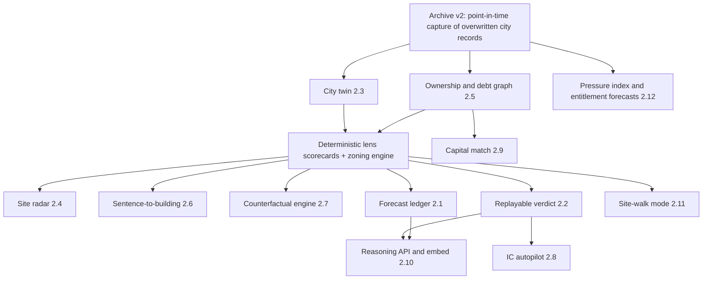

# 03. The No-Limits Vision: KOANO in Five Years

Everything in this document is labeled `VISION` unless stated otherwise. Each idea names the dependency it needs (data partner, capital, regulatory change, model capability). A dependency does not disqualify an idea. Every idea keeps the locked decisions: provenance stays honest, the verdict math stays deterministic, and landlords and flippers are not an audience.

The grounded audit (00, 01, 04 to 08 and the panel) describes what is real today. This document describes where it could go. Where a vision idea has a "first version that ships with today's resources," that version is marked `MISSING` (achievable now) and cites the code it builds on.

---

## 0. The thesis the vision serves

The audit's central finding is that KOANO's provenance discipline and deterministic aggregator are genuinely rare, but the verdict sitting on top of them is often wrong, or answers the wrong question. Examples: BUY on a site with a 1,071-unit tower already under construction, and a $149M price for a two-bedroom co-op. The five-year vision follows one line of argument:

> **KOANO becomes the only real estate intelligence whose every past judgment can be replayed, checked against what the city later recorded, and scored in public.**

Every idea below either feeds that ledger (more events forecast, more records captured point-in-time, more decisions expressed as falsifiable probabilities) or monetizes it (lenders, funds, cities and data incumbents paying for judgment they can audit). The reasoning layer the exit thesis describes is only worth buying if it carries a track record. Without one, an incumbent can rebuild it in a quarter (see `panel/vc_and_ma.md` §2c).

---

## 1. The long list (44 ideas)

Grouped by theme. The twelve marked ★ are developed in section 2.

### A. Time and memory
1. ★ **The point-in-time city twin.** Every NYC lot's regulatory, ownership, physical and market state for any week, scrubbable backward and forward.
2. **"What was knowable then" toggle** on every verdict, document and chart, rendering the city exactly as it looked on the verdict date.
3. **Verdict changelog.** When a stored verdict would flip today, show the precise input that moved it ("HPD registration changed owner on 2026-11-02").
4. **Archive-native backtesting studio.** Users define a rule ("lots with ≥80% unused FAR, no NB filing, owner holding >10 years") and see how it would have performed since 2003 on reconstructable history.
5. **Publication-lag intelligence.** Measure how long each city record takes to appear (deed recorded vs DOF publication) and flag "this sale exists in ACRIS but not yet in DOF."

### B. Proof and trust
6. ★ **The public forecast ledger.** Hash-chained, timestamped probabilities on pre-registered public events, with live reliability diagrams.
7. ★ **The replayable verdict.** Every production verdict sealed with its full evidence bundle, re-executable byte for byte from a public verification URL.
8. **Compliance certificate per document.** A machine-verifiable page proving inputs, excluded protected-class proxies, the disparate-impact test for that method era, and source license status.
9. **Fair Housing Audit page.** A versioned public disparate-impact test run on every engine change.
10. **Source rights ledger.** Per source: terms URL, attribution, redistribution status. Clean title as a product.
11. **Correction and dispute loop.** Anyone can dispute a public-record error. Corrections enter the archive with their own provenance and are sent back to the agency.

### C. Sourcing and foresight
12. ★ **Autonomous site radar.** Nightly scoring of every lot against each client's buy box, a Monday ranked brief, and a push alert when a new qualifying site appears.
13. ★ **Ownership and debt graph.** LLCs resolved to people and operators through HPD contacts, ACRIS parties, DOS filings and signatories, with mortgages, maturities and lis pendens on the graph.
14. **Maturity wall radar.** Inferred loan maturities from ACRIS mortgage recordings, rate-shock refinance gaps per property, and a citywide "who needs equity in the next 12 months" map.
15. **Distress pre-signal feed.** Lien sale list entry, ECB balances, managing agent churn, permit abandonment, tax arrears, and court filings, combined into a weekly early-warning score.
16. **Off-market intent signals.** Owners who just filed a demolition, pulled a zoning lot description, or hired an expediter. An ethical-use policy is required, and the feature is offered only to the stated audiences.
17. **Competing-project radar.** "A 23-story NB was just filed 400 feet from your site." Supply pipeline at the block level, DOB NOW based.

### D. Underwriting and design
18. ★ **Sentence-to-building.** One sentence produces a zoning-compliant envelope, unit mix, 485-x path, land residual and verdict in seconds.
19. ★ **Counterfactual engine.** "If the rezoning passes / rates drop 100bp / the IBX opens, what happens to this site and this portfolio?"
20. **Air-rights exchange intelligence.** Every zoning lot merger and TDR priced from ACRIS, contiguity-aware mergeable FAR, and the owner contact chain.
21. **Assemblage solver.** Find the cheapest combination of adjacent lots that unlocks a target envelope, given ownership complexity and recent trades.
22. **Construction cost oracle.** Cost per BSF by type, height and borough, learned from DOB NOW estimated job costs plus partner cost data.
23. **Rent-regulated multifamily underwrite.** Stabilized-unit estimate, legal-rent proxy, HSTPA constraints, DSCR at market debt, and the refi gap.
24. **Tax abatement navigator.** 485-x wage tiers, ICAP, J-51 and the 421-a legacy timeline, computed per lot with eligibility proofs.

### E. Committees and capital
25. ★ **IC autopilot that defends itself.** An IC memo that takes adversarial questions live, cites every answer to the ledger, and refuses to answer beyond its evidence.
26. ★ **Capital match.** Every verdict also says who is likely to finance the deal, on what terms, from public mortgage recordings plus lender partner feeds.
27. **LOI drafter.** Draft an LOI from the verdict and the user's terms, flagging every clause that depends on a fact KOANO could not verify.
28. **Data-room reconciler.** Upload an offering memorandum. KOANO reconciles every claim against the public record ("OM says 42 units; HPD registration says 38").
29. **Lender collateral monitor.** A debt fund's whole book watched weekly: violations, permits, ownership, tax, flood, with covenant-relevant alerts.

### F. Platform and distribution
30. ★ **The KOANO reasoning API and embed.** Data providers, banks, brokerages and title companies embed provenance-carrying verdicts inside their own products, with partner-attributed provenance.
31. **Bring-your-own-data enclave.** A fund's private rent rolls, T12s and deal history flow in under `partner`/private provenance and never leave their tenant.
32. **Data-exchange consortium.** Institutions contribute private outcomes (prices, rents, terms) under NDA in exchange for calibrated benchmarks. The CompStak give-to-get model, applied to underwriting outcomes.
33. **City-agency mode.** Published weights, FOIL-safe documents, accessible PDFs. Used by community boards and HPD for enforcement prioritization.
34. **University and research program.** Archive slices for academics, producing citations, press and a hiring pipeline.

### G. Interfaces
35. ★ **Site-walk mode.** Stand on a sidewalk, point the phone, and get the lot, the envelope, the owner chain and the verdict, by voice.
36. **Trace everywhere.** Pull any number in any PDF back to its source via a deep link.
37. **The Bench as live television.** Shareable recordings of a verdict assembling itself, embeddable in pitch decks.
38. **Natural-language archive query.** "Show me every Brooklyn block where violations doubled while permits rose since 2026."
39. **Voice IC prep.** A 6 a.m. briefing call that walks an associate through the questions the committee will ask.

### H. Public indices and civic
40. ★ **KOANO City Pressure Index.** A weekly published index of permits, violations, filings, ownership churn and distress, cited by the press the way Case-Shiller is.
41. **Tenant Building Record.** A free habitability and landlord-conduct dossier for every multiple dwelling, mission-aligned and viral among tenant associations. (Serves renters, not landlords.)
42. ★ **Entitlement forecasting by community board.** Probability and timeline for every pending ULURP, BSA and LPC action, scored publicly.
43. **Policy simulator for legislators.** City of Yes style changes simulated across every lot before a vote, with the distribution of new capacity by tract.
44. **Climate-adjusted land value surface.** First Street-class hazard (via partner) joined to entitlement and price, so the city can see where capacity and risk collide.

---

## 2. The twelve, fully developed

For each: what it is, who it is for, why it is defensible, how it changes the valuation story, what it takes to build, and a first version shippable with today's resources.

### 2.1 The public forecast ledger (idea 6)

**What it is.** Every KOANO verdict is re-expressed as explicit probabilities on pre-registered, publicly resolvable events. Examples: "P(submarket repeat-sales index rises over 12 months) = 0.64", "P(NB or ALT-1 filing on this lot within 24 months) = 0.31", "P(open class B+C violations higher in 12 months) = 0.58". Each day's forecasts are hashed into a Merkle root and publicly timestamped. A Track Record page shows reliability diagrams, Brier skill against two baselines (base rate and naive momentum), resolution, AUC, and every exclusion with its reason. A random monthly "shadow panel" of about 2,000 stratified NYC lots is forecast alongside customer requests, so calibration is not biased by which addresses users happen to pick.

**Who it is for.** Institutional buyers' model-risk teams (the SR 11-7 question "how do you know it works?"), lenders, press, and every acquirer's diligence team.

**Why it is defensible.** It cannot be backfilled. A competitor starting today publishes nothing for 12 to 24 months, and an LLM-based competitor cannot honestly backtest at all, because its pretraining already contains the outcomes. Losses are shown as prominently as wins, which no marketing-driven vendor will copy.

**Valuation story.** This moves KOANO from "a nice interface on public data" to "the only real estate AI with a provable accuracy history." Three panelists independently chose it as their "never seen anything like this" moment (`panel/ai_expert.md` §11, `panel/data_strategist.md` §13, `panel/vc_and_ma.md` §8). It is also the artifact that justifies a revenue multiple closer to the MSCI/RCA end of the comp range than the tooling end.

**Dependencies.** Time (the earliest honest 12-month resolution is roughly Q4 2027), the engine inversion in 2.2 (an LLM vote cannot be backtested), and the provenance constraint fix (`schema.sql:118`).

**First version (MISSING, achievable now).** Rewrite `lib/archive/outcomes.ts` to resolve fixed events against the verdict timestamp (today it is mis-windowed and overwritten, `outcomes.ts:26-32,97`), add `model_id`, `prompt_sha` and `code_sha` to `verdicts`, start the shadow panel with the deterministic site-screening scorecard that already exists (`lib/documents/builders/site-screening.ts:205`), and publish a daily hash to a public GitHub repo. Cost: storage and one cron.

### 2.2 The replayable verdict (idea 7)

**What it is.** Every production verdict is sealed with its full evidence bundle: every provider response, every raw model completion, the model ID, prompt hashes and code SHA. Content-addressed storage and a hash on the immutable verdict row hold it together. A public URL (`koano.co/v/{id}`) re-runs the deterministic aggregation on the frozen inputs, shows the hash match, and diffs it against a fresh run on today's data: "On 14 September we said BUY at 69. Here is exactly what moved since."

**Who it is for.** Funds' operational due diligence teams, lenders' examiners, any IC that needs to prove what it knew on the day. It also serves the verdict permalink sharing loop (`panel/design_engineer.md` opportunity 3).

**Why it is defensible.** The record/replay cassette already exists for the test fixture (`lib/testing/cassette.ts`). The staff architect estimates the product is about 70 percent built and described nowhere as a product (`panel/engineer.md` §24). Competitors without per-figure provenance cannot fake it.

**Valuation story.** It turns "auditable" from a marketing adjective into a verifiable property. Today the claim is false: the evidence ledger is explicitly not persisted (`lib/agents/synthesis.ts:171-174`).

**Dependencies.** Object storage, about 2 to 3 weeks of engineering. No data partner needed.

**First version (MISSING).** Switch the cassette's mode to "record to storage" for production runs, store `evidence_uri` and `evidence_sha256` on `verdicts`, and ship `scripts/replay-verdict.ts <id>` before the public page.

### 2.3 The point-in-time city twin (idea 1)

**What it is.** A scrubbable timeline for every NYC lot. Zoning, ownership chain, registrations, violations with their open and closed status paths, permits and job filings with their status histories, sales, liens, flood and hazard, and KOANO's own past verdicts, for any week since capture began. It is approximated further back from reconstructable public history (DOF annualized sales since 2003, archived PLUTO since 2002, ACRIS since 1966). Drag the slider and the map, the ledger and the verdict re-render as of that week.

**Who it is for.** Acquisitions teams diligencing a seller's history, lenders, litigators, journalists, researchers, and the calibration engine itself (it is the substrate for honest backtests).

**Why it is defensible.** Only the overwritten fields make it unique, and those are exactly what the current archive does not capture citywide (`panel/data_strategist.md` §1-3): HPD registration owner and agent history, violation status transitions, DOB NOW filing status paths, ZAP status paths, and assessment roll years before they roll off. Every week of delay is permanent loss.

**Valuation story.** This converts the archive from "mostly redundant with public history" into the diligence-grade asset the exit thesis assumes. It becomes the thing an acquirer actually prices.

**Dependencies.** Archive v2 (record-level change-data capture outside Vercel's 300s limit), 2 to 3 years of compounding, object storage, and a queue worker.

**First version (MISSING).** A `record_versions` table and a citywide weekly capture of `tesw-yqqr`, `feu5-w2e2` and `w9ak-ipjd` status fields, run from a scheduled worker with the existing gap ledger and external liveness check. Cost: low single-digit dollars per month in storage (`panel/data_strategist.md` §9).

### 2.4 Autonomous site radar (idea 12)

**What it is.** The user defines a buy box once (boroughs, zoning districts, minimum buildable area, maximum ownership tenure, no active NB or DM job, no rent-stabilized occupancy, OZ preference). Every night KOANO scores every lot in the city against it. PLUTO is corrected by DOB NOW filings and ACRIS deeds, which fixes the exact defect that made the flagship demo recommend buying a site already under construction. On Monday the user gets a ranked brief: "Seven sites cleared your buy box this week." Each site comes with its envelope, owner chain, debt picture, supportable land value at the user's assumptions, and a pre-filled screening memo.

**Who it is for.** NYC infill developers, land brokers and development-focused funds. This is the wedge customer (`panel/gtm_pricing.md` §3).

**Why it is defensible.** It requires the whole stack at once: parcel facts, filings, ownership, a deterministic scorer, provenance on every line, and the archive's diff engine. The diff engine already exists for monitoring (`lib/monitor/detect.ts`).

**Valuation story.** It moves KOANO from a tool you open to a service that finds deals. It makes KOANO impossible to remove from the sourcing workflow, which is where the real estate tycoon says it must live (`panel/real_estate_tycoon.md` §6, §11).

**Dependencies.** A deterministic lot scorer (port from `site-screening.ts:205`), DOB NOW and ACRIS ingestion, compute for nightly citywide scoring (about 860k lots, cheap without LLMs), and a land residual engine for the price line.

**First version (MISSING).** Citywide nightly PLUTO plus DOB NOW scoring of vacant and underbuilt lots in three boroughs against one hard-coded buy box, emailed through the existing Resend digest path (`lib/monitor/digest.ts`), no LLM in the loop.

### 2.5 Ownership and debt graph (idea 13)

**What it is.** A point-in-time graph that resolves LLCs to the people and operators behind them. Its edges come from HPD registration contacts (head officer, officers, managing agent and their business addresses), ACRIS deed and mortgage parties and signatories, DOB NOW owner fields, and NYS DOS corporation filings. Mortgages, assignments, satisfactions, lis pendens and inferred maturities sit on the edges. Every edge carries provenance and a confidence, and name-only merges of individuals are forbidden (the legal panel's Risk 4: `nyc-landlord.ts:198` merges unrelated people today).

**Who it is for.** Acquisitions associates ("who really owns this and what do they owe?"), lenders, tenant advocates (with a separate, conduct-only product), journalists. It explicitly excludes use as a landlord-harassment or flipper tool.

**Why it is defensible.** Who Owns What (JustFix) already does registration-contact portfolios for free, so the moat is the point-in-time history plus the debt layer plus provenance, and none of those exist in the free tools. Registration contacts are overwritten by the city, so history only exists if KOANO captures it.

**Valuation story.** This is the off-market and distress engine. It is the asset Reonomy-style buyers paid for (Altus bought Reonomy for $201.5M per `panel/vc_and_ma.md` §2a), done with time depth.

**Dependencies.** ACRIS ingestion (public, large), DOS data, entity resolution that respects legal limits on individuals, and the Archive v2 capture of contacts.

**First version (MISSING).** Head-officer clustering from `feu5-w2e2` for any queried building, displayed with every edge sourced. It replaces the exact-match landlord logic (`nyc-landlord.ts:1-13`), and the persona sessions showed it catching 13 buildings where KOANO showed 1 (`panel/user_roleplay.md` problem 7).

### 2.6 Sentence-to-building (idea 18)

**What it is.** The user types: "Eight-story mixed-use, ground-floor retail, 485-x affordable, on this lot." KOANO returns, in seconds, a zoning-compliant massing envelope drawn on the lot (height, setbacks, lot coverage, City of Yes UAP bonus where eligible), a unit mix, the 485-x wage-tier path, a construction cost range, and a land residual. It then shows the deterministic verdict on "supportable land value vs ask." The LLM parses the sentence into typed parameters. A deterministic zoning engine computes everything else, and every rule cites the Zoning Resolution section.

**Who it is for.** Developers, architects in pre-design, land brokers pricing a site.

**Why it is defensible.** A deterministic, citation-carrying NYC zoning engine is hard. TestFit and Archistar do massing, but they price nothing and carry no provenance (see `02_competitors.md`). Joining massing, price and provenance in one artifact is new.

**Valuation story.** This is the feature that justifies the $15,000-a-month tier the real estate tycoon describes (`panel/real_estate_tycoon.md` §1).

**Dependencies.** A machine-readable Zoning Resolution (City of Yes text), a construction cost partner, rent and cap rate inputs (user-entered first, partner later), and a 3D envelope renderer.

**First version (MISSING).** As-of-right residential FAR and maximum height for the R6 to R8 contextual districts only, with user-entered price, rent, cost and cap rate, producing a land residual table in the screening memo. Every input is labeled user-provided.

### 2.7 Counterfactual engine (idea 19)

**What it is.** Pick a lot, a portfolio or a neighborhood, then toggle a scenario: a pending rezoning passes, rates move by ±100bp, a transit line opens, flood maps are redrawn, 485-x wage tiers change. KOANO recomputes envelopes, residuals, verdicts and portfolio exposure deterministically, then shows the distribution of outcomes and which assets flip.

**Who it is for.** Institutional portfolio teams, city policy staff, legislators (idea 43), lenders stress-testing collateral.

**Why it is defensible.** It only works if every verdict is a deterministic function of typed facts. KOANO's locked architecture is built for exactly this, and LLM-voting competitors cannot do it reproducibly.

**Valuation story.** It turns KOANO from "an opinion about today" into "a model of the city," which is what an acquirer like Moody's or MSCI sells into risk and policy desks.

**Dependencies.** The deterministic lens scorecards (the engine inversion), the zoning engine from 2.6, and transit, flood and rate scenario inputs (partner or public).

**First version (MISSING).** A rate toggle on the land residual (a pure function), plus a "proposed rezoning" toggle for one live ZAP project area, using the ZAP project boundary and the proposed districts.

### 2.8 IC autopilot that defends itself (idea 25)

**What it is.** The IC memo becomes a live object. A committee member asks "why not just buy the comparable two blocks east?" or "what happens if the stabilized units don't decontrol?" KOANO answers in the meeting, citing only ledger facts, showing the arithmetic, and saying "I cannot answer that from the evidence" when it cannot. Every exchange is appended to the sealed verdict record.

**Who it is for.** Acquisitions associates the night before IC, and ICs themselves.

**Why it is defensible.** It depends on the replayable verdict (2.2), the claim-graph narrator with a verifier (`panel/ai_expert.md` §3 step 6), and per-figure provenance. Without those layers it is a chatbot that hallucinates in front of a committee.

**Valuation story.** It embeds KOANO in the one meeting where money moves.

**Dependencies.** Real underwriting inputs (rent rolls, T12, debt terms) via upload or partner, a claim-level verifier, and Opus-class long context for data rooms.

**First version (MISSING).** A "question this memo" panel on the IC memo that answers only from the verdict's `data_points` and breakdown, with claim verification, and logs each Q&A to the verdict.

### 2.9 Capital match (idea 26)

**What it is.** Alongside "should we do this deal," KOANO says who is likely to finance it. It learns lender appetite from ACRIS mortgage recordings: which lenders financed which asset types, sizes, boroughs and sponsors, and how recently. Partner lender feeds then add live terms. The verdict shows "three lenders closed comparable construction loans in this CD in the last 18 months," with recordings linked.

**Who it is for.** Developers and sponsors, mortgage brokers, debt funds looking for deal flow.

**Why it is defensible.** Recorded mortgage history combined with the ownership graph and provenance is a dataset nobody publishes in this form for NYC. Lender partnerships create two-sided pull.

**Valuation story.** It adds a transaction-adjacent revenue line (referral or marketplace economics), which has a different multiple than subscriptions.

**Dependencies.** ACRIS mortgage parsing, lender partnerships for terms, and regulatory review of any referral compensation.

**First version (MISSING).** A "recent comparable financings" table on the screening memo built from ACRIS mortgage documents on nearby lots, every row linked to the recorded document.

### 2.10 The KOANO reasoning API and embed (idea 30)

**What it is.** A versioned API and embeddable widget returning provenance-carrying verdicts, envelopes, event probabilities and coverage maps. Partners' data enters through a context-aware provider interface under `partner` provenance, attributed by name. A partner SDK with a contract-test harness built on the cassette lets a data provider's engineer integrate in days, not quarters.

**Who it is for.** Data incumbents (the exit buyers), banks' internal tools, brokerage platforms, title companies.

**Why it is defensible.** Provenance and replay become the integration contract, so a partner's data shows up attributed, and the partner gets a reasoning layer they did not have to build.

**Valuation story.** This is the exit thesis made concrete. A buyer can see KOANO already running on their own data class.

**Dependencies.** The provider interface rework. Today a partner integration touches 9 to 12 files, so the "one-line swap" claim is false (`panel/engineer.md` §17). It also needs tenancy, metering, SOC 2, and the first partner agreement.

**First version (MISSING).** A read-only `GET /api/v1/verdicts/{id}` returning the sealed verdict and its coverage map, plus a documented `ProviderContext` interface with one reference partner adapter built against a free source, to prove the contract.

### 2.11 Site-walk mode (idea 35)

**What it is.** A mobile mode. Stand on the sidewalk, point the phone, and KOANO resolves the lot from GPS and heading. It outlines the lot in AR, reads the envelope, owner chain, open violations and active filings aloud, and answers follow-ups by voice: "What's the as-of-right height here?" "Who did the owner borrow from?" Street imagery can be analyzed for vacancy and condition signals, labeled as model-inferred and never fed into the deterministic verdict unless confirmed.

**Who it is for.** Developers and brokers who still walk neighborhoods to source.

**Why it is defensible.** By itself it is not defensible, since anyone can build an AR shell. It becomes defensible as the most memorable delivery surface for the twin, the radar and the graph.

**Valuation story.** It drives brand and demo power, and makes a video that sells the company in thirty seconds.

**Dependencies.** A responsive and native app (the dashboard has no mobile layout today, `panel/design_engineer.md` problem 3), lot-resolution accuracy at the curb, voice, and vision models.

**First version (MISSING).** A mobile web page: "use my location" resolves the nearest lot via the existing geocoder, then shows the verdict band and the five headline facts, after the responsive shell exists.

### 2.12 City Pressure Index and entitlement forecasting (ideas 40 and 42)

**What it is.** Two public products from the same archive. (a) A weekly KOANO City Pressure Index of permits, filings, violations, ownership churn and distress by community district, with methodology published and history downloadable, designed to be cited by the press. (b) For every pending ULURP, BSA and LPC action: a probability of approval and a timeline distribution, learned from ZAP history since 1970 plus status-path capture, and scored publicly through the forecast ledger.

**Who it is for.** Press and researchers (index). Developers, land-use attorneys, community boards and lenders (entitlement forecasts).

**Why it is defensible.** Published indices compound brand authority, and entitlement status paths are overwritten by the city (ZAP `project_status` is current-only), so only a capturer has the history.

**Valuation story.** The index gives KOANO earned media and a recognizable name. Entitlement forecasting replaces the current "entitlement approval 95%," which is really a DOB alteration-paperwork ratio on a dataset that has nearly stopped receiving filings (`panel/real_estate_tycoon.md` §4.3, `panel/data_strategist.md` §1.3).

**Dependencies.** ZAP ingestion, Archive v2 status capture, and 2+ years of status paths for timeline estimates.

**First version (MISSING).** A monthly CD-level index of DOB NOW filings, HPD violations opened and closed, and HPD registration owner changes, published as a static page and CSV. Plus a descriptive (not predictive) ULURP outcomes table by CD from ZAP history.

---

## 3. How the twelve fit together

The foundation is three things, and all three are achievable now: Archive v2, deterministic lens scorecards, and sealed verdicts. Every vision item rests on them. That is why the roadmap (`05_product_roadmap.md`) spends its first 90 days there and not on the visible features.

## 4. What the vision deliberately excludes

- **No LLM-decided numbers.** Every probability, residual and score comes from versioned code. LLMs extract, critique, narrate and answer questions under verification.
- **No resident-composition signals in any decision.** No "gentrification stage," income or education in verdict paths (the legal panel's Risk 2). Neighborhood change is described through transactions and filings, never people.
- **No landlord-enforcement-evasion or flipper tooling.** Distress and ownership features are scoped to developers, institutional acquirers, lenders, tenants and civic users, with an acceptable-use policy and monitoring.
- **No fabricated coverage outside NYC.** National expansion arrives market by market as partner-provenance layers, and the coverage map stays the honest boundary.
