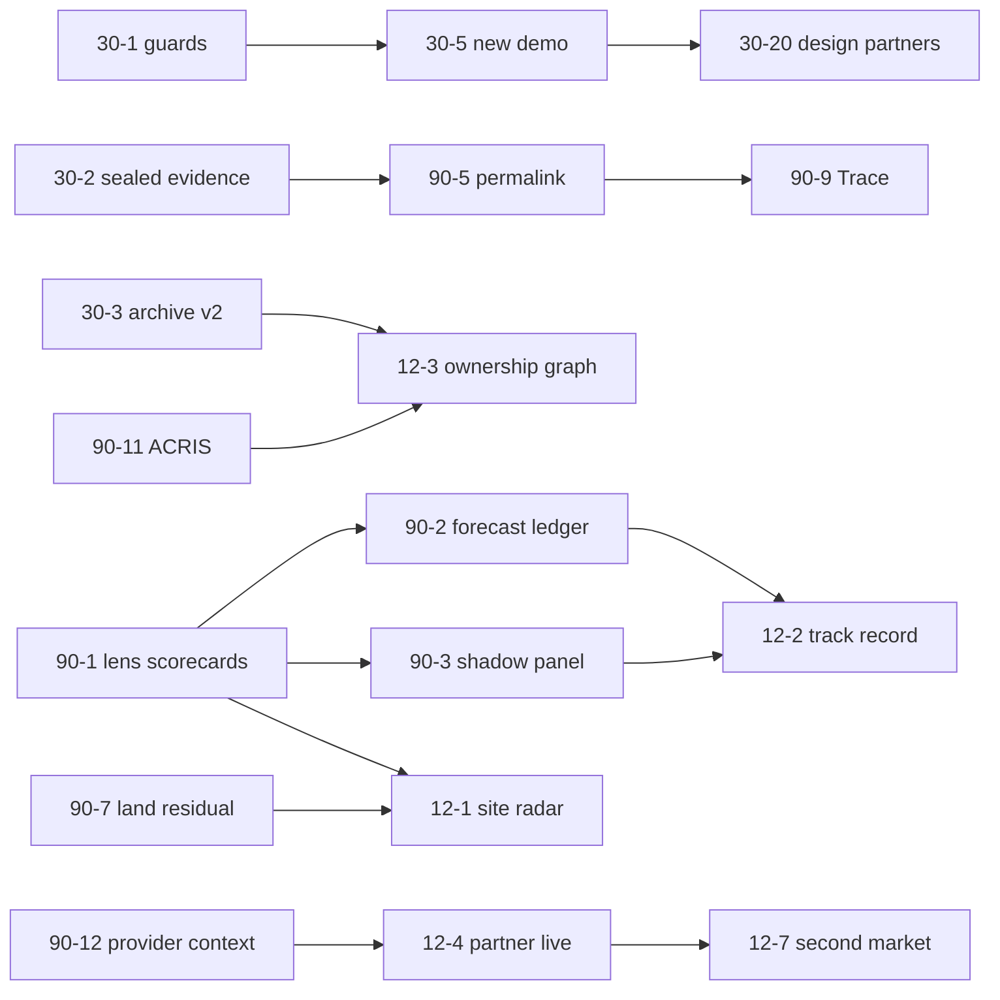

# 05. Product Roadmap

Four horizons. Every item carries a state (`EXISTS`, `PARTIAL`, `MISSING`, `VISION`), effort (S/M/L/XL), impact (1 to 10), and the panelist who championed it. Items are ranked by impact on enterprise value within each horizon. IDs are referenced from other audit files.

Panelist key: **ENG** staff architect, **DES** design engineer, **TYC** real estate tycoon, **UX** product designer, **AI** AI systems expert, **DATA** data strategist, **VC** venture and M&A, **GTM** go-to-market and pricing, **LEG** legal and trust, **USR** user role-play, **COMP** competitor research.

Sequencing logic, from the convergence of all eleven reports:
1. **Stop being wrong in public.** The flagship verdicts fail a four-minute DOB NOW check, and the valuations break on co-ops and multifamily.
2. **Stop losing what cannot be recovered.** That means the overwritten city records and the evidence behind each verdict.
3. **Make the product sellable.** Ship the documents people pay for, fix capacity and legal paper, then build the dashboard redesign.
4. **Turn verdicts into scored forecasts**, so the track record starts compounding.

The red team adjusted this plan (`08_red_team.md` §4). It showed that the original schedule was about 70 person-weeks for one founder. So:
- **The 90-day critical path** is the items marked **CP**. Costed at S = 0.5, M = 1.5 and L = 3 founder-weeks, it comes to about 18 to 20 founder-weeks against 12 calendar weeks. The plan only fits if the hire or contractor (30-22) lands inside the 90 days, or if the radar (30-25) slips to week 12.
- **Items marked NEXT** are the first work after the critical path: Develop-lens scorecard, internal ledger, shadow panel and backtest.
- **Items marked FROZEN** wait for a gate: 20 paying customers, or a second engineer funded (30-22).
- **The land residual and site radar** were pulled forward (30-24, 30-25).
- **The forecast events** were redesigned (90-2).

---

## Horizon 1. Next 30 days: correctness, capture, sellability

Target outcome: a NYC developer can run the product on a site they know, find nothing false in ten minutes, buy it, and receive a document they would forward.

| ID | Item | State | Effort | Impact | Champion |
|---|---|---|---|---|---|
| 30-1 CP | **Active-construction and occupancy guards.** Add DOB NOW job filings (`w9ak-ipjd`) to permits and filings. Classify NB and DM jobs by job type, not `work_type` text (`nyc-permits.ts:221`). Suppress the FAR nudge (`direction.ts:47-81`) and flag the site when any of these hold: an active NB or DM job, a co-op or condo class, 6 or more units pre-1974 (likely stabilized), or landmark status. Stop counting the subject's own permits as neighborhood pipeline. Re-record the fixture with a reviewed diff. | PARTIAL | S to M | 10 | TYC, AI, DATA |
| 30-2 CP | **Sealed evidence per verdict.** Switch the existing cassette (`lib/testing/cassette.ts`) to record production runs to object storage. Store `evidence_uri`, `evidence_sha256`, `model_id`, `prompt_sha`, `code_sha` and `degradation` on `verdicts`. Ship `scripts/replay-verdict.ts <id>`. This makes "auditable" true, since today `data_points` is never persisted (`synthesis.ts:171-174`). | MISSING | M | 10 | ENG, AI, LEG |
| 30-3 CP | **Archive v2, capture part.** Weekly citywide record-level capture of the datasets the city overwrites: HPD registrations `tesw-yqqr` and contacts `feu5-w2e2` (all fields), DOB NOW filing status, ZAP project status, and HPD, ECB and DOB status fields. Use a `record_versions` table with hash-on-change. Run it on a worker outside Vercel's 300s limit, and keep the external liveness check on a different host. Every week of delay is permanent loss. | MISSING | M to L | 10 | DATA, ENG |
| 30-4 CP | **Valuation guardrails.** No building-area valuation for co-op, condo or 7+ unit subjects; print the reason instead. Compute band, midpoint and HPI adjustment on one comp pool, exclude the subject from its own comps, and fix the Exhibit B weight row (`pricing-sheet.ts`, `net-sheet.ts`, `cma.ts:73-79`, `ic-memo.ts:442-454`). | PARTIAL (bug) | S | 10 | USR, TYC |
| 30-5 CP | **Replace the flagship demo.** Remove 175 3rd St, 1800 Park Ave and 70-33 260th St from the hero (`exampleVerdict.ts`), fixture, captures, video and sample PDFs. Choose a site hand-checked against DOB NOW and ACRIS, and record a new fixture. | PARTIAL | S | 9 | TYC |
| 30-6 CP | **Provenance CHECK constraint fix.** Widen `verdicts` and `documents` to the five provenance states (`schema.sql:118`, `migration-006:30`). Verify production first with the one-line query in `panel/engineer.md` §7.1. Check every supabase-js `{ error }` in the Stripe webhook, the documents audit and the monitor runs. | PARTIAL (bug) | S | 9 | ENG, AI, LEG |
| 30-7 CP | **Wire the sold documents.** Add the CMA (PDF and DOCX), IC memo (PDF and DOCX) and portfolio risk report buttons. Route 402 and 403 responses into the upgrade sheet with the tier preselected. Delete the "Not yet available" tile. | EXISTS server-side, MISSING UI | S | 9 | UX, USR, GTM |
| 30-8 CP | **Remove resident composition from the verdict.** Drop `bachelors_or_higher_pct` and the gentrification-stage step from `demand-sentiment.ts`, re-base it on transaction-side signals, and add a banned-language gate in `grounding.ts`. Fixture re-record. | EXISTS (risk) | M | 9 | LEG |
| 30-9 CP | **Terms of Service, Privacy Policy and a signup consent step.** Add the subprocessor disclosure (Anthropic, Clerk, Supabase, Resend, Mapbox, Vercel) and the AI-output disclaimer on verdict screens. | MISSING | S | 9 | LEG |
| 30-10 CP | **White-label CMA, truly.** No KOANO mark, DOCX paragraph or PDF author on client-facing types. Suppress empty letterheads. | PARTIAL | S | 8 | DES, GTM, LEG |
| 30-11 CP | **Capacity and metering.** Replace the 50/day global breaker with per-plan monthly credits, per-plan COGS budgets and an edge rate limit. Meter `site-detail`. Add a usage meter in the shell. Failed runs refund their credit. | PARTIAL | S | 8 | ENG, GTM, UX |
| 30-12 CP | **Pricing truth pass.** One price per tier, one free-tier definition (recommended: one full screening memo plus watermarked previews), Portfolio as an annual contract with a paid pilot, a real "Contact sales" path, and "test mode" removed from the customer UI. | PARTIAL | S | 8 | GTM, UX |
| 30-13 | **Rename and demote "entitlement approval ratio"** to "DOB filing record" until ZAP and BSA data exist. Add a date window. Rewrite the "discretionary review" narration. | PARTIAL | S | 8 | TYC, DATA, USR |
| 30-14 | **Fix the crime signal.** Correct the violent and non-violent labels and the year-over-year comparison window (`fbi-ucr.ts:100,113,117,129`). | EXISTS (bug) | S | 7 | LEG |
| 30-15 | **CI on GitHub Actions.** Run the build, fixture replay and pure tests. Fix the red `test-shard-logic`. Add a schema-contract test that inserts each provenance state. Add partitions through 2030. Add Sentry. | PARTIAL | S | 7 | ENG |
| 30-16 | **Watch from every lens.** Add a Watch action to Community, Transaction and Development (`POST /api/properties` + `PATCH /api/monitoring`). | MISSING | S | 7 | UX |
| 30-17 | **Single vocabulary per lens.** Rename the screening "Confidence" to "Site score". Fix the confidence-to-verdict mismatch (confidence currently describes the modal agent verdict), and include the nudge in the persisted breakdown. | PARTIAL | S | 7 | TYC, USR, AI |
| 30-18 | **AA color tokens, focus rings and the panel state contract** ("loading" must never read "Unavailable"). | PARTIAL | S | 6 | DES |
| 30-19 | **Rewrite the archive and moat copy** to name exactly the non-reconstructable datasets. Remove the "one-line swap" claim. | PARTIAL | S | 6 | DATA, ENG |
| 30-20 CP | **Five paid design partners.** Recruit mostly land and investment-sales brokers, plus NYC infill developers and land-use attorneys, through DOB NOW applicant and owner data plus recorded development-site sales, at a paid pilot price ($750/month broker pilot; never free). Start only after 30-1, 30-4 and 30-5 ship. Metric: paid for month two, and forwarded a memo unedited. | MISSING | M | 10 | GTM, VC |

| 30-21 CP | **Verify before claiming uniqueness.** Ask NYCDB maintainers, JustFix and the vendors whether anyone retains historical HPD registration contacts, and file a FOIL request with HPD for registration history. Until confirmed, no "only record" claim. | MISSING | S | 7 | Red team |
| 30-22 CP | **Raise a small round or hire one engineer.** This gates every FROZEN item. | MISSING | M | 9 | Red team, VC |
| 30-23 CP | **Hosting and durability check.** Confirm the Vercel plan (Pro before commercial launch) and Supabase Pro with PITR. Add an insert-only archive role and weekly off-site archive snapshots. | PARTIAL (unverified) | S | 7 | Red team, ENG |
| 30-24 CP | **Land residual v1** (pulled forward from 90-7). User-entered price, program, cost, rent, cap and rate. As-of-right residential FAR for common R districts. Every input labeled. The Develop verdict becomes "residual vs ask", and the FAR nudge is retired once it ships. | MISSING | L | 10 | TYC, red team |
| 30-25 CP | **Site radar v1** (pulled forward from 12-1). Nightly deterministic PLUTO plus DOB NOW plus ACRIS-deed scoring against one buy box per client, no LLM, delivered as a Monday email via `lib/monitor/digest.ts`. | MISSING | M | 10 | TYC, red team |
| 30-26 CP | **Emit the computed `decision` before the narrator** (the S-sized slice of the Bench), so "computed, then narrated" is visible. | MISSING | S | 7 | DES |

## Horizon 2. Next 90 days: the scored engine and the redesigned product

Target outcome: every verdict is a sealed, replayable record that forecasts defined public events. The dashboard shows its reasoning live. Five paying developers renew.

| ID | Item | State | Effort | Impact | Champion |
|---|---|---|---|---|---|
| 90-1 NEXT (Develop lens first); others FROZEN | **Invert the engine: deterministic lens scorecards.** Port each specialist prompt's reasoning rules into unit-tested, versioned scorecards. The template exists in `site-screening.ts:205` `computeVerdict`. Use separate rule sets for Develop, Acquire/Hold, Price and Tenant. The LLM moves to extraction, an adversarial critic that emits typed flags with evidence IDs, and a claim-graph narrator under a verifier. Migrate to a current model with no temperature dependence. | PARTIAL | L | 10 | AI, USR, TYC |
| 90-2 NEXT (internal) | **Event forecasts and the internal forecast ledger (redesigned after the red team).** (a) Information-set exclusion: a forecast whose outcome was knowable at verdict time is ineligible, for example an active NB or DM job, or a recorded but unpublished deed. (b) Decision-level primary events: the land residual at verdict time vs the lot's next recorded arm's-length sale, and ADVANCE/PASS vs a filing or trade by an unrelated party within 24 months. Market-level events are context only. (c) Rewrite `outcomes.ts` to resolve point-in-time, append-only. Hash daily. Publication waits for the gate in 12-2. | PARTIAL | M | 10 | AI, DATA, VC |
| 90-3 NEXT | **Shadow panel.** Each month, run deterministic forecasts on stratified random NYC lots, oversampling flagged lots with weights disclosed, and report positives per cohort. The red team computed about 11 NB positives per 2,000 random lots over 24 months, so the sample is sized to the event, not fixed at 2,000. | MISSING | S (after 90-1) | 9 | AI |
| 90-4 FROZEN | **The Bench and the early `decision` event** (`04_redesign_spec.md` §2.1). | MISSING | M | 9 | DES |
| 90-5 FROZEN | **Shell redesign.** Responsive shell, one URL per subject (`/p/{bbl}`), the shareable sealed permalink (`/v/{id}`), the fixed verdict band, the evidence drawer, global search and plain lens names. | MISSING | M to L | 9 | UX, DES |
| 90-6 FROZEN | **Multifamily acquisition pack.** DOF classes 07 and 08 comps with $/unit, HPD litigation, AEP, CONH, evictions, ECB balances, an owner network by head officer and contact address, and a rent-stabilized unit estimate (NYCDB-style tax-bill counts, with the source license checked). | MISSING | M | 9 | USR, TYC, DATA |
| 90-7 MOVED | **Land residual engine (v1), now 30-24.** User-entered price, program, cost, rent, cap and rate. As-of-right residential FAR for common R districts. 485-x eligibility flags. Output: max supportable land $/BSF vs ask. Every user input is labeled. This fills the IC memo's placeholder sections honestly. | MISSING | L | 9 | TYC, COMP |
| 90-8 FROZEN | **True entitlement module (v1).** ZAP ULURP and CPC history by community district and action type, BSA outcomes, LPC and historic districts, E-designations. Show descriptive rates first. Forecasts come later. | MISSING | M | 8 | TYC, DATA |
| 90-9 FROZEN | **Trace, built first on the read-only permalink page,** then ported to the live dashboard. | MISSING | L | 8 | DES |
| 90-10 FROZEN | **Tenancy.** Clerk Organizations, `org_id` on every table, RLS actually enforced on read paths via Clerk-issued Supabase JWTs. Stop routing all reads through the service role. | MISSING | L | 8 | ENG |
| 90-11 FROZEN | **ACRIS ingestion.** Deeds, mortgages, assignments, satisfactions, lis pendens and parties. This is the substrate for the ownership and debt graph and for comparable financings. | MISSING | M | 8 | DATA, TYC |
| 90-12 FROZEN | **Context-aware provider interface** (`{addr, tenant, credentials, deadline, market}`) plus a market router and a contract-test harness on the cassette. One reference `partner` adapter. | MISSING | L | 8 | ENG, COMP |
| 90-13 FROZEN | **Fair-housing disparate-impact test.** Run it offline on every engine era, document the method, and prepare it for publication. | MISSING | M | 7 | LEG |
| 90-14 FROZEN | **OM upload reconciled against the public record.** "The OM says 42 units, HPD says 38." Use structured extraction with page citations. | MISSING | M | 7 | AI, COMP |
| 90-15 FROZEN | **Excel export** of every table, the residual and the comps. | MISSING | S | 7 | COMP, TYC |
| 90-16 FROZEN | **Tenant Building Record** for the renter path of the Property lens. | MISSING | M | 6 | USR |
| 90-17 FROZEN | **Run deadline, cancellation and graceful degradation.** One failed agent degrades the run instead of failing it. Build a shared input cache with dataset-cadence TTLs. | PARTIAL | M | 6 | ENG, AI |
| 90-18 FROZEN | **Instrumentation.** Product analytics plus per-run tokens, cost and latency logged to a `runs` table. Gross margin per customer. | MISSING | M | 7 | ENG, VC |
| 90-19 NEXT | **Publish a deterministic backtest** of the guarded site scorecard on reconstructable history (DOF annualized sales since 2003, archived PLUTO, DOB permits), with look-ahead controls (`panel/ai_expert.md` §4.4). Gets credibility before any rival does. | MISSING | M | 8 | Red team, AI |

## Horizon 3. Next 12 months: the radar, the graph, the first scored record

Target outcome: KOANO finds deals as well as judging them. The first resolved forecast cohort is published with its losses. There is $0.5M to $1.5M ARR, a first data partner and a second market in progress.

| ID | Item | State | Effort | Impact | Champion |
|---|---|---|---|---|---|
| 12-1 | **Autonomous site radar v2** (v1 is 30-25): multiple buy boxes, ownership and debt context, pre-filled memos. Nightly citywide deterministic scoring against each client's buy box, a Monday ranked brief, and a pre-filled memo per site (`03_vision.md` §2.4). | MISSING | L | 10 | TYC, DATA |
| 12-2 | **First published track record, aggregate only.** Reliability diagrams, Brier skill against baselines and every exclusion, once the counts pass the gate in `panel/ai_expert.md` §4.3. **Publication policy (red team Attack 9):** aggregate calibration only, no individual client verdict or address without consent, shadow-panel lots as the public examples, counsel review before launch, E&O insurance before institutional contracts. | MISSING | M | 10 | AI, VC |
| 12-3 | **Ownership and debt graph v1.** HPD contacts history plus ACRIS parties plus DOS. Point-in-time, with no name-only merges of individuals. | MISSING | L | 9 | DATA, TYC |
| 12-4 | **First data partnership live under `partner` provenance.** Order: Regrid or ATTOM for parcels, then MLS via Trestle or Bridge (BYO credentials), then CompStak. Clear the Freddie Mac PMMS terms in writing. | MISSING | L | 9 | DATA, COMP, VC |
| 12-5 | **SOC 2 Type I, SSO, and an SR 11-7-shaped model documentation pack.** | MISSING | L | 8 | ENG, LEG |
| 12-6 | **Verdict API v1.** A read-only sealed verdict plus coverage map, metered. | MISSING | M | 8 | ENG, GTM |
| 12-7 | **Second market.** Northern New Jersey (Gold Coast) or Los Angeles, chosen where regulation is the edge. Launch only with a partner parcel feed and the same guards. | VISION | XL | 7 | TYC |
| 12-8 | **KOANO City Pressure Index (monthly)** and descriptive ULURP outcome tables, published openly. | MISSING | M | 7 | DATA |
| 12-9 | **Capital match v1.** A "recent comparable financings" table from ACRIS mortgages. | MISSING | M | 7 | TYC |
| 12-10 | **IC memo "question this memo" panel** under claim verification. | MISSING | M | 7 | AI |
| 12-11 | **Compliance certificate per document.** Inputs, excluded proxies, the disparate-impact result for the era, and source license status. | MISSING | M | 7 | LEG |
| 12-12 | **Sentence-to-building v1** for the R6 to R8 contextual districts. | MISSING | L | 7 | TYC |

## Horizon 4. Three to five years: the decision layer

All `VISION`. Dependencies are named in `03_vision.md`.

| ID | Item | Effort | Impact | Champion |
|---|---|---|---|---|
| 5Y-1 | Point-in-time NYC twin with a "what was knowable then" toggle on every artifact | XL | 10 | DATA |
| 5Y-2 | A forecast ledger with 20,000+ matured forecasts across 3+ cycles, cited in client IC minutes and lender credit files | XL (time) | 10 | AI, VC |
| 5Y-3 | Reasoning API embedded by data incumbents and banks, with partner-attributed provenance in 10 to 25 metros | XL | 10 | VC, ENG |
| 5Y-4 | Counterfactual engine for rezonings, rates, transit and flood maps across portfolios and the city | XL | 9 | TYC |
| 5Y-5 | Entitlement forecasting by community board, scored publicly | L | 8 | DATA |
| 5Y-6 | IC autopilot that defends itself under questioning | L | 8 | AI |
| 5Y-7 | Data-exchange consortium (private outcomes in exchange for calibrated benchmarks) | XL | 8 | DATA |
| 5Y-8 | Site-walk mode | L | 6 | DES |
| 5Y-9 | Policy simulator for city agencies and legislators | XL | 6 | DATA, LEG |

---

## What is deliberately not on the roadmap

- **New audiences.** Landlords and flippers are excluded. Cluster 0 and Cluster 3 stay out.
- **National launch before NYC verdicts survive a DOB NOW and ACRIS check** (`07_kill_list.md` #30).
- **More LLM agents.**
- **Any feature that would display a representative figure without its badge.**

## Dependencies at a glance

