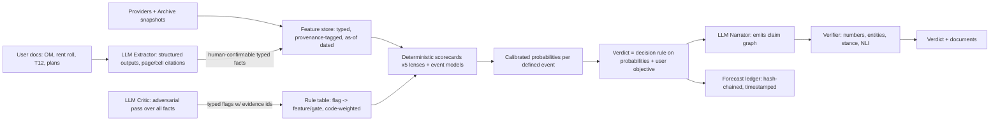

# Panel 6.5: AI Systems Expert

Role: research and applied roles at frontier labs; built production agentic systems for finance and law. Scope: agent architecture, prompts, structured outputs, grounding, determinism, failure modes, calibration, evals, frontier capabilities, the document chatbot.

Method: read every file in `lib/agents/` in full, `lib/testing/cassette.ts`, `scripts/lib/decision-surface.ts`, `scripts/test-grounding.ts`, the raw completions inside `scripts/fixtures/nyc-175-3rd-st.json`, `lib/archive/outcomes.ts`, `supabase/migration-011-verdict-outcomes.sql`, `supabase/migration-021-verdict-method-era.sql`, `supabase/schema.sql`, `lib/supabase/verdicts.ts`, `src/app/api/agents/stream/route.ts`, `src/app/api/narrative/route.ts`, the LLM call sites in `lib/documents/`, and `lib/koano-guard.ts`. Ran offline only: `npx tsx scripts/test-fixture.ts` (passes, byte-identical) and a scratch probe of `groundObservation` (results below). No Anthropic API calls were made. Model facts come from Anthropic's current docs (Sources).

---

## 0. The verdict in one paragraph

The five-agent design is partly theater. Each "agent" is a single call with no tools, given 5 to 45 pre-fetched numbers from a fixed slice of providers, asked for a categorical vote plus three coarse bands. No agent sees another agent's evidence, so cross-domain facts that change the answer never meet (worked example in section 1.3). The "deterministic synthesis" is real arithmetic, but its inputs are LLM judgments. I traced it: the LLM sets 100% of each agent's vote direction, about 93% of the published risk score, 100% of the signal window, and most of the variance in the published confidence. The code decides how the votes are combined. It does not decide the votes. Meanwhile the one fully deterministic decision function in the repo, the site-screening scorecard in `lib/documents/builders/site-screening.ts:205`, sits unused by the main verdict. The determinism strategy also has an expiry date: `claude-sonnet-4-6` is the last Sonnet that accepts `temperature`. Every Claude 4.7-and-later model returns HTTP 400 on a non-default temperature, and Sonnet 4.6 can be retired from 17 February 2027. The architecture that wins inverts the current one. Deterministic, versioned, backtestable scorecards produce calibrated probabilities for defined, observable events. LLMs extract typed facts with citations (from offering memoranda, filings, imagery), act as adversarial critics that raise typed flags, and narrate under claim-level verification. A public, hash-chained forecast ledger turns that into a track record no competitor can copy backward.

---

## 1. Is five agents theater? The evidence

### 1.1 What each agent actually receives and returns

| Agent | Providers (pre-fetched by code) | Data points in prompt | LLM returns |
|---|---|---|---|
| market-timing | FHFA HPI, ACS, DOF sales (4 comps), PMMS, HUD FMR, Census BPS | ~25 | verdict, conviction, risk_band, window_band, prose |
| infrastructure | DOB permits only | 5 + up to 8 permit strings | same |
| demand-sentiment | ACS, HMDA, QCEW, IRS SOI | ~16 | same |
| risk-volatility | crime, FEMA flood, EPA, USGS, OpenFEMA, NOAA, HPD/ECB/DOB, NRI | ~45 | same |
| regulatory-policy | MapPLUTO, OZ, HPD registrations, HUD QCT/DDA | ~27 | same |

Sources: `lib/agents/{market-timing,infrastructure,demand-sentiment,risk-volatility,regulatory-policy}.ts`. None of the agents can call a tool, ask for more data, see another agent's facts, or iterate. "Agent" here means "prompt partition." That is a legitimate design (a mixture of prompted judges), but it is not agentic. The marketing language ("five specialist AI agents") claims more than the code does.

### 1.2 What the LLM contributes to each published number (traced)

Pipeline: `callAgentLLM` (`lib/agents/shared.ts:170`) → bands mapped to figures (`shared.ts:147-149`: conviction low/medium/high → 58/72/86; risk low/moderate/high → 25/50/80; window short/medium/long → 3/12/24) → `assembleAgentVerdict` → `aggregate` (`lib/agents/synthesis.ts:92`).

**Verdict.** `agentScore = Σ(conf_i × DIRECTION[verdict_i]) / Σ conf_i` (`synthesis.ts:93-102`, DIRECTION in `breakdown.ts:11`), then `+ structural nudge` (`direction.ts:47`), then thresholds (`breakdown.ts:30`). Every `verdict_i` is the LLM's categorical call. Code only demotes a low-conviction buy or sell to hold or wait (`shared.ts:157`). The confidence weights barely differ: on the recorded run they span 74 to 82 (fixture `expected.breakdown.agents`), so the "confidence-weighted" vote is within about 5% of an equal-weight vote. Per agent, `confidence = 0.65 × deterministic + 0.35 × band` (`confidence.ts:16,42`). The "deterministic" part takes its agreement term from `minoritySignalCount` (`confidence.ts:33`, `shared.ts:351`), which is an LLM output. So an agent that honestly lists counter-evidence gets down-weighted, and one that lists none gets up-weighted. That is a perverse incentive built into the math.

**The structural nudge is the strongest single voter.** With near-equal weights, one agent moving hold→buy shifts the score by about 0.4. The nudge for `unused_far_pct >= 80` is +1.0 (`direction.ts:62-65`), worth about 2.5 agents. On the reference address it decided the verdict: the agents' score was 0.23 (HOLD, with three hold, one buy, one wait), and the nudge took it to 1.23 (BUY) (fixture `expected.breakdown`). I support that in principle, since it is a deterministic fact deciding. But it ignores everything `entitlement.ts` knows. `deterministicEntitlementRisk` adds +22 risk for a special district (`entitlement.ts:61-64`), while `structuralDirection` ignores special districts entirely. Two deterministic modules in the same engine disagree about the same fact.

**Confidence.** `20 + 55 × agreementFrac + 0.2 × weightedAvgConf`, capped (`synthesis.ts:126`). `agreementFrac` is the weight share of agents matching the agents' modal verdict (all LLM). On the fixture: 20 + 55 × 0.598 + 0.2 × 78.3 = 68.6 → 69. I reproduced this exactly. Note what the 69 measures: three of five agents agreeing on **HOLD**. It is then printed next to a **BUY** verdict. Confidence is therefore not a probability that the published verdict is right. It cannot be calibrated as-is (section 4).

**Risk.** `0.5 × rv.risk + 0.5 × mean(all five risks)` (`synthesis.ts:129-131`). Risk-volatility's risk is a pure band (25/50/80). Regulatory's risk is `0.7 × entitlement + 0.3 × band` (`regulatory-policy.ts:146-149`). The other three are pure bands. The deterministic share of the published risk score is 0.1 × 0.7 = **7%**, and the LLM share is **93%**. On the fixture, four of five risk bands are "moderate" = 50 and the published risk is 51. In plain terms, the risk score says "the model said moderate." The five risks are also different quantities (timing risk, demand risk, execution risk, entitlement risk, hazard risk), averaged as if they were the same thing.

**Window.** The median of five LLM window bands (`synthesis.ts:134-135`): **100% LLM.** This matters more than it looks, because the window becomes the calibration horizon (`outcomes.ts:49`). The model therefore picks the yardstick its own forecast is graded on.

**Conclusion.** The claim in the brief and in CLAUDE.md line 139 ("Verdict, confidence, risk and window are computed by pure deterministic code... The LLM is narrator only") is false as stated. The aggregation is deterministic and the inputs are not. Under the locked decision ("LLMs ... do not secretly decide the verdict"), the current engine falls short at the specialist layer. It does not hide this, since the breakdown is shown in `VerdictMathPanel`, but it does not admit it either.

### 1.3 Worked example: the decomposition loses the most important fact

From the raw completions in `scripts/fixtures/nyc-175-3rd-st.json`:

- The infrastructure agent saw a Foundation permit (2026-03-04) and construction-fence permits on the subject BBL and voted BUY at high conviction: "physical construction has begun at the site itself."
- The regulatory agent saw special district G and 97% unused FAR. It never saw the Foundation permit, and voted WAIT.
- The structural nudge read 97% unused FAR from MapPLUTO and pushed the verdict to BUY.
- The narrator then wrote: "Ground-up construction already underway on a parcel with 97% unused residential FAR ... makes this a development-driven buy."

If construction is underway, the unused-FAR figure is stale (PLUTO lags the permit record), and the parcel is being built by its current owner. "Buy" for whom? No single agent had both facts, so none could say "the headroom is being consumed right now." One model reading all ~110 facts would very likely have flagged this. The decomposition did not just add cost here. It removed a cross-domain inference that matters for the decision.

### 1.4 What the LLM adds that code could not

To be fair, there are real contributions:
1. Reading qualitative context in data values (scope notes, coverage caveats, "hpd_registered=false is a coverage fact"). The prompts encode this well.
2. Proposing interactions ("outside SFHA but county has frequent flood declarations" in `risk-volatility.ts:23`). This rule could be written as code in an afternoon.
3. Prose.

Items 1 and 2 are domain rules written in English inside prompts, executed by a stochastic interpreter that regresses to "hold." CLAUDE.md line 277 records 14 of 15 sites returning hold. Every rule in these prompts can be turned into a deterministic feature. The fact that the team kept adding deterministic overrides (entitlement, confidence, direction) is the codebase admitting this one module at a time.

**Answer:** as a decision engine, the five-agent design is mostly theater. As a UI and narrative device (five lenses on a property), it has value and should be kept. Each lens should become a deterministic scorecard plus LLM explanation.

---

## 2. Prompts, structured output, grounding, determinism, failure modes

### 2.1 Prompt quality: EXISTS, above average

The specialist prompts are the strongest part of the AI layer. They are domain-literate, they encode lag discipline (BPS, HMDA, IRS are flagged as lagged in `market-timing.ts:22`), they say "absence is neutral" for OZ and QCT, they forbid expanding codes (`shared.ts:129`), and they use coarse bands rather than fake precision (`shared.ts:121`). Weaknesses:
- `RESPONSE_FORMAT_INSTRUCTIONS` (~2,800 chars) is repeated in all six calls and competes with the domain prompt for attention.
- The verdict semantics are undefined at the top level. "Buy" means a different thing per agent (`risk-volatility.ts:31` "risk-adjusted entry attractive", `infrastructure.ts:18` "pipeline lifting the area"), and nowhere does the prompt state whose decision it is (acquirer, owner, lender) or over what objective. You cannot calibrate a verdict whose meaning varies by agent.
- The demand agent is asked to "estimate the gentrification stage on a 1-7 scale" (`demand-sentiment.ts:24`). That is an uncalibrated, unsourced, sensitive label, and it ends up in client-facing reasoning ("stage 6-7 of 7" in the fixture).
- The completions contain unsourced arithmetic and reasoning errors that the gate cannot see. One is "$9,100/month in principal and interest" (market-timing first draft). Another compares the comps median $/sqft against a tract median home *value* "on a per-sqft basis for 1,400 to 2,100 sqft" stock, an invented conversion. Both appear in the fixture.

### 2.2 Structured output: PARTIAL, regex extraction on a model that supports constrained decoding

`extractJson` takes the substring from the first `{` to the last `}` and calls `JSON.parse` (`shared.ts:134-141`). There is no schema validation beyond verdict membership and non-empty reasoning (`shared.ts:229-234`). Unknown bands silently default to "medium" or "moderate" (`shared.ts:246-248`). That default is itself a hidden decision: a malformed conviction becomes 72. Anthropic structured outputs (`output_config.format` with `json_schema`, constrained decoding) are GA on `claude-sonnet-4-6` and every newer model. That guarantees schema-valid JSON with enum fields, except on refusal or max_tokens. Adopting it removes the parse-failure class and the silent defaults. Effort S.

### 2.3 The grounding gate: PARTIAL, and narrower than documented

`lib/agents/grounding.ts` is an honest piece of engineering, and its header (lines 13-34) names its own blind spots. What it checks: capitalized proper-noun runs, all-caps acronyms, and 4-digit years must have every token in an allowlist made of data-point labels, values, sources, the address, and ~900 common words. What I demonstrated offline with the real function (scratch probe, no API):

| Input observation | Gate result |
|---|---|
| "the site sits within the gowanus special district, which mandates inclusionary housing adopted in 2021." | Caught only "2021". Lowercase "gowanus", "inclusionary" pass. |
| "Special district G requires 25% affordable units under mandatory inclusionary housing." | **Passes.** Fabricated rule, fabricated number. |
| "Prices will rise 40% over the next two years; this is a guaranteed buy." | **Passes.** |
| "Residential development rights exist as-of-right within the R7-2 envelope, so no variance is required." | **Passes.** Unsourced legal conclusion. The narrator wrote almost exactly this in the fixture. |
| "This is the Gowanus Superfund site." with a datum `registered_owner = "GOWANUS SUPERFUND HOLDINGS LLC"` present | **Passes.** Any data string poisons the allowlist. |

Other gate issues:
- **False positives drive cost.** On the recorded run, 2 of 5 specialists were re-prompted for "Individual", "Dec", "Oct", "LTV", "Critically" (visible when running `scripts/test-fixture.ts`). That is a 40% retry rate on ordinary English, with each retry being a full second call.
- **Laundering.** The narrator's allowlist is built from the agents' headlines and observations (`synthesis.ts:185-205`). Anything that slipped past an agent's gate becomes allowed vocabulary downstream. `briefing.ts` does the same with stored verdict headlines, including pre-gate historical ones.
- **Coverage is far from total.** `narrative.ts` (the broker-facing neighborhood narrative) has no gate. The IC memo exec summary (`ic-memo.ts:246`), site-screening reasoning (`site-screening.ts:319`), property-intelligence trajectory (`property-intelligence.ts:244`), tax-appeal argument (`tax-appeal.ts:124`) and comparison reasoning all call the model directly and ship raw text into PDFs with no gate. Only CMA-type documents go through `runGroundedNarrative` (`src/app/api/documents/route.ts:480-528`). The comment in `briefing.ts:15` ("the last model call in the product behind the grounding gate") is wrong. The most expensive document in the product, the IC memo, is ungated.
- `KOANO_CV_AUDIT.md` lines 292 and 301 claim "every figure traced to a source." No code verifies figures.

### 2.4 The contradiction guard: PARTIAL, it only logs

`synthesis.ts:238-242`: if the narrator's verdict differs from the computed one, it calls `console.warn` and nothing else. The narrator's headline and arbitration prose (which may argue for the other verdict) still ship as `headline` and reasoning steps. Verdict words ("buy", "sell", "hold") are in `COMMON_VOCAB` (`grounding.ts:75`), so a headline stating the wrong action passes grounding. Because the narrator goes through `callAgentLLM`, it also gets `tieBreakVerdict`: a narrator "buy" at low conviction becomes "hold", and the guard fires spuriously. A real guard needs three parts: (a) never ask the narrator for a verdict (inject it), (b) classify the stance of the headline and each sentence with a cheap model or rules, and (c) on contradiction, regenerate once, then fall back to a template headline.

### 2.5 Temperature and determinism: PARTIAL, and expiring

- Specialists run at temp 0 (`shared.ts:180`). Temp 0 on Claude is not bitwise deterministic. CLAUDE.md line 346 admits band wobble across live runs ("confidence 67 vs 68"). Also, CLAUDE.md cites 67 while the fixture asserts 69.
- The narrator runs at 0.4. `narrative.ts`, `briefing.ts`, and every document builder set no temperature, so they run at the API default of 1.0. That contradicts the comment at `shared.ts:175-177` ("Temperature is EXPLICIT, never the API default").
- **The fixture proves code regression, not reproducibility.** `viaCassette` freezes raw completions (`cassette.ts:9-15`), so replay checks only that deterministic code is stable on fixed text. That is valuable, but it says nothing about whether the same address gives the same verdict tomorrow. One address, one recording.
- **Expiry.** Per Anthropic's deprecation page, `temperature`/`top_p`/`top_k` return a 400 on Claude 4.7 and later. `claude-sonnet-4-6` is "Active, not sooner than February 17, 2027." The whole reproducibility promise depends on a legacy model. Migrating to Sonnet 5.5 (cheaper at $2/$10 vs $3/$15) breaks the determinism story unless the LLM leaves the decision path. That is the architectural argument and the cost argument pointing the same way.

### 2.6 Model choice and prompt caching

- `KOANO_RUNTIME_MODEL = 'claude-sonnet-4-6'` (`shared.ts:16`) is now a legacy model. Current models are Sonnet 5.5 ($2/$10), Haiku 5.5 (from $0.10/$0.50), Opus 5.5 ($4/$20), and Fable 5.1 ($10/$50). Model ID is not persisted with the verdict (`lib/supabase/verdicts.ts:23-44` stores `method` and `inputs_era`, but not model, prompt hash, or git SHA). A calibration record that cannot tell which model produced a forecast is not auditable.
- **Caching mostly does nothing.** Sonnet 4.6's minimum cacheable prefix is 1,024 tokens, and below it caching is "processed without caching, and no error is returned." Measured prompt sizes in characters (system plus format): risk 6,730, market 6,040, regulatory 5,522, demand 4,890, synthesis 5,149, infrastructure 4,426 (≈1,100 tokens, borderline). `narrative.ts` (1,048 chars) and `briefing.ts` (1,585) fall below the minimum, so their `cache_control` is a no-op. Where caching does apply, the five agents have different prompts and run in parallel, so they never share a prefix. The global breaker is 50 runs per day (`koano-guard.ts`), so hits within the 5-minute TTL are rare. Each run therefore pays the 1.25× write premium on the system prefix without reading it back. The large part of each request (the data payload) is never cached anyway. Net effect: caching slightly *raises* cost today.

### 2.7 Failure modes

| Failure | Current behavior | Evidence |
|---|---|---|
| Any one agent throws (parse error, invalid verdict, 429/529, max_tokens truncation at 2,000) | `Promise.all` rejects and the whole verdict fails. The user's quota slot is consumed ("Attempts that pass the guard count even if the pipeline later fails"). | `synthesis.ts:387-393`, `koano-guard.ts` header |
| Narrator returns `"Buy"` (capitalized) | `validVerdicts.includes` is case-sensitive, so it throws and the entire verdict is lost because of the prose step | `shared.ts:229` |
| Non-NYC or degraded verdict persisted | `verdicts.overall_provenance` has `check (overall_provenance in ('live','representative'))`, but the engine now emits `partner`, `fetch_failed`, `coverage_absent`. No migration alters the constraint. Insert fails and `persist_error` is returned. | `supabase/schema.sql:118`, `CLAUDE.md:219-235`, `lib/supabase/verdicts.ts:45` |
| Prompt injection via data | Owner names, management company, comp addresses, permit addresses, EPA site names, and provider scope notes go verbatim into the prompt and into the grounding allowlist. HPD registration names are self-filed by owners. | `regulatory-policy.ts:118-120`, `market-timing.ts:75-81`, `infrastructure.ts:38-44` |
| Outcome scanner partial failure | `catch { continue; }` swallows every error silently | `outcomes.ts:87-90` |
| Outcome scanner scale | `.select()` with no range returns the PostgREST default cap (typically 1,000 rows); 7 sequential queries per verdict | `outcomes.ts:40-44` |

The persistence constraint deserves emphasis. Unless production was altered by hand (unverified), every non-NYC verdict and every verdict with a failed fetch is missing from the immutable audit trail and from the calibration record. That is survivorship bias built into the data model. Only the cleanest NYC runs survive to be graded.

### 2.8 Cost per verdict and metering exposure (estimate)

Estimate from prompt sizes, data-point counts and the eight recorded completions (~3.7k chars each). Per verdict: about 6 calls × (≈1.4k system + ≈2k data) plus ~2 grounding retries ≈ 29k input tokens, and ≈7k output tokens. On Sonnet 4.6 that is about $0.09 + $0.11 ≈ **$0.20 per verdict** (±50%). Plan limits in `koano-guard.ts` are per rolling 24h: Portfolio 500, Development 150, Transaction 50, Community 20. Worst case per month: Portfolio 500 × 30 × $0.20 = **$3,000 against $1,499 revenue**, Development $900 vs $499, Transaction $300 vs $149, Community $120 vs $19. Only the global 50-runs-per-day breaker prevents this, and that breaker also caps the whole company at 50 verdicts a day. Moving the decision to code removes most of this cost (section 3).

---

## 3. The architecture that wins

Principle: **the LLM never produces a number or category that enters the decision.** It produces typed, cited facts (extraction), typed flags with evidence pointers (critique), and verified prose (narration). Code produces probabilities. Locked decisions are respected: decision math deterministic, provenance first.

1. **Feature store (deterministic).** Every provider value becomes a typed feature with `as_of`, `source`, `provenance`, `snapshot_hash`. The archive supplies point-in-time values for backtests. Example derived features: FAR headroom, headroom *net of active NB/foundation permits* (fixes 1.3), violation trajectory, sales velocity, HPI momentum, flood exposure, contamination distance.
2. **Five lens scorecards (deterministic).** Port each specialist prompt's "How to reason" bullets into explicit, unit-tested rules with signed, bounded weights. `site-screening.ts:205` `computeVerdict` is the template and it already exists. Keep the five lenses in the UI, because users like the decomposition and that is the honest version of it.
3. **Event models → probabilities.** Define the events (section 4.1). Start with transparent logistic or monotone GAM models on the lens features. Fit on point-in-time history from public datasets that predate the archive (DOF annualized sales, archived PLUTO versions, DOB permit issuance dates). Calibrate with isotonic regression on out-of-time folds. These are deterministic at inference, version-pinned and backtestable. An LLM cannot be backtested honestly, because its pretraining already contains the outcomes (it "knows" Gowanus was rezoned in 2021 and what happened next).
4. **Verdict = decision rule.** For example, an acquirer BUY means P(submarket 12-mo repeat-sales change > 0) ≥ τ and P(entitlement block) ≤ κ and no hard-gate flags. Thresholds are published. The confidence shown *is* the probability.
5. **LLM Critic (proposes, does not decide).** One strong call (Sonnet 5.5, or Opus 5.5 for IC-memo tier) over *all* facts, prompted adversarially: "What fact here would make a buy wrong? Output only flags from this enum, each with the datapoint ids that support it." Enum examples: `ACTIVE_CONSTRUCTION_ON_SUBJECT`, `STALE_FAR_VS_PERMITS`, `CONTAMINATION_ADJACENT`, `OWNER_PORTFOLIO_DISTRESS`. Code verifies the cited ids exist and the rule's predicate holds, then applies the flag's code-defined effect. This is how the cross-domain inference in 1.3 gets caught without letting the model vote.
6. **Narrator with a claim graph.** Use structured outputs to emit `[{sentence, claims:[{type: number|entity|comparison|causal, datapoint_ids, value}]}]`. The verifier checks that every number equals a cited value or a whitelisted derivation (ratio, difference, percent) within tolerance, that every entity token is in the cited values, and that sentence stance matches the verdict (Haiku 5.5 classifier). Unverifiable sentences are withheld visibly, which keeps the existing honesty rule. This closes the four gaps that `grounding.ts:21-28` documents.
7. **Untrusted-data hygiene.** Wrap all provider strings in a delimited `<untrusted_data>` block, tell the model to treat them as data, strip control phrases, and stop adding data strings to the narrator's allowlist (use datapoint ids instead). The decision path no longer touches the LLM, so injection can at worst garble prose, which the verifier then catches.
8. **Model portfolio.** Sonnet 5.5 for critic and narrator, Haiku 5.5 for stance and NLI checks and routing, Opus 5.5 for long OM extraction. No temperature dependence anywhere. Persist `model_id`, `prompt_sha`, `code_sha`, `feature_snapshot_hash` on every verdict.

Cost after the inversion: scorecards cost nothing. Critic plus narrator plus checks is about 2 calls ≈ 12k input and 2.5k output on Sonnet 5.5 ≈ $0.05, roughly 4× cheaper than today. A deterministic-only "quick verdict" (no prose) is free, which makes the shadow panel in 4.4 affordable.

---

## 4. Calibration: a statistically sound, publishable record

### 4.1 Make verdicts forecast something observable

The current `verdict_outcomes` design (`migration-011`, `outcomes.ts`) records events but never scores them against the forecast. `direction` on a sale is always 0 (`outcomes.ts:57`). A permit-count increase is "+1 favorable" for every verdict (`outcomes.ts:84`). Violation bounds use the earliest and latest snapshot for the BBL regardless of the verdict date (`outcomes.ts:26-31,61-65`), which mixes pre-verdict history and post-window data into "the outcome." The horizon is the LLM's window band. Fix: each verdict type emits probabilities for fixed, pre-registered events.

| Audience / verdict | Event (binary unless noted) | Horizon | Public source |
|---|---|---|---|
| Transaction / Portfolio BUY-HOLD-WAIT-SELL | Submarket (ZIP or tract) repeat-sales $/sf index change > 0; secondary: > metro HPI change | 12 mo (fixed) | DOF rolling and annualized sales, FHFA HPI vintage-pinned |
| Same | Subject sells within horizon (secondary; conditional price vs predicted band if it sells) | 12 / 24 mo | DOF, ACRIS deeds (Open Data) |
| Development ADVANCE/HOLD/PASS | NB or ALT-1 filing on subject or assemblage within 24 mo; secondary: approved | 24 mo | DOB NOW / BIS filings |
| Development | Discretionary action (BSA variance, ULURP) required: yes/no | 36 mo | ZAP / BSA records |
| Community | Open HPD class B+C violations higher at horizon than at verdict date | 12 mo | HPD (archive) |
| Tax appeal | Assessment reduced on appeal (where packet used) | next roll | DOF assessment rolls |
| Risk score | Continuous: realized adverse events count (new class C, ECB, flood claim proxies) | 12 mo | HPD, ECB, OpenFEMA |

Rules: the horizon is fixed per event and never chosen by a model. Outcome windows start at the verdict timestamp. Pre-verdict state is taken from the snapshot at or before `created_at`.

### 4.2 Metrics

- **Brier score** per event, plus **Brier skill score** against two baselines: climatology (the base rate in the same borough and quarter) and a naive momentum model (last-12-month index direction). Report the Murphy decomposition (reliability, resolution, uncertainty). Resolution is the headline, because it shows KOANO separates outcomes rather than merely being well-calibrated on the base rate.
- **Log loss**, with probabilities clipped to [0.02, 0.98] and the clip disclosed.
- **Reliability diagrams**: 10 equal-count bins, Wilson 95% intervals per bin, and ECE with a bootstrap CI. Separate panels by borough, `inputs_era`, `method`, `model_id`, and provenance rollup. A coverage_absent verdict must never be pooled with a fully live one.
- **Discrimination**: AUC with DeLong CI.
- **Continuous outcomes** (risk score, price): CRPS against a predictive distribution, or interval coverage for published bands.
- **Clustering**: forecasts in the same tract and month are correlated. All CIs use block bootstrap over (tract × month) clusters. Report effective n, not raw n.

### 4.3 Sample size and publication thresholds

- Per reliability bin at p≈0.5, a ±5pp 95% half-width needs n≈384. Ten bins means ~4,000 resolved forecasts per event for a fine-grained diagram. Five bins means ~2,000.
- A headline Brier skill claim: with per-forecast paired Brier-difference SD ≈ 0.10 and a design effect ≈ 2 from clustering, detecting a 0.02 improvement at 95% needs about (1.96 × 0.10 / 0.02)² × 2 ≈ 190 resolved forecasts. Detecting 0.01 needs about 770.
- **Publication gate (proposal):** at least 500 resolved forecasts per event, at least 50 distinct tracts, at least 4 monthly entry cohorts, and pre-registered resolution rules frozen before any of those forecasts resolve. With 12-month horizons and the engine as it stands today, the earliest honest publication is roughly Q4 2027. The shadow panel below is what makes the counts reachable.

### 4.4 Backtesting against the archive, without fooling yourself

- **The archive started August 2026.** Archive-era out-of-sample evaluation cannot start resolving until about August 2027 for 12-month events. Anything earlier must use reconstructable public history: DOF annualized sales back to 2003, archived MapPLUTO releases, DOB issuance dates, HPD violation dates, ACS and HPI *vintages*.
- **Look-ahead bias.** (a) Revised data: HPI and ACS get revised, so use the vintage available at the as-of date. Permit and violation records get edited, so use the archive snapshot where one exists and flag reconstructed rows. (b) LLM leakage: any model with a June 2026 knowledge cutoff has seen the outcomes of 2019-2025. **Never include an LLM judgment in a historical backtest.** Only the deterministic scorecards can be backtested. This is the cleanest argument for section 3.
- **Survivorship and selection.** (a) The persistence constraint (2.7) drops non-live verdicts. Fix it first. (b) Users pick addresses, which is not a random sample. Fix it with a **shadow panel**: each month, score a stratified random sample of about 2,000 NYC BBLs (by borough, land use and building class) with the deterministic engine, at near-zero cost, and log those forecasts to the same ledger. The panel gives unbiased calibration. User verdicts become a second, labeled population. (c) Sale outcomes exist only for parcels that sell, so use area-level events for primary scoring and parcel sale price only conditionally.
- **Era discipline.** `inputs_era` (`breakdown.ts:25`) is a good idea. Extend it to `method + model_id + prompt_sha + code_sha` and never pool across eras without stating so.

### 4.5 Publication format

A public "Track Record" page and a quarterly PDF. Contents: per-event reliability diagram, Brier and BSS against both baselines with CIs, AUC, n and effective n, base rates, inclusion and exclusion counts (with reasons), the era breakdown, and pre-registration links. The underlying ledger is downloadable: forecast id, timestamp, event, probability, horizon, outcome, and resolution source. Each day's forecasts are hashed into a Merkle root that is publicly timestamped (for example a signed commit to a public repo, or an RFC 3161 timestamp), so nobody, KOANO included, can edit history. This is the asset an acquirer pays for.

---

## 5. Eval suite for "beats human analysts by X"

Preregister everything (hypotheses, metrics, sample, analysis) before collecting analyst responses.

**Tasks**
1. *Directional submarket call* (12-mo index direction, probability output). Ground truth: realized repeat-sales index.
2. *Site triage* (rank 3 to 5 candidate sites). Ground truth: which received NB/ALT-1 filings within 24 months (historical, reconstructed as-of). Metric: NDCG@1, Kendall τ.
3. *Risk-flag recall* (find all material issues: SFHA, class C violations, Speculation Watch, contamination ≤0.25 mi, over-max FAR, active construction, ownership portfolio distress). Ground truth: expert-adjudicated checklist from public records, built by two licensed reviewers with a third resolving disagreements. Metric: recall, precision, F1.
4. *Fact extraction from documents* (OM, rent roll): unit count, NOI, zoning claims. Ground truth: double-keyed gold labels. Metric: field-level exact and tolerance accuracy.
5. *Claim faithfulness* of generated memos. Metric: unsupported claims per 100 claims, judged by blinded annotators against the cited facts.
6. *Time and cost to answer.*

**Arms**: (A) KOANO alone, (B) analysts alone, (C) analysts with KOANO (the commercially real claim), (D) a single frontier model with all facts and no scorecards (the honest ablation of the five-agent and scorecard design).

**Analyst baseline**: at least 12 analysts (acquisitions associates or VPs, 3 to 10 years, NYC), paid, time-boxed to match a realistic workflow (for example 45 minutes per site), given the same data packet with KOANO branding removed, blinded to outcomes. Use historical cases where outcomes are known but the analyst cannot easily look them up (strip addresses where possible, or use as-of cases older than recall), plus a prospective cohort scored after resolution. Report analyst-to-analyst agreement.

**Statistics**: paired comparison on identical cases, cluster bootstrap CIs, Holm correction across tasks. A claim is publishable only in the form: "On 400 preregistered NYC site-triage cases, KOANO's top pick received a new-building filing within 24 months 41% of the time vs 29% for analysts (difference 12pp, 95% CI 6 to 18)." The numbers in that sentence are illustrative, not results. Never make the claim from arm A vs B on prose quality.

---

## 6. Frontier capabilities

| Capability | State | Design | Provenance handling |
|---|---|---|---|
| Long-context OM reading | MISSING | Opus 5.5 or Sonnet 5.5 at 1M context: ingest the whole OM, rent roll, T12. Structured outputs into a typed `DealPacket`. Then a **reconciliation pass**: each OM claim checked against public record ("OM: R7A as-of-right 400k sf; MapPLUTO: M1-4/R7-2, special district G"). Flags only; decisions in code. | New provenance state needed for user-supplied documents, for example `user_document`, citing page and cell. Never shown as `live`. |
| Vision: floor plans | MISSING | Extract unit count, unit mix, and approximate areas. Cross-check against the Certificate of Occupancy and PLUTO units. | Extracted, labeled "model-read from plan p.X", user-confirmable |
| Vision: street and aerial imagery | VISION (imagery licensing; Street View terms for ML use unverified) | Facade condition, sidewalk shed presence (cross-check DOB shed permits), vacancy signals, lot occupancy | `partner` once licensed |
| Computer use on city portals | PARTIAL need | ACRIS master, legals and parties are already on NYC Open Data, so use APIs first. Computer use only for document images (mortgage PDFs, BSA calendars, legacy BIS pages), run in a sandbox with rate limits and terms review. | Snapshot the page into the archive and cite the snapshot |
| LOI drafting | MISSING | Template plus LLM fill from user-entered terms and KOANO facts. Human sign-off required. No autonomous negotiation (counterparty-facing liability). | Every factual clause cites a fact id |
| Policy simulation | VISION (zoning text parsing) | Deterministic zoning engine: alternative district or text amendment → recompute FAR, use groups, headroom across all lots. The LLM translates proposed text amendments into rule deltas for a human to verify. Output: "if City of Yes provision X applies, these 1,200 lots gain >50% headroom." | Labeled scenario, never forecast |
| Retrieval over archive | MISSING | Typed tools (`get_series(bbl, dataset, from, to)`, `diff(bbl, t1, t2)`) for an agent, not free SQL. "What changed on this block since August?" answers cite snapshot ids. | Inherits snapshot provenance |

The genuinely agentic use of the model is here: tool-using research over the archive and documents, producing typed facts. That is where multi-step agents beat code. The current "agents" sit in the one place where code beats them.

---

## 7. Document chatbot: upload, ask, generate

**Flow**
1. *Upload*: PDF, XLSX, DOCX, images; max 400 pages per file. Virus scan, then text-layer extraction, page rasterization only where the text layer is poor. Classify the document type with Haiku 5.5.
2. *Ingest once*: structured extraction into typed schemas (OM, rent roll, T12, lease abstract, plan), with page and cell citations. Use the Batch API (50% off) when the user is not waiting. Store chunks and embeddings plus the typed facts. Run reconciliation against KOANO facts.
3. *Ask*: router (Haiku 5.5). Typed-fact lookups are answered from the DB with no LLM. Analytical questions go to Sonnet 5.5 with retrieved chunks (top ~15k tokens) or the full doc via 1-hour cache when the thread is long. Answers use claim-graph output with the same verifier as section 3. Uncited claims are withheld.
4. *Generate*: LOI draft, IC memo section, variance report, "questions to ask the broker." These are templates whose facts come only from typed facts and documents.

**Token math (Sonnet 5.5: $2 in, $10 out, 1h cache write $4, cache read $0.10 per MTok; Haiku 5.5 from $0.10/$0.50; newer tokenizer ≈ +30% tokens vs Sonnet 4.6, included)**
- Ingest a 60-page OM: about 1,600 tokens per page ≈ 100k input → $0.20. Extraction output ≈ 8k → $0.08. Reconciliation ≈ 20k in and 2k out → $0.06. **≈ $0.35** (≈ $0.18 batched). A 300-page data room ≈ $1.50.
- Ask (RAG): about 15k context + 1k question in, 1k out → $0.032 + $0.010 ≈ **$0.04**. Verifier on Haiku ≈ $0.002. Full-doc cached thread: one 1-hour write of 100k = $0.40, then per question 100k × $0.10/M = $0.01 + output $0.01 ≈ $0.02. Use the cache once a thread passes about 12 questions per hour.
- Router-only answers (about 40 to 60% of questions in comparable products, an assumption to measure): ≈ $0.001.
- Generate (LOI or memo section): about 25k in, 4k out ≈ **$0.09**.

**Metering (credits; 1 credit ≈ $0.01 of COGS; target AI COGS ≤ 15% of price)**

| Tier | Price | Doc ingests / mo (page cap each) | Questions / mo | Generations / mo | Worst-case COGS |
|---|---|---|---|---|---|
| Free | 0 | 1 (30 pp) | 5 | 0 | ≈ $0.40 lifetime |
| Community | $19 | 2 (60 pp) | 30 | 3 | ≈ $2.20 |
| Transaction | $149 | 15 (120 pp) | 250 | 30 | ≈ $21 |
| Development | $499 | 50 (300 pp) | 800 | 60 | ≈ $73 |
| Portfolio | $1,499 | 200 (400 pp) | 2,500 | 200 | ≈ $225 |

Hard per-request limits: max_tokens 4k for answers and 8k for generations. Conversation memory is summarized past 30k tokens. A pre-call reservation equals the estimated maximum cost, settled to actual `usage` from the response (extend `guardSpend` from counting runs to a token ledger, `koano-guard.ts`). A per-org daily breaker sits at 3× the average daily allotment. Overage is sold as credit packs. Ingests are cached by file hash, so re-uploading costs nothing. The same ledger should meter verdicts. Today's per-24h verdict allowances can cost more than the subscription price (2.8).

---

## 8. Top 10 problems (ranked by enterprise-value impact)

| # | Problem | State | Evidence | Effort | Impact |
|---|---|---|---|---|---|
| 1 | "Deterministic verdict" is LLM votes aggregated by code. The LLM sets all vote directions, ~93% of risk, 100% of window, most confidence variance. Confidence measures agent agreement on the modal verdict, not the published one (69 = hold agreement printed beside BUY). | PARTIAL | `shared.ts:147-163,246-249`, `synthesis.ts:92-135`, fixture breakdown | L | 10 |
| 2 | Determinism relies on `temperature`, which every Claude 4.7+ model rejects. Sonnet 4.6 retirement can come from 17 Feb 2027. Fixture proves code stability, not reproducibility. | PARTIAL | `shared.ts:16,180`; Anthropic deprecations page | L (fixed by #1's rebuild) | 9 |
| 3 | Calibration record cannot calibrate: outcomes are never scored against the verdict, the horizon is LLM-chosen, outcome bounds ignore the verdict date, and there is no model/prompt/code version on verdicts. | PARTIAL | `outcomes.ts:26-31,49,57,84`; `verdicts.ts:23-44` | M | 9 |
| 4 | `verdicts.overall_provenance` check allows only live/representative. Non-NYC and degraded verdicts likely fail to persist, creating survivorship bias in the audit trail and track record. | PARTIAL (prod unverified) | `schema.sql:118`; no altering migration | S | 8 |
| 5 | Grounding gate misses lowercase entities, numbers, legal conclusions, and predictions. Data strings poison the allowlist. 40% false-positive retry rate. Narrator launders agent text. | PARTIAL | `grounding.ts:114-143`; probe results 2.3 | M | 8 |
| 6 | IC memo exec summary, screening reasoning, trajectory, tax-appeal argument and neighborhood narrative ship ungated LLM text at temp 1.0 into client documents | PARTIAL | `ic-memo.ts:246`, `site-screening.ts:319`, `property-intelligence.ts:244`, `tax-appeal.ts:124`, `agents/narrative.ts:95` | S | 8 |
| 7 | Per-tier verdict allowances can cost 2× the subscription price; a global 50/day breaker caps the whole business | EXISTS (as a risk) | `koano-guard.ts` PLAN_LIMITS, dailyRunCap | S | 7 |
| 8 | Decomposition hides cross-domain facts (active Foundation permit vs 97% "unused" FAR). The nudge ignores entitlement facts that `entitlement.ts` scores. | PARTIAL | fixture completions; `direction.ts:47-81` vs `entitlement.ts:61` | M | 7 |
| 9 | Contradiction guard only logs. The verdict-word headline is unchecked. Narrator invalid-verdict casing can fail the entire run. Any single agent failure loses the verdict and burns quota. | PARTIAL | `synthesis.ts:238-242`, `shared.ts:229`, `synthesis.ts:387` | S | 6 |
| 10 | Regex JSON extraction, silent band defaults, no schema validation. Prompt caching mostly a no-op or a net cost. Legacy model, no per-call usage logging. | PARTIAL | `shared.ts:134-141,246-248`; prompt sizes 2.6 | S | 5 |

## 9. Top 10 opportunities (ranked)

| # | Opportunity | State | Effort | Impact |
|---|---|---|---|---|
| 1 | Public, hash-chained, timestamped forecast ledger with live reliability diagrams (section 4.5) | MISSING | M | 10 |
| 2 | Invert the engine: deterministic lens scorecards plus calibrated event probabilities. Port `computeVerdict` (site-screening.ts:205) patterns to all five lenses. | PARTIAL (template exists) | L | 10 |
| 3 | Shadow panel: monthly stratified random BBL forecasts at near-zero cost, giving unbiased calibration in 12 months | MISSING | S (after #2) | 9 |
| 4 | OM and data-room reader with public-record reconciliation ("the OM says X, the city says Y") | MISSING | M | 9 |
| 5 | Preregistered analyst-vs-KOANO study, including the centaur arm (section 5) | MISSING | M | 8 |
| 6 | Claim-graph narrator plus verifier across every LLM surface (agents, documents, briefing, chat) | MISSING | M | 8 |
| 7 | LLM critic emitting typed flags (catches the 1.3 class of error without letting the model vote) | MISSING | S | 7 |
| 8 | Document chatbot with a token ledger (section 7) | MISSING | M | 7 |
| 9 | Deterministic zoning engine for policy simulation (City of Yes, rezonings) across all lots | VISION | XL | 7 |
| 10 | Tool-using archive research agent ("what changed on this block"), the genuinely agentic use | MISSING | M | 6 |

## 10. What I would rebuild first

Week 1 (S items, no architecture change): fix the provenance check constraint. Persist `model_id`, `prompt_sha`, `code_sha` per verdict. Switch all calls to structured outputs with enums. Put every document and narrative call behind `runGroundedNarrative` with explicit temperature while still on 4.6. Make the contradiction guard regenerate and fall back to a template. Let one failed agent degrade instead of failing the run. Move metering to a token ledger with per-tier COGS caps.

Weeks 2 to 6: build the feature store and port the five specialist prompts into deterministic lens scorecards (the prompts are already the spec). Define the events of section 4.1, rewrite `outcomes.ts` to resolve them point-in-time against the verdict timestamp, and start the shadow panel. Demote the LLM to critic (typed flags) plus narrator (claim graph plus verifier). Migrate to Sonnet 5.5 and Haiku 5.5, which become safe because nothing in the decision path depends on temperature anymore.

## 11. "I have never seen anything like this"

A real estate engine whose every forecast since day one sits on a public, cryptographically timestamped ledger. Each forecast is an explicit probability on a pre-registered, publicly resolvable event. A live reliability diagram updates itself as the city's own records resolve outcomes, and an unbiased random panel of the whole city is scored alongside customer requests. Every verdict can be opened down to the feature values, the snapshot hashes, and the exact code version that produced it, and re-run bit-for-bit. Nobody in proptech publishes a falsifiable track record. Doing it first, and having the only longitudinal archive that makes it possible, is the moat and the acquisition story in one artifact.

---

## Grounded vs VISION separation

Sections 1, 2, 8 and the problems table are grounded in code and cite files and lines. Section 3 is a MISSING architecture, buildable now. Sections 4 to 7 mix MISSING (buildable now with public data) and VISION items, labeled per row. Cost figures are estimates from prompt sizes and recorded completions, not billing data.

## Sources

- https://platform.claude.com/docs/en/docs/about-claude/models/overview (current model lineup, IDs, pricing summary)
- https://platform.claude.com/docs/en/models/sonnet-5-5/overview (Sonnet 5.5: non-default temperature returns 400; 512-token cache minimum; pricing)
- https://platform.claude.com/docs/en/about-claude/model-deprecations (claude-sonnet-4-6 Active, retirement not sooner than 17 Feb 2027; temperature/top_p/top_k deprecated on Claude 4.7 and later)
- https://platform.claude.com/docs/en/about-claude/pricing (Sonnet 4.6 $3/$15; Sonnet 5.5 $2/$10; Haiku 5.5; cache multipliers; batch 50%; newer tokenizer about 30% more tokens)
- https://platform.claude.com/docs/en/docs/build-with-claude/structured-outputs (output_config.format json_schema, constrained decoding, supported models incl. sonnet-4-6)
- https://platform.claude.com/docs/en/docs/build-with-claude/prompt-caching (1,024-token minimum for Sonnet 4.6; below minimum is processed without caching and no error; 5-min default TTL; write 1.25x, read 0.1x)

## Discrepancies vs the brief (section 3 of the prompt)

1. "Verdict, confidence, risk and window are computed by pure deterministic code. The LLM is narrator only." The aggregation is deterministic, but each specialist's verdict, conviction, risk band and window band are LLM outputs that drive the published figures (section 1.2). Only the synthesis call is narrator-only.
2. "With a contradiction guard." It logs a warning and changes nothing shipped (`synthesis.ts:238-242`).
3. "Five agents run at temperature 0." True for the specialists. The narrator runs at 0.4, and the neighborhood narrative, portfolio briefing and all document-builder calls use the API default 1.0 (no temperature set).
4. "Five provenance states." The `verdicts` (and documents, `migration-006:30`) tables still constrain `overall_provenance` to live/representative (`schema.sql:118`).
5. "A record/replay fixture asserts byte-identical decision output." True on frozen completions for one address. It is a code-regression test, not evidence that live runs reproduce (CLAUDE.md:346 concedes live wobble). CLAUDE.md cites confidence 67 while the fixture asserts 69.
6. "Planned verdict calibration record." Scaffolding exists (`verdict_outcomes`, weekly scanner), but it does not compare outcomes to verdicts, uses an LLM-chosen horizon, and ignores the verdict date when bounding outcomes.
7. The verdict enum includes `drop` (`schema.sql:113`, `shared.ts:26`), but the aggregator can never emit it (`breakdown.ts:31-36`).
8. Not in the brief: a second, fully deterministic verdict engine exists for documents (`site-screening.ts:205`, ADVANCE/HOLD/PASS), independent of the agent verdict. The same address can get two different verdicts from two engines.
9. Prompt caching is described in code comments as "on every agent system prompt." It is set everywhere, but it is a silent no-op on prompts below 1,024 tokens (narrative, briefing) and rarely hits elsewhere.
